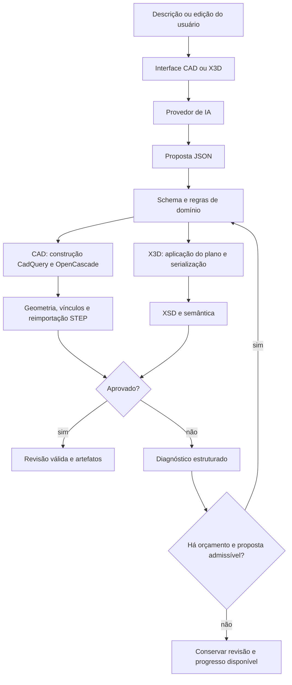

# Forma: modelagem conversacional CAD e X3D com representações estruturadas, validação geométrica e reparo orientado por diagnósticos

**Autoria:** a confirmar pelos responsáveis pelo trabalho.  
**Afiliação e contato:** a preencher para submissão.  
**Data desta análise:** 13 de outubro de 2026.  
**Versão examinada:** `ea609ae2c724ca5efc5c6b20cb18a6775e066e43`.  
**Natureza do manuscrito:** artigo de desenvolvimento e avaliação exploratória de um artefato de software, com apêndices de rastreabilidade e reprodução.

## Resumo

A modelagem tridimensional por linguagem natural exige converter descrições potencialmente ambíguas em representações editáveis e geometricamente verificáveis. Este trabalho apresenta o Forma, um ambiente web com fluxos distintos para construção CAD e edição de cenas X3D. A arquitetura separa inferência linguística, contratos de domínio, construção determinística e aprovação dos resultados: modelos de linguagem produzem dados estruturados, enquanto validadores e motores locais verificam sua admissibilidade. O fluxo CAD emprega uma linguagem de operações tipadas, CadQuery/OpenCascade, reimportação de STEP, análise de interferências em poses amostradas e verificação de vínculos mecânicos declarados. O fluxo X3D utiliza planos de edição, serialização controlada, validação estrutural e semântica e preservação da última revisão válida. O sistema incorpora reparos conservadores, limites de chamadas e inspeções, isolamento do trabalho nativo, checkpoints de geração e exportação de rascunhos. A metodologia combina inspeção do código, análise retrospectiva do histórico de desenvolvimento, reconciliação de requisitos históricos e atuais, testes de contratos e integração e análise de uma avaliação registrada com IA real. Nessa avaliação, 15 de 16 pedidos satisfizeram os critérios implementados de geometria, requisitos e exportação, correspondendo a 93,75%, com limite inferior unilateral exato de 73,60% a 95% de confiança sob o modelo binomial. Uma tentativa posterior falhou por indisponibilidade do provedor e foi mantida separadamente. Os resultados sustentam a viabilidade do ambiente nos casos exercitados, mas não demonstram confiabilidade universal, correção de engenharia ou ausência contínua de colisões. A contribuição consiste na integração rastreável entre intenção textual, representação intermediária, diagnóstico geométrico, recuperação de falhas e artefatos exportáveis.

**Palavras-chave:** modelagem conversacional; CAD paramétrico; X3D; modelos de linguagem; validação geométrica; representação intermediária; reparo de montagens.

## Abstract

Natural-language 3D modeling requires converting potentially ambiguous descriptions into editable and geometrically verifiable representations. This paper presents Forma, a web environment with separate workflows for CAD construction and X3D scene editing. Its architecture separates language inference, domain contracts, deterministic construction, and result acceptance. Language models produce structured data, while local validators and geometry engines assess admissibility. The CAD workflow combines a typed operation language, CadQuery/OpenCascade, STEP reimport, interference checks at sampled poses, and verification of declared mechanical connections. The X3D workflow uses editing plans, controlled serialization, structural and semantic validation, and preservation of the last valid revision. Bounded repairs, native-process isolation, generation checkpoints, and draft export support failure recovery. The methodology combines source inspection, reconciliation of historical and current requirements, contract and integration tests, and analysis of a recorded live-AI evaluation. Fifteen of sixteen requests met the implemented geometry, requirement, and export criteria, yielding an observed success rate of 93.75% and a one-sided exact 95% lower confidence bound of 73.60% under a binomial model. A later attempt failed because the provider was unavailable and was retained separately. These findings support feasibility within the exercised cases, without establishing universal reliability, engineering correctness, or continuous collision freedom.

**Keywords:** conversational modeling; parametric CAD; X3D; language models; geometric validation; intermediate representation.

## 1. Introdução

A criação de modelos tridimensionais envolve decisões sobre dimensões, sistemas de coordenadas, sequência de operações, topologia, materiais e finalidade do objeto. Na modelagem mecânica, acrescentam-se condições de montagem, folgas, engate, retenção e compatibilidade entre movimento e geometria. Uma descrição textual plausível pode omitir ou contradizer qualquer desses requisitos. Consequentemente, produzir uma resposta bem formada ou uma imagem convincente é insuficiente para comprovar a validade do modelo resultante.

Representações CAD sequenciais oferecem uma alternativa à geração exclusiva de malhas: registram operações e parâmetros associados à construção. DeepCAD investiga a geração de sequências CAD; Text2CAD explora sua obtenção a partir de instruções textuais. Esses trabalhos estabelecem um contexto para a modelagem generativa com representação editável, sem constituírem evidência experimental sobre o Forma. [DeepCAD](https://arxiv.org/abs/2105.09492), [Text2CAD](https://arxiv.org/abs/2409.17106).

O Forma aborda esse problema como um ambiente de engenharia de software e integração geométrica. Um agente propõe dados; o domínio rejeita contratos inválidos; o motor constrói a geometria; diagnósticos orientam correções; somente resultados aprovados podem substituir revisões válidas. A solução contempla dois objetivos: produzir sólidos e montagens CAD exportáveis em STEP/STL e permitir a composição visual de cenas X3D editáveis por conversa.

O objetivo deste artigo é descrever a implementação efetivamente examinada, suas decisões arquiteturais, os métodos de validação e reparo, as evidências disponíveis e os limites das conclusões. O PRD é tratado como fonte de intenção e evolução, confrontada com código, testes e artefatos. Funcionalidades planejadas não são apresentadas como realizações.

As questões de investigação são:

1. Como separar interpretação textual e execução geométrica sem executar código arbitrário produzido pela IA?
2. Quais verificações permitem distinguir contrato válido, sólido válido, montagem sem interferências amostradas e vínculo mecânico verificado?
3. Como recuperar progresso e reparar falhas sem descartar silenciosamente requisitos funcionais?
4. Que desempenho e confiabilidade podem ser sustentados pelas evidências registradas?

As contribuições descritas são uma arquitetura com representações intermediárias distintas para CAD e X3D; uma cadeia de verificação entre receita e arquivo exportado; estratégias de reparo subordinadas a progresso verificável; mecanismos de recuperação e controle de recursos; e uma avaliação exploratória com falhas preservadas. Não se reivindica pioneirismo absoluto nem superioridade sobre outros sistemas, pois não houve revisão sistemática ou comparação experimental controlada.

## 2. Fundamentação e trabalhos relacionados

### 2.1. Representações geométricas e histórico de construção

Uma malha descreve superfícies discretizadas. Uma representação CAD baseada em operações descreve também uma sequência de construção. No Forma, o histórico próprio permanece na receita JSON; STEP transporta a geometria B-Rep e STL transporta sua aproximação triangular. A exportação STEP não deve ser confundida com a entrega de um histórico nativo de um CAD comercial.

CadQuery oferece uma interface de modelagem apoiada no OpenCascade e em representações por fronteira, B-Rep. O Forma usa essa infraestrutura para construir primitivas, executar operações booleanas, aplicar acabamentos e exportar sólidos. A validade emitida pelo kernel é uma propriedade da representação construída, distinta da adequação do projeto à fabricação. [Conceitos do CadQuery](https://cadquery.readthedocs.io/en/stable/primer.html).

### 2.2. Geração de CAD por modelos de linguagem

DeepCAD representa modelos como sequências de operações e propõe uma abordagem generativa baseada em Transformer. Text2CAD condiciona a geração CAD em descrições textuais de diferentes níveis de detalhe. Text-to-CadQuery investiga a geração direta de programas CadQuery. A diferença operacional do Forma é interpor um contrato JSON restrito, interpretado por código controlado, entre o provedor linguístico e o motor geométrico. [DeepCAD](https://arxiv.org/abs/2105.09492), [Text2CAD](https://arxiv.org/abs/2409.17106), [Text-to-CadQuery](https://arxiv.org/abs/2505.06507).

Essa opção torna explícitos os recursos admissíveis, suas restrições e os pontos de validação. Em contrapartida, limita a expressão ao catálogo implementado. A escolha é arquitetural; não foi avaliada por uma ablação que compare geração direta de Python e geração da linguagem JSON sob condições equivalentes.

### 2.3. X3D e composição de cenas

X3D é uma família de padrões para representação e intercâmbio de conteúdo tridimensional, com arquitetura e codificações definidas em normas próprias. O Forma serializa cenas XML X3D 4.0 com perfil `Immersive` e utiliza X3DOM para visualização HTML. O suporte do projeto cobre um subconjunto de objetos e operações, não toda a norma. [Padrões recomendados do Web3D Consortium](https://www.web3d.org/standards/all).

Cenas visuais e peças mecânicas têm critérios de aceitação diferentes. Uma composição de primitivas pode conter interpenetrações intencionais, enquanto uma montagem CAD pode exigir folgas e conexões físicas verificáveis. O projeto mantém os dois domínios separados para evitar atribuir à validação X3D garantias próprias de sólidos CAD.

### 2.4. Construção e avaliação de artefatos

A organização deste relato é compatível com a perspectiva de Design Science: um problema motiva um artefato cuja utilidade é examinada por avaliação. Essa classificação é retrospectiva e orienta o manuscrito; os arquivos disponíveis não comprovam que o desenvolvimento tenha seguido formalmente esse método desde seu início. [Hevner et al., 2004](https://aisel.aisnet.org/misq/vol28/iss1/6/).

## 3. Materiais e métodos

### 3.1. Delineamento

Foi realizado um estudo de caso técnico, de natureza aplicada e avaliação exploratória. A unidade principal de análise é o sistema Forma na revisão Git identificada no cabeçalho. As unidades secundárias são contratos de domínio, fluxos de geração e edição, verificadores geométricos, estratégias de reparo, casos de teste e tentativas do benchmark registrado.

A análise reuniu cinco fontes de evidência:

| Fonte | Uso metodológico | Limite |
|---|---|---|
| PRD atual e histórico, README, auditorias e documentação | Reconstruir objetivos, evolução, capacidades e limitações declaradas | Documentos podem conter trechos superados |
| Histórico Git e diffs de marcos arquiteturais | Reconstruir a sequência de mudanças e relacioná-las a problemas, decisões e regressões documentadas | Commits podem reunir trabalho realizado em momentos diferentes |
| Código e schemas TS/Python, API, agente, frontend e scripts | Identificar regras e mecanismos implementados | Inspeção não exercita todos os caminhos possíveis |
| Testes e exemplos geométricos | Identificar oráculos, regressões e fluxos cobertos | Aprovação não equivale a cobertura completa |
| Relatório JSON de avaliação com IA real | Quantificar entregas, chamadas, verificações e duração | Corpus pequeno, desenvolvido junto ao sistema |

O submódulo `services/x3d-mcp/vendor` foi identificado na revisão `74da0ec46f477f0048aee813ecfc5fc87e655537`. Ele fornece componentes da cadeia X3D e tem autoria/licença próprias. Sua integração não deve ser descrita como implementação integralmente original do projeto.

### 3.2. Reconciliação dos requisitos

O PRD histórico de 22 de setembro de 2026 descrevia um MVP Web3D com WebLLM/WebGPU e CAD como evolução futura. O PRD vigente tem baseline de 2 de outubro e incorpora atualizações posteriores, inclusive de 8 de outubro. Na revisão examinada, CAD já constitui uma área principal e o servidor MCP remoto é opcional.

Para resolver contradições, adotou-se a seguinte regra: o código determina a existência e o comportamento implementado; testes e artefatos sustentam comportamentos exercitados; documentos datados descrevem o contexto histórico; listas de trabalho futuro permanecem como propostas. A regra não torna o código correto por definição: defeitos podem existir e precisam de verificação independente.

### 3.3. Separação entre evidências históricas e verificações desta análise

O benchmark com inferência real foi executado anteriormente e está registrado em `docs/benchmarks/cad-2026-10-08.json`. Nesta análise, seus valores foram extraídos e o limite de confiança foi recalculado com a função versionada. Não foram realizadas novas chamadas pagas ou vinculadas à assinatura.

Em 13 de outubro de 2026 foram executados `npm test`, `npm run typecheck`, os testes do domínio Python e uma seleção direcionada da API. O ambiente desta análise usa Linux, Node.js 25.3.0 e Python 3.12.13 no ambiente virtual da API. Ele difere do Windows/Node 24 usado nos registros históricos. As contagens atuais são apresentadas separadamente na seção de resultados.

Não foram coletados dados de participantes humanos, produtividade de usuários, avaliação perceptual, custos monetários, consumo energético ou medições controladas de memória máxima. Nenhum desses resultados é inferido das contagens de testes.

### 3.4. Critérios operacionais de aceitação

Foram diferenciados cinco níveis:

1. **Sintático:** JSON legível e compatível com o schema.
2. **De domínio:** IDs, referências, quantidades, parâmetros e sequências admissíveis.
3. **Geométrico:** sólido conectado, topologia válida, volume positivo e operações efetivas.
4. **De intercâmbio e montagem:** STEP reimportável e consistente; interferências e vínculos verificados quando aplicáveis.
5. **De entrega no benchmark:** aprovação, requisitos instrumentados satisfeitos e exportação não vazia sem erro registrado.

Um resultado pode passar em um nível e falhar em outro. A exportação parcial de rascunho é recuperação de trabalho, não aprovação da montagem. `mechanicalStatus=verified` significa aprovação do perfil mecânico implementado e das poses amostradas.

### 3.5. Reconstrução da metodologia de desenvolvimento

Para compreender como a solução foi construída, examinou-se a sequência dos 58 commits alcançáveis a partir da revisão analisada, abrangendo registros de 21 de setembro a 13 de outubro de 2026. A leitura das mensagens e dos arquivos alterados foi complementada pela inspeção de diffs em marcos de implementação: aplicação determinística de planos, validação X3D, continuação de respostas truncadas, diagnóstico e reparo CAD, conjuntos, exportação de rascunhos, orçamento de ações e verificação de requisitos. O objetivo foi identificar mudanças de abordagem e de critérios de aceitação, sem atribuir a cada commit uma etapa experimental independente.

As mudanças foram agrupadas segundo o problema técnico enfrentado e a responsabilidade acrescentada ao sistema. Para cada grupo, buscou-se relacionar a limitação observável, a resposta arquitetural e a evidência usada para verificar o comportamento. Quando auditorias ou fixtures descrevem a origem de uma falha, essa relação é documental; quando apenas a sequência de alterações a sugere, trata-se de interpretação retrospectiva. Não foram presumidas entrevistas, experimentos ou decisões de projeto ausentes dos registros.

Esse procedimento permite caracterizar o desenvolvimento como incremental e orientado por ciclos de construção, diagnóstico e regressão. A funcionalidade era ampliada e, à medida que novos casos expunham limites do contrato ou do verificador, esses limites eram convertidos em regras explícitas e testes. Essa caracterização não comprova adoção formal de Scrum, desenvolvimento dirigido por testes ou Design Science durante todo o projeto. O histórico mostra a incorporação conjunta de implementação e testes, mas não permite concluir que cada teste tenha precedido seu código.

As datas de commits indicam a incorporação das mudanças ao repositório. Elas não necessariamente coincidem com a realização do trabalho: o commit final de 13 de outubro, por exemplo, inclui auditorias e avaliações datadas de 8 de outubro. A reconstrução usa essas fontes de forma complementar e preserva a diferença entre data de registro, data declarada de avaliação e comprovação experimental.

## 4. Evolução do escopo e arquitetura

### 4.1. Evolução observável

| Aspecto | PRD histórico | Estado examinado |
|---|---|---|
| Objetivo principal | Composição conversacional Web3D | CAD e X3D em áreas independentes |
| IA | WebLLM como runtime primário | WebLLM, endpoint compatível e clientes locais autenticados |
| Cadeia X3D | Referência centrada em serviço MCP | Backend local padrão; MCP remoto opcional |
| CAD | Evolução futura | Programas 3.0, conjuntos 4.0 e compatibilidade 2.x |
| Exportação | HTML e formatos X3D | Acrescenta STEP/STL completos e por componente |
| Persistência | Sem armazenamento duradouro como objetivo inicial | SQLite para CAD/receitas; sessões X3D temporárias |
| Recuperação | Conservação de cena válida | Checkpoints, rascunhos, JSON e ZIP parcial |
| Garantias | Validação estrutural/semântica X3D | Acrescenta verificações CAD e perfil de vínculos mecânicos |

A evolução não eliminou os limites de engenharia: continuam ausentes solver geral de restrições, análise estrutural e dimensionamento por cargas.

### 4.2. Trajetória de desenvolvimento e amadurecimento do método

O Forma chegou à arquitetura atual por ampliações sucessivas do que o sistema precisava representar, verificar e recuperar. O elemento de continuidade foi a separação entre uma proposta produzida pela IA e o estado aceito pela aplicação. O que mudou ao longo do desenvolvimento foi a profundidade dessa verificação: inicialmente voltada à estrutura de cenas, depois à construção de sólidos e, por fim, às relações entre componentes e à conservação do trabalho diante de falhas.

**Estabelecimento de uma cadeia verificável.** Os primeiros registros, em setembro, mostram a construção dos contratos `ModelSpec` e `ModelPlan`, do interpretador determinístico, do serviço de sessões e revisões e do pipeline X3D. A integração do agente e da interface foi apoiada nessa infraestrutura. Assim, a aplicação já distinguia a resposta linguística, o candidato de alteração e a revisão válida. A decisão de impedir que um candidato inválido sobrescrevesse o estado anterior aparece explicitamente tanto na mutação quanto na validação. Essa base forneceu um mecanismo de contenção de falhas que permaneceu relevante nas expansões posteriores.

**Adaptação às condições reais da inferência.** A conexão com provedores externos tornou visíveis problemas que o contrato ideal de geração não resolvia: diferenças entre endpoints, campos dimensionais incorretos, pedidos excessivos de esclarecimento, respostas malformadas e limites de saída. As alterações seguintes combinaram normalização conservadora, ajustes de contexto, diagnóstico e retentativas limitadas. Quando cenas maiores ultrapassaram a capacidade de uma única resposta, a solução passou a admitir continuação em lotes validados. A unidade de progresso deixou de depender exclusivamente da conclusão de todo o pedido: cada lote aceito podia ser conservado, enquanto a incompletude permanecia identificável. Esse passo antecipou a estratégia de recuperação usada mais tarde no CAD.

**Adoção do MCP e retirada de sua obrigatoriedade.** A primeira arquitetura utilizava efetivamente o servidor `x3d_mcp` do Web3D Consortium por transporte Streamable HTTP; não se tratou apenas de uma alternativa planejada. O histórico registra inicialização, descoberta de ferramentas e integração da construção, validação e exportação X3D. Essa escolha permitiu reaproveitar uma cadeia especializada já existente, com versão fixada, em vez de implementar todos os seus recursos no projeto. A integração também exigiu tratamento de sessão, disponibilidade do servidor e compatibilidade de dependências. Já no primeiro marco foi necessário restringir a biblioteca a `mcp<2`, pois a resolução para a versão 2 alterava a API FastMCP esperada pelo upstream.

Durante a evolução, foram acrescentados composição em lote, cache e diagnóstico de chamadas, além de tratamento de cancelamento e erros de transporte. Na arquitetura posterior, a aplicação passou a serializar o `ModelSpec` diretamente e a chamar os validadores e conversores upstream como biblioteca local. A mudança retirou do fluxo padrão a necessidade de iniciar um terceiro serviço, estabelecer uma sessão MCP e transportar por HTTP operações entre processos da mesma instalação. Os motivos técnicos sustentados por essa mudança são a simplificação da inicialização e a redução das dependências operacionais de construção e validação. A diminuição de sobrecarga de comunicação é uma consequência arquitetural esperada, mas o material disponível não apresenta uma comparação controlada de latência que permita quantificá-la ou atribuir-lhe isoladamente a decisão.

Portanto, houve retirada do MCP como intermediário obrigatório, preservando a biblioteca X3D e seus schemas, validadores e conversores. O transporte remoto continua disponível para interoperabilidade com um servidor existente, mediante `X3D_BACKEND=mcp`. Essa separação conserva o investimento na integração original e permite usar os mesmos critérios de aprovação com execução local. Limitações específicas do upstream, como a conversão X3DJ malformada na revisão fixada, permanecem identificadas e não são apresentadas como falhas resolvidas simplesmente pela troca do transporte. A evidência dessa transição está nos commits `60ac38e`, `68843e8`, `5023d4b` e `f05b05f`, em [docs/x3d-mcp.md](docs/x3d-mcp.md) e nos testes do backend local.

**Transição da composição visual para a construção de sólidos.** No fim de setembro, o projeto incorporou peças CAD, persistência, receitas e programas de operações. O escopo deixou de se limitar à disposição de primitivas em uma cena. Uniões, cortes e exportações passaram a exigir evidências do motor geométrico. Os reparos foram então ampliados para tratar dimensões ausentes, operações sem efeito e sólidos desconectados. A inspeção dos diffs mostra o enriquecimento dos diagnósticos com limites espaciais e informações sobre a etapa rejeitada, além de restrições à remoção de operações durante uma correção. A mudança metodológica foi passar de uma orientação predominantemente textual para um ciclo no qual a falha geométrica específica alimentava a proposta seguinte.

**Ampliação de peças para conjuntos.** A introdução de componentes independentes e movimentos, no início de outubro, acrescentou uma escala de verificação que não existia na peça isolada. Corpos individualmente válidos podiam colidir depois de posicionados ou durante o curso. Foram incorporadas inspeções de interferência, amostras de movimento e verificações de exportação/reimportação do conjunto. O planejamento passou a decompor o pedido em corpos, enquanto os geradores reutilizavam o contrato de programa. Essa composição preservou a infraestrutura anterior, mas tornou insuficiente aprovar cada componente separadamente: a aceitação final precisava considerar suas relações.

**Distinção entre montagem geométrica e coerência mecânica.** A etapa seguinte consolidou a separação das áreas CAD/X3D, o backend X3D local e novas opções de provedor, ao mesmo tempo que aprofundou os critérios de montagem. Casos documentados de suportes separados da base, engate insuficiente e pares roscados incompatíveis evidenciaram que ausência de colisão não bastava para sustentar uma interpretação funcional. O sistema incorporou contratos de ancoragem e conexão, consultas de material e relações cinemáticas. Roscas reais e movimentos vinculados também exigiram preservar o perfil funcional durante reparos. O critério de sucesso passou, portanto, a depender do propósito declarado dos componentes, dentro de um perfil mecânico explicitamente limitado.

**Conservação do progresso e contenção dos reparos.** Com o aumento da complexidade, falhas passaram a ocorrer depois de várias peças já construídas ou de uma sequência extensa de operações. Recomeçar todo o pedido desperdiçava trabalho e podia produzir alterações não relacionadas ao problema. Checkpoints, edição por ID, reparos localizados e exportação de rascunhos responderam a essa condição. A arquitetura passou a conservar o que estava disponível sem confundi-lo com uma montagem aprovada. Em paralelo, orçamentos globais, identidade canônica de candidatos e aceitação por progresso verificável restringiram ciclos de correção. Essa etapa articulou dois objetivos: aproveitar resultados parciais e manter os critérios de aprovação integral.

**Consolidação da fidelidade e avaliação explícita.** As alterações finais reuniram expansão do catálogo, proteção de requisitos funcionais e supervisão do trabalho nativo. Furos cegos passaram a ser verificados no sólido final; recursos como molas e varreduras receberam contratos e testes próprios; cancelamento, limites de memória e lock compartilhado passaram a controlar operações dispendiosas. A avaliação com IA real acrescentou uma distinção entre geometria válida, atendimento aos requisitos instrumentados e entrega exportável. A falha M4 tornou concreta a necessidade de separar folga de passagem e folga de rosca: corrigiu-se o limite inferido do contrato e verificou-se o mesmo candidato sem reclassificar retrospectivamente a tentativa como sucesso.

A trajetória sugere um processo de amadurecimento por explicitação de condições antes implícitas. A cada ampliação do escopo, o projeto acrescentou tanto capacidade de geração quanto critérios de rejeição e recuperação. Essa interpretação é sustentada pela evolução dos contratos, verificadores, testes e registros de falha; ela não equivale a demonstrar que todas as decisões foram planejadas antecipadamente ou que cada alteração melhorou quantitativamente o desempenho. O resultado atual é uma arquitetura em que a autonomia do agente depende de propostas verificáveis, limites de execução e preservação de estados válidos.

### 4.3. Organização do monorepositório

O frontend utiliza React e TypeScript, com Vite. A API é implementada em Python/FastAPI. Os contratos são compartilhados entre Python/Pydantic e TypeScript/JSON Schema. A integração geométrica utiliza CadQuery/OpenCascade; o frontend CAD possui visualizador WebGL próprio; a visualização X3D usa HTML com X3DOM.

| Diretório | Responsabilidade |
|---|---|
| `apps/web` | Interface, configuração de IA, controladores, editores, prévias e downloads |
| `apps/api` | HTTP, validação, motores, persistência, artefatos e supervisão de processos |
| `packages/agent` | Provedores, prompts, geração, planejamento, reparo e checkpoints |
| `packages/domain` | Tipos, schemas, parsers e invariantes compartilhados |
| `services/x3d-mcp` | Biblioteca upstream fixada e execução remota opcional |
| `scripts`, `tests`, `examples`, `docs` | Automação, avaliação, regressões, exemplos e rastreabilidade |



A figura representa o princípio comum; os ciclos concretos CAD e X3D possuem regras próprias. Cancelamento, indisponibilidade e quota interrompem o ciclo, sem serem tratados automaticamente como defeitos geométricos.

### 4.4. Dependências e reprodutibilidade

Os manifestos declaram React 19, TypeScript 6, Vite 8, CadQuery `>=2.8,<3`, FastAPI, Pydantic, WebLLM e bibliotecas de validação. Essas declarações são intervalos ou versões de manifesto; o conjunto efetivamente instalado deve ser recuperado dos lockfiles e do ambiente. O projeto documenta Node 24 e Python 3.12 ou superior como requisitos de execução.

Os arquivos `package-lock.json` e `uv.lock`, a revisão Git e o ponteiro do submódulo são materiais de reprodução. A disponibilidade de clientes oficiais autenticados e do modelo remoto continua externa a esses arquivos.

## 5. Representações intermediárias e contratos

### 5.1. Cenas e planos X3D

`ModelSpec` 1.0 descreve objetos identificados, propriedades da cena, dimensões, transformações e materiais. Seu catálogo primitivo inclui caixa, esfera, cilindro e cone. `ModelPlan` descreve operações de criação, exclusão, duplicação, alteração de dimensões, translação, rotação, escala, material, nome e propriedades da cena, além de esclarecimento e ausência de alteração.

A separação permite validar a intenção operacional antes da serialização X3D. A transformação de um plano em candidato não deve modificar a revisão vigente até que o candidato seja aprovado. IDs fornecem referências estáveis para edições conversacionais.

A configuração padrão limita projetos a 300 objetos e planos a 100 operações; o agente possui continuação em lotes de até 25 operações, com limite de 12 lotes. Esses tetos delimitam recursos da aplicação, sem prometer a geração satisfatória de qualquer cena desse tamanho.

### 5.2. Programas CAD

`CadProgramSpec` 3.0 define unidades em milímetros, identificação da peça e sequência de até 32 etapas. A primeira etapa é a única operação `base`; etapas seguintes podem unir, cortar ou modificar o sólido, conforme o recurso. A base não admite padrão. IDs de etapas devem ser únicos.

O contrato limita o total de instâncias de padrões a 256, o total de passos de rosca a 160, dentes de engrenagem/cremalheira a 1.024, voltas de mola a 64 e segmentos de sweep a 128 por programa, considerando padrões. Perfis poligonais admitem até 32 pontos. São limites de complexidade implementados, não propriedades universais dessas técnicas.

O catálogo contém 21 discriminadores:

| Família | Recursos |
|---|---|
| Primitivas | `box`, `cylinder`, `sphere`, `cone` |
| Perfis e transições | `polygon_prism`, `revolve_profile`, `regular_prism`, `loft` |
| Recursos vazados e cortes | `tube`, `torus`, `slot`, `hole`, `thread` |
| Geometria mecânica | `spur_gear`, `rack` |
| Varreduras | `pipe_bend`, `helical_spring`, `sweep` |
| Acabamentos | `fillet`, `chamfer`, `shell` |

Os modificadores possuem restrições próprias: operação `modify`, transformações nulas e ausência de padrões. `selectionBox` restringe centros de arestas selecionadas para fillet/chamfer. Não é seleção persistente por identidade topológica de faces ou arestas.

### 5.3. Conjuntos CAD e mecânica

`CadAssemblySpec` 4.0 contém de dois a oito componentes e até 128 etapas totais. Cada componente reutiliza o contrato de programa, possui posição e pode declarar movimento. Ao menos um componente deve ser fixo. Grupos de movimento precisam compartilhar intervalo e valor do comando.

O contrato opcional `mechanics` identifica uma peça ancorada e até 24 conexões. Cada vínculo contém componentes, recursos referenciados, tipo, folga máxima, engate mínimo e método de fixação. Um grafo não direcionado representa as conexões; uma busca a partir da peça ancorada exige alcançar todos os componentes. Conectividade declarada é necessária, mas não suficiente: a geometria correspondente também é inspecionada.

A interface exige vínculos por padrão na criação mecânica. Contratos antigos sem `mechanics` são preservados e identificados como não verificados. Rascunhos parciais usam contrato próprio, permitindo um componente disponível sem violar a exigência de dois componentes de um conjunto aprovado.

### 5.4. Coerência entre linguagens

Modelos Pydantic são a fonte dos schemas CAD compartilhados. `scripts/generate-cad-schemas.py` gera os contratos; validadores TypeScript e Python exercitam fixtures comuns. A geração enviada ao modelo pode empregar um schema compacto, mas a resposta passa posteriormente pelo contrato completo.

Essa camada reduz divergências entre navegador, agente e API. Não substitui as verificações geométricas: dimensões formalmente positivas podem descrever um corte sem efeito, uma união desconectada ou um acabamento impossível.

## 6. Metodologia de geração e edição

### 6.1. Abstração dos provedores

Uma interface de provedor permite escolher WebLLM com WebGPU, endpoint HTTP compatível com OpenAI ou clientes locais Codex/Claude Code. O nome compatível indica formato de integração, não identidade obrigatória do fornecedor do modelo. Os endpoints externos recebem pedidos do navegador e dependem de chave, modelo e CORS adequados.

Na ponte local, a API chama clientes oficiais instalados e autenticados, com argumentos controlados e entrada por stdin. Ferramentas são desabilitadas, não há shell intermediário e o JSON final é recuperado dos mecanismos próprios de cada cliente. Variáveis de credenciais de faturamento são filtradas. Rotas locais exigem loopback, Host adequado e Origin permitido quando presente.

O uso de clientes de assinatura não elimina os limites da conta. O JSON produzido continua sendo entrada não confiável. Políticas de geração, limites de saída e retentativas podem variar entre provedores; a aplicação não demonstra equivalência de qualidade entre eles.

### 6.2. Fluxo CAD

A criação começa pela classificação do pedido como peça ou conjunto. Para conjuntos, um plano define corpos, posições, movimentos e vínculos. Planos com três ou mais componentes recebem revisão adicional antes da construção. Cada componente é gerado com acesso ao pedido original, decisões inferidas e corpos já disponíveis.

```text
receber pedido e iniciar orçamento
classificar peça ou conjunto
se conjunto:
    planejar componentes e vínculos
    revisar plano quando aplicável
para cada corpo pendente:
    obter receita estruturada
    validar contrato e requisitos instrumentados
    preparar dimensões inferidas quando permitido
    inspecionar no motor nativo
    tentar reparos admissíveis dentro do orçamento
    conservar receita e diagnóstico disponíveis
inspecionar resultado completo
se aprovado:
    salvar revisão e disponibilizar artefatos
senão:
    conservar progresso e permitir recuperação
```

O pseudocódigo resume o fluxo, não define uma sequência imutável de chamadas. Checkpoints, candidatos já disponíveis e reparos determinísticos podem evitar novas inferências. Na criação/edição autônoma, uma falha final pode permitir um replanejamento seletivo, preservando componentes não afetados. A correção direta de interferências não repete esse planejamento.

### 6.3. Requisitos explícitos e decisões inferidas

O sistema diferencia uma medida pedida pelo usuário de uma medida sugerida no plano. Preparação de stock ou redução de acabamento pode ajustar decisões inferidas, mas não deve alterar silenciosamente requisitos explícitos.

`cad-explicit-requirements.ts` verifica recursos literais e parâmetros no formato `campo=valor` antes do kernel. Essa verificação é conservadora: não interpreta integralmente qualquer descrição em prosa. A fidelidade completa depende de oráculos adicionais e revisão do resultado.

A interface CAD usa `noQuestions=true`. Uma resposta indevida de esclarecimento pode receber até duas tentativas internas de resolução; insistência termina em falha técnica com preservação do contexto. O SDK mantém compatibilidade com esclarecimentos quando configurado. O comportamento X3D conserva sua política própria de perguntas.

### 6.4. Orçamento e prevenção de ciclos

| Ação na interface CAD | Chamadas de IA | Verificações distintas | Prazo |
|---|---:|---:|---:|
| Criação e edição | 20 | 48 | 1.200 s |
| Correção de montagem | 5 | 16 | 240 s |

Esses tetos globais coexistem com limites locais de reparo e políticas do provedor. A estratégia determinística de montagem tem seus próprios limites padrão de 16 etapas e 48 validações; não representa autorização para ultrapassar o orçamento global da ação que a invoca.

Identidades canônicas ignoram ordem de campos JSON, preservando a ordem das operações. Caches limitados reutilizam inspeções equivalentes, e repetição de candidatos interrompe ciclos. Inspeções canceladas ou que falham tecnicamente são removidas do cache para não bloquear retomadas válidas.

### 6.5. Fluxo X3D

O agente gera um `ModelPlan`, que passa por validação e aplicação sobre um candidato. O backend local produz XML controlado a partir do `ModelSpec`; validadores upstream verificam schema e semântica. Um autofix específico de `containerField` pode ser aplicado antes de nova validação. Persistindo erros, a revisão não é substituída.

Cenas extensas podem usar continuação por lotes. Há contadores de truncamento, continuação, reparos e lotes omitidos. No benchmark X3D, omitir um lote implica falha, mesmo quando outros foram aplicados. A existência do protocolo e do corpus de 32 pedidos não comprova que suas metas de desempenho e acerto tenham sido atingidas.

## 7. Construção geométrica e verificação CAD

### 7.1. Operações e integridade do sólido

O interpretador constrói os recursos, aplica transformações e padrões e executa uniões ou cortes sequenciais. Cada corpo precisa permanecer um sólido válido e conectado, com volume finito e positivo. Uniões desconectadas e cortes que dividem a peça são rejeitados. Operações sem mudança efetiva também produzem diagnóstico.

Perfis poligonais recebem verificação de arestas degeneradas e auto-interseções. Acabamentos utilizam seletores enumerados e são executados pelo kernel; não há garantia de que qualquer raio ou seleção formalmente válida seja geometricamente realizável. Erros reportam a etapa e informações úteis à correção.

### 7.2. Sistemas de coordenadas

As transformações incluem referencial do recurso, movimento e posição do componente. Cilindros e roscas são centrados; furos partem da entrada e avançam em Z local negativo. Essa diferença é relevante: interpretar o centro de uma rosca como sua entrada pode deslocar o corte e deixar material indevido no receptor.

Para movimentos agrupados, um comando comum é multiplicado por fatores físicos. Um par fuso/porca usa o avanço por volta \(L=pz\), em que \(p\) é o passo e \(z\) o número de entradas. Na convenção documentada para rosca direita e porca sem rotação:

\[
\theta(q)=-\frac{360}{pz}q,\qquad x(q)=q.
\]

O sinal depende da convenção de eixo e montagem. Essa relação cinemática declarada precisa ser compatível com o perfil e o material efetivamente construídos.

### 7.3. Recursos especiais

**Roscas.** Perfis métricos e trapezoidais, sentidos direito/esquerdo e múltiplas entradas são construídos geometricamente. A implementação utiliza seções polares e extrusões torcidas segmentadas em até uma volta. Verificações adicionais de volume, conectividade e perfil respondem a casos em que a validade do kernel isoladamente não detectou perda da forma helicoidal. Cortes internos usam o perfil correspondente com folga radial. Os perfis truncados não certificam classes ISO, tolerâncias de fabricação ou resistência.

**Furos.** Furos simples, rebaixados e escareados podem declarar término cego/passante e fundo mínimo. As verificações consultam o sólido final, após operações posteriores e transformações. Não basta declarar uma profundidade correta se outro corte eliminar o fundo ou uma união preencher o canal.

**Engrenagens e cremalheiras.** O catálogo produz engrenagens retas com perfil evolvente e cremalheiras. A presença dos dentes e suas dimensões não constitui verificação de engrenamento, transmissão de torque ou capacidade de carga.

**Curvas, molas e sweeps.** Curvas de tubo utilizam arco real de 1° a 270°. Molas usam arame circular varrido em hélice, com 1–32 voltas por recurso e extremidades abertas. Sweeps utilizam de 2 a 16 pontos em trajetória aberta segmentada, com junções em esquadria. Não há interpolação spline nesse recurso. A documentação registra que uma alternativa spline foi retirada após divergência de round-trip, sem afrouxar o critério de fidelidade.

### 7.4. Interferências e amostragem do movimento

Cada componente é construído localmente uma vez por inspeção. As poses transformam os sólidos disponíveis. São examinadas a posição atual e as frações 0, 0,25, 0,50, 0,75 e 1 do intervalo quando existe movimento.

O verificador usa caixas conservadoras para eliminar pares seguramente separados. Para candidatos restantes, calcula a interseção real:

\[
V_{ij}(q)=\operatorname{Volume}(S_i(q)\cap S_j(q)).
\]

Interseções acima de 0,1 mm³ são rejeitadas. Interseção inválida, volume não finito ou volume negativo além da tolerância também impedem aprovação. O limiar não é uma tolerância industrial de ajuste. Pares com a mesma pose são reutilizados; o diagnóstico conserva os registros por amostra.

No pior caso, a enumeração envolve \(O(mn^2)\) pares para \(n\) componentes e \(m\) poses. O custo real depende fortemente das operações geométricas, especialmente roscas e booleanas. Não foi produzida uma curva experimental de escalabilidade.

A amostragem usa uma fração comum para os componentes móveis e não enumera o produto cartesiano de todas as posições independentes. Portanto, além dos intervalos entre amostras, combinações não amostradas de comandos independentes também podem conter colisões.

### 7.5. Verificação de vínculos mecânicos

O verificador combina referências declaradas com consultas ao sólido final e usa as poses da inspeção de interferências.

| Vínculo/método | Evidências exigidas no perfil implementado |
|---|---|
| Fixo por adesivo | Contato plano com área comum mínima, ou encaixe admitido com material/engate; adesivo declarado |
| Fixo parafusado | Contato, pelo menos dois furos coaxiais, passagem e material compatíveis |
| Fixo em base roscada | Passagem/rosca métrica compatíveis, acesso, material, engate útil e fundo quando declarado |
| Fixo capturado | Batentes a pequenas translações e antirrotação testada geometricamente |
| Guia linear | Coaxialidade, folga, material e engate; duas guias separadas para impedir giro do carro |
| Mancal rotativo | Munhão/furo compatíveis e retenção axial nos dois sentidos |
| Transmissão roscada | Parâmetros complementares, perfil exposto, engate, folga e cinemática coerente |

Consultas de material incluem quatro direções e três estações axiais para pares de recursos; roscas acrescentam cristas/vales nas fases helicoidais. Padrões receptores podem ser usados quando existe exatamente uma instância coaxial; padrões positivos e correspondências ambíguas têm restrições.

A prova de rebaixo/escareado acompanha o raio efetivo do perfil ao longo da profundidade. Assim, um alojamento legítimo não é confundido com ausência de parede de um furo simples. Assento ausente, alojamento preenchido e entrada enterrada continuam inválidos.

A conectividade do grafo, o alinhamento e as consultas de material não resolvem todos os graus de liberdade nem provam uma sequência de instalação. Parafusos comerciais declarados podem não ser sólidos exportados. A aprovação depende de sua instalação e de decisões externas de engenharia.

### 7.6. Fidelidade STEP e discretização STL

Após exportar STEP, o sistema reimporta o arquivo e compara quantidade de sólidos, validade, volume e seis coordenadas extremas das caixas. Em conjuntos, as comparações são realizadas por componente e globalmente. Utiliza-se `math.isclose` com tolerância relativa de \(10^{-5}\) e absoluta de \(10^{-4}\), aplicadas nas unidades da grandeza comparada.

Em termos escalares, o teste verifica:

\[
|a-b|\leq\max(10^{-5}\max(|a|,|b|),10^{-4}).
\]

A comparação de volume e limites detecta perdas relevantes, mas não prova identidade topológica completa ou igualdade local de superfícies. Geometrias diferentes podem compartilhar essas medidas; por isso, testes específicos também consultam pontos de material e perfis.

STL deriva do STEP validado. A tesselação utiliza deflexão linear absoluta configurada de 0,1 mm e tolerâncias angulares tentadas em 0,1, 0,2, 0,35 e 0,5 rad, começando pela mais fina. O limite padrão é 64.000.000 bytes para STL e 10.000.000 bytes para STEP/artefatos gerais. A prévia possui discretização própria e não deve ser usada como medida exata da geometria.

## 8. Reparo, recuperação e integridade das revisões

### 8.1. Política de progresso verificável

Estratégias locais tratam posicionamento, encaixes cilíndricos, pares roscados e folga de movimento. Propostas passam novamente pela inspeção. Para aceitar progresso parcial, a política proíbe novos pares/poses em conflito, aumento relevante de interferências existentes e introdução de defeitos mecânicos.

Para um volume anterior \(v\), a comparação usa tolerância \(\max(0,001,10^{-6}v)\) mm³. Deve haver redução verificável de volume, quantidade de colisões ou defeitos. A comparação de defeitos mecânicos é implementacional e depende de diagnósticos estruturados; não constitui uma prova formal de equivalência funcional.

O reparo conserva IDs, corpos não afetados e recursos funcionais. Roscas, dentes, molas e varreduras não podem ser simplificados silenciosamente para obter aprovação. Exclusões precisam de autorização compatível com o pedido, considerando negações. O backend decide a validade e não altera por conta própria a receita submetida para fazê-la passar.

### 8.2. Acabamentos e edições incrementais

Reparos de fillet/chamfer podem testar até três tamanhos menores quando a dimensão foi inferida. Medidas explícitas não recebem essa redução automática. Uma chamada focada pode alterar seleção, tamanho ou posição da etapa na sequência, conservando o restante.

A edição incremental local usa substituição/inserção/remoção por ID, aplicada deterministicamente antes da validação. Etapas omitidas na resposta permanecem. IDs desconhecidos, conflitos e remoções não autorizadas são rejeitados. Outros caminhos de integração mantêm envio de programa completo e políticas próprias de reparo de formato.

### 8.3. Falha M4 e reconciliação de contrato

O benchmark revelou uma montagem com passagem Ø4,5 mm para parafuso M4 e `maxClearance=0,1` mm. A folga radial da passagem é:

\[
c=(4,5-4)/2=0,25\text{ mm}.
\]

A folga da rosca interna de 0,1 mm é uma condição distinta. O reparo reconcilia somente o limite inferido da conexão para 0,25 mm, conservando corpos e diâmetros. Um máximo explicitamente exigido pelo usuário não pode ser ampliado por essa inferência.

A regressão do candidato preservado confirmou dois sólidos, volume de 25.627,289341 mm³, STEP de 1.588.958 bytes e estado mecânico verificado após a reconciliação. O contrato anterior continua recusado. Essa verificação não converte a tentativa inicial falha em sucesso de geração.

### 8.4. Checkpoints, rascunhos e persistência

Checkpoints registram plano, componentes concluídos, candidatos, etapa pendente e contexto de reparo. Quota, cancelamento ou falha de inspeção podem interromper a ação sem repetir a geração de componentes concluídos. O resultado nativo validado pode ser conservado até confirmação de salvamento.

Há três camadas distintas de continuidade:

| Camada | Conteúdo | Duração |
|---|---|---|
| Revisão CAD salva | Receita, STEP e medidas em SQLite | Sobrevive ao reinício |
| Rascunho recuperável | Geometria/receita disponível, pedido e diagnóstico no navegador ou JSON | Permite prévia/exportação após reload |
| Checkpoint completo do agente | Estado interno de geração e reparo | Memória da aba; não sobrevive ao reload |

A exportação de rascunhos constrói componentes independentemente. Uma falha interrompe apenas o corpo afetado, preservando o prefixo geométrico válido anterior. O ZIP contém receita original, sólidos disponíveis, STEP/STL globais e por componente e relatório de etapas/peças omitidas. STEP é reimportado; não há aprovação global nem gravação de revisão. O teto padrão do ZIP é 128.000.000 bytes. Se apenas o STL exceder o limite, a omissão é registrada e os demais materiais podem ser conservados.

O armazenamento CAD usa SQLite com revisões e controle de revisão esperada; atualizações usam transação `BEGIN IMMEDIATE`. Uma edição inválida não substitui a revisão válida. Sessões X3D ficam em memória, com expiração padrão após 3.600 s de inatividade; um manifesto JSON permite transporte e importação, sem constituir persistência automática da conversa no servidor.

## 9. Validação X3D e operação segura

### 9.1. Estrutura, semântica e política espacial

O backend local serializa objetos conhecidos para XML, aplica escala de exibição — 0,001 por padrão — e converte rotações para a representação X3D. Validações XSD e semântica verificam o candidato. O pipeline de correção limitado não executa código textual da IA.

A política espacial distingue modo visual e separação estrita. Caixas delimitadoras são aproximações conservadoras: sua sobreposição não comprova interseção de objetos curvos ou rotacionados. No modo visual, avisos não deslocam automaticamente a cena; no estrito, a separação exigida pode bloquear a alteração. Isso evita destruir conexões visuais legítimas por uma inferência textual global.

O HTML de prévia é exibido em iframe com `sandbox="allow-scripts"`. A página depende de X3DOM carregado pela internet. Essa prévia não prova execução offline nem correção física da cena.

### 9.2. Isolamento do trabalho nativo

Requisições CAD são enfileiradas por processo da API. Um lock de arquivo do sistema operacional coordena workers entre processos que compartilham `CAD_WORKER_LOCK_PATH`. A espera padrão é 60 s; timeout retorna ocupação, sem desencadear correção paga de geometria.

Os workers têm teto configurado padrão de 2.048 MB, prazo de 240 s e kernel com duas threads, ajustável de uma a oito. Windows utiliza Job Objects; POSIX utiliza limite de espaço de endereçamento e mecanismos de encerramento, com sinal de morte do pai em Linux. Desconexão HTTP sinaliza cancelamento, observado em esperas de até 100 ms, seguido do encerramento da árvore de processos.

Esses mecanismos restringem workers nativos. Não são um teto agregado de RAM de toda a máquina. Processos em máquinas diferentes ou com locks diferentes são independentes. Prazos do cliente e do backend têm papéis distintos.

### 9.3. Limites de implantação

A ponte local tem proteções específicas de origem e execução. O projeto ainda lista autenticação e propriedade de projetos como trabalho necessário antes de oferta compartilhada. A presença de SQLite, CORS e sandbox de prévia não demonstra segurança multiusuário. Não houve teste de intrusão nesta análise.

## 10. Protocolo de avaliação

### 10.1. Testes automatizados

O projeto combina testes TypeScript do frontend/agente/domínio, testes Python do domínio/API, testes de schemas compartilhados, testes de navegador Playwright e verificações estáticas. A configuração CI separa esses grupos, mas sua existência não comprova execução remota bem-sucedida.

Testes do agente frequentemente usam respostas programadas de IA. Nos testes de navegador descritos pela documentação, React, API, CadQuery, validação e downloads são reais; a inferência é simulada. Isso permite testar aceitação e rejeição de forma controlada, sem medir o comportamento estatístico de um modelo livre.

Os oráculos incluem volumes analíticos, presença/ausência de material, conectividade, contagem de sólidos, limites espaciais, reimportação STEP, vínculos, conservação de operações e recusa de regressões. São oráculos complementares, com cobertura restrita aos casos construídos.

### 10.2. Corpus CAD com IA real

O corpus versionado contém 16 pedidos: furos cegos, engrenagem de 24 dentes, rebaixo lateral cego, tubo, curva tubular, mola esquerda, sweep tubular 3D, chanfro regional, placa com alojamentos passantes, fixação M4 em base cega, cremalheira, porca sextavada roscada, eixo com rasgo, rasgo oblongo, suporte estático de três corpos e adaptador por loft vazado.

A avaliação inicial ocorreu em 8 de outubro de 2026, com provedor `local-codex`, modelo `client-default`, Windows, uma thread de kernel e teto de worker de 1.536 MB. O identificador exato do modelo resolvido pelo cliente, CPU, GPU, RAM total, temperatura e seed não estão registrados nesse relatório. A revisão exata do código no momento de cada tentativa tampouco é individualizada por hash; o corpus e o agente evoluíram durante as melhorias.

O corpus foi usado para orientar desenvolvimento e não é um conjunto reservado. A ordem registrada dos casos difere da ordem atual do arquivo de prompts; a associação é feita por ID. Não foi presumida correspondência por posição de array.

### 10.3. Definição das métricas

O sucesso de entrega implementado requer estado `validated`, ausência de problemas de requisitos, ZIP com tamanho positivo e ausência de erro de exportação. Os requisitos verificam campos e estruturas da receita, contagem de instâncias, orientação equivalente de eixos e, quando declarados, medidas reais e estado mecânico. Nem todos os detalhes textuais de cada pedido possuem um oráculo independente.

A taxa observada é \(\hat p=s/n\). O limite inferior unilateral de Clopper–Pearson a 95% é obtido por inversão da cauda binomial:

\[
\sum_{k=s}^{n}\binom{n}{k}L^k(1-L)^{n-k}=0,05,
\]

para \(s>0\), com \(L=0\) quando não há sucessos. O uso da distribuição binomial pressupõe observações adequadas ao modelo, incluindo independência e uma probabilidade interpretável para a população de interesse. Essas hipóteses não são estabelecidas pelo corpus de desenvolvimento. [NIST: limites binomiais exatos](https://itl.nist.gov/div898/software/dataplot/refman2/auxillar/exacbici.htm).

O script calcula percentis por posto mais próximo: \(x_{\lceil nq\rceil}\), em ordem crescente. Assim, seu campo `medianDurationMs` é o percentil 50 por essa convenção, e não a média dos dois valores centrais quando \(n\) é par. `durationMs` cobre geração e inspeção, sem tempo posterior de download/exportação.

## 11. Resultados

### 11.1. Avaliação inicial com IA real

| Caso | Resultado | Duração (s) | Chamadas IA | Verificações CAD |
|---|---|---:|---:|---:|
| Placa com quatro furos cegos | Aprovado | 20,839 | 1 | 1 |
| Engrenagem evolvente de 24 dentes | Aprovado | 17,804 | 1 | 1 |
| Rebaixo lateral cego | Aprovado | 16,655 | 1 | 1 |
| Tubo e parede | Aprovado | 11,715 | 1 | 1 |
| Curva de tubo vazado | Aprovado | 14,066 | 1 | 1 |
| Mola de mão esquerda | Aprovado | 14,324 | 1 | 1 |
| Sweep tubular 3D | Aprovado | 15,127 | 1 | 1 |
| Chanfro por região | Aprovado | 14,497 | 1 | 1 |
| Placa com alojamentos passantes | Aprovado | 21,378 | 1 | 1 |
| Base roscada M4 e placa | Falhou | 169,750 | 4 | 3 |
| Cremalheira reta | Aprovado | 13,044 | 1 | 1 |
| Porca sextavada roscada | Aprovado | 25,559 | 1 | 1 |
| Eixo com rasgo | Aprovado | 17,898 | 1 | 1 |
| Rasgo oblongo | Aprovado | 13,727 | 1 | 1 |
| Suporte estático de três corpos | Aprovado | 142,023 | 5 | 4 |
| Adaptador vazado por loft | Aprovado | 21,834 | 1 | 1 |

Fonte: `docs/benchmarks/cad-2026-10-08.json`, bloco `initialEvaluation`, associado aos prompts por ID.

| Indicador | Valor |
|---|---:|
| Tentativas iniciais executadas | 16/16 |
| Entregas aprovadas | 15/16 |
| Taxa observada | 93,75% |
| Limite inferior unilateral exato, 95% | 73,6043% |
| Chamadas de IA | 23 |
| Verificações CAD | 21 |
| Percentil 50, posto mais próximo | 16,655 s |
| Percentil 95, posto mais próximo | 169,750 s |
| Casos aprovados com uma chamada | 14 |

Pela convenção usual de média dos dois valores centrais, a mediana dessas 16 durações é 17,2295 s. O percentil 95 coincide com o maior valor por causa do tamanho da amostra e da regra de posto. Portanto, os números devem ser comparados somente com medições de escopo e estimador compatíveis.

A falha M4 combinou contrato de folga incompatível com a passagem e resposta JSON inválida no replanejamento. O rascunho completo foi conservado, mas não contou como entrega aprovada.

### 11.2. Tentativa posterior e regressão determinística

Após a correção de contrato, uma nova tentativa do caso M4 falhou por indisponibilidade temporária do provedor, após duas chamadas, sem inspeção CAD. Sua duração foi 77,318 s. O relatório preserva essa ocorrência em `postFixEvaluation`.

Considerando apenas a contagem bruta das 17 tentativas registradas, há 15 aprovações, ou 88,24%. Essa agregação mistura estados diferentes do agente e não deve ser interpretada como estimativa de uma única configuração estável. A regressão determinística do candidato corrigido é uma evidência distinta: verifica o reparo sem medir nova geração.

### 11.3. Verificações executadas nesta análise

| Verificação em 13/10/2026 | Resultado |
|---|---|
| `npm test`: frontend | 66 aprovados |
| `npm test`: agente | 348 aprovados |
| `npm test`: domínio TS | 79 aprovados |
| `npm test`: golden | 12 aprovados |
| Total TypeScript/golden | 505 aprovados, nenhuma falha |
| Domínio Python | 118 aprovados em 6,19 s |
| `npm run typecheck` | Aprovado nos três workspaces |
| Seleção API: X3D local, regressão M4 e acabamentos regionais | 11 aprovados em 36,76 s; dois avisos de depreciação |
| Limite inferior de 15/16 | Recalculado: 0,7360426027114317 |

Os logs desta análise ficam em `.cache/article-review/`; não são materiais versionados. A seleção API foi escolhida para exercitar os dois motores e uma regressão importante sem repetir a bateria nativa completa. Não foram reexecutados Playwright, build, lint, FreeCAD ou benchmark de IA real nesta análise.

### 11.4. Evidências históricas complementares

A última continuação documentada de 8 de outubro registra 118 testes do domínio Python, 505 TypeScript/golden, 42 casos distintos da API em execuções direcionadas e quatro testes novos de navegador com IA programada. Não representa uma execução integral contemporânea de todas as suítes.

Exemplos disponíveis incluem suporte mecânico, mecanismo rosqueado, prensa e estágio linear. O estágio linear de referência declara oito corpos, 12 conexões e curso de ±30 mm, com guias separadas, fuso real e volante removível. Esses exemplos documentam capacidades e procedimentos; não foram todos reconstruídos nesta análise.

O fixture X3D de célula industrial contém 59 objetos e 64 operações, utilizado para regressão da política visual/estrita. A documentação informa preservação da composição no modo visual e rejeição no estrito. O caso reconstrói uma classe de problema relatado, não a cena original indisponível.

Contagens de revisões sucessivas não foram somadas, pois muitos testes e exemplos se repetem. Resultados históricos devem ser lidos com sua data, configuração e escopo.

## 12. Discussão

### 12.1. Separação de responsabilidades

A principal decisão arquitetural é deslocar a aceitação da saída linguística para verificadores controlados. O modelo pode produzir uma receita plausível; a aplicação decide se o contrato é admissível, se o sólido existe, se o intercâmbio preserva medidas e se os vínculos declarados encontram evidências geométricas.

Isso oferece rastreabilidade e diagnósticos mais específicos que uma imagem final isolada. Também impõe um catálogo finito e depende da qualidade dos próprios verificadores. Uma aprovação incorreta do verificador permanece possível, como evidenciam as correções de falsos negativos documentadas no histórico.

### 12.2. Distinção entre fidelidade e validade

Um sólido válido pode violar um pedido de furo cego; uma montagem sem interferências pode ter apoios suspensos; um movimento animado pode não corresponder ao avanço da rosca. O projeto trata essas diferenças por verificações de término, material, grafo e relações cinemáticas.

Ainda assim, requisitos escritos em linguagem livre não são completamente formalizados. A taxa do benchmark mede o subconjunto instrumentado de fidelidade, não a conformidade total de um projeto de engenharia com a descrição original.

### 12.3. Recuperação e custo operacional

A conservação de rascunhos, corpos concluídos e resultados validados evita repetir trabalho em falhas previsíveis. Reparos locais podem resolver classes específicas sem nova inferência. A exportação parcial oferece acesso à geometria disponível, com omissões explícitas.

O estudo não mediu a economia causal dessas estratégias. Para demonstrá-la, seria necessário comparar variantes com e sem cache, checkpoints e reparo determinístico sobre pedidos e condições controlados, registrando chamadas, tempo, custo e sucesso.

### 12.4. Interpretação da taxa de sucesso

Quinze sucessos em 16 casos constituem evidência exploratória favorável. O limite inferior de 73,60% mostra a incerteza de uma amostra pequena mesmo sob hipóteses binomiais. A seleção pelo desenvolvimento e a alteração do sistema enfraquecem uma interpretação populacional direta.

Para \(n\) sucessos em \(n\) tentativas, o limite unilateral é \(L=0,05^{1/n}\). Com 299 sucessos, obtém-se aproximadamente 0,99003. Essa conta apenas ilustra o tamanho necessário nesse cenário idealizado; repetir pedidos correlacionados ou ignorar falhas não estabelece 99% de confiabilidade geral.

### 12.5. Alcance científico

O material sustenta um artigo sobre arquitetura, mecanismos de validação e estudo de viabilidade de um ambiente conversacional. Ainda não sustenta afirmações de ganho de produtividade, equivalência a CAD profissional, superioridade sobre modelos especializados ou qualidade industrial certificada.

A revisão de literatura aqui apresentada é direcionada ao posicionamento técnico. Não constitui revisão sistemática nem levantamento exaustivo do estado da arte até a data da análise.

## 13. Ameaças à validade e limitações

**Validade de construto.** Sucesso significa passar nos critérios implementados. O benchmark mistura verificação de receita e medidas, com graus diferentes de instrumentação por pedido. ZIP não vazio é um critério operacional de entrega, complementado pelo pipeline geométrico, não uma inspeção independente de todo arquivo por outro CAD.

**Validade interna.** O corpus orientou melhorias. Agente e verificadores foram alterados ao longo das avaliações. Falhas de provedor, schema e geometria têm origens diferentes; o sucesso final não isola a contribuição de cada componente.

**Validade externa.** Dezesseis pedidos de desenvolvimento não representam todos os mecanismos, estilos de linguagem, usuários ou provedores. O modelo real foi registrado apenas como padrão do cliente. Não há avaliação equivalente de WebLLM ou Claude, nem taxa real X3D consolidada neste relatório.

**Validade estatística.** A inferência binomial requer hipóteses não comprovadas pela amostra. O percentil 95 de 16 casos é instável. As 17 tentativas agregadas não pertencem a uma única configuração congelada.

**Verificação geométrica.** As poses são discretas e sincronizadas por fração do intervalo. Não há prova contínua ou exploração de todas as combinações independentes. Volume e limites STEP não provam igualdade completa da superfície. Consultas amostradas de material podem deixar defeitos locais sem cobertura.

**Engenharia mecânica.** Não há FEA, dimensionamento por carga, fadiga, desgaste, lubrificação, pré-carga, rigidez de mola, certificação de roscas, solver geral de mates ou prova automática de instalação/remoção. Engrenagens são geradas, mas seu engrenamento não é verificado.

**Operação e recuperação.** Checkpoints completos dependem da aba. Rascunhos persistidos não restauram todo o raciocínio de geração. X3D não tem persistência automática duradoura. Locks coordenam apenas os processos que compartilham o caminho configurado.

**Reconstrução histórica.** O histórico versionado registra mudanças incorporadas, não todas as tentativas locais ou decisões dos responsáveis. Commits amplos agregam intervenções e não permitem determinar a ordem interna de cada experimento. A narrativa de desenvolvimento é uma síntese retrospectiva apoiada em diffs e documentação, sem validação por entrevistas.

**Reprodução.** Faltam identificação exata do modelo real, hardware completo e hash individual da implementação por rodada. Serviços externos podem mudar. Registros históricos locais e a configuração CI não substituem evidência de execução remota.

## 14. Trabalhos futuros

A próxima avaliação deve congelar código, prompts, modelos e configuração; separar corpus de desenvolvimento e teste reservado; registrar hardware e versões; e definir antecipadamente critérios, número de tentativas e política de falhas. Provedores devem ser comparados com oráculos equivalentes e latência de exportação medida separadamente.

Uma avaliação de engenharia deve incluir revisão especializada de dimensões, terminologia, sequência de montagem e fabricação, além de verificações independentes em outro kernel. Uma ablação deve isolar reparos determinísticos, revisão de planos, checkpoints e caches. Estudos com usuários podem investigar esforço e produtividade mediante protocolo específico.

No sistema, prioridades incluem persistência integral de checkpoints, gestão de projetos, autenticação/propriedade em implantação compartilhada, redução do bundle WebLLM, prévia X3D sem dependência externa, novas famílias mecânicas, restrições de esboço e seleção topológica persistente. Verificação adaptativa/contínua do movimento e combinações independentes são necessárias para ampliar o alcance das garantias de interferência.

## 15. Conclusão

O Forma integra modelagem conversacional, representações estruturadas e motores locais em dois fluxos distintos: CAD para sólidos/montagens e X3D para composição visual. Seu método combina restrições de domínio, construção controlada, diagnósticos, reparos limitados, recuperação e verificação dos artefatos.

A avaliação registrada encontrou 15 entregas aprovadas em 16 pedidos, preservando uma falha inicial e uma tentativa posterior indisponível. Os testes executados nesta análise corroboram os contratos e regressões exercitados. Esses resultados sustentam a viabilidade técnica do artefato no escopo examinado, com limites explícitos de amostragem, fidelidade, engenharia e reprodução. A generalização exige uma avaliação independente, representativa e com configuração congelada.

## Referências

1. WU, Rundi; XIAO, Chang; ZHENG, Changxi. **DeepCAD: A Deep Generative Network for Computer-Aided Design Models**. ICCV, 2021. [Registro e artigo](https://arxiv.org/abs/2105.09492).
2. KHAN, Mohammad Sadil et al. **Text2CAD: Generating Sequential CAD Models from Beginner-to-Expert Level Text Prompts**. 2024. Trabalho aceito no NeurIPS 2024; título conforme registro arXiv. [Registro e artigo](https://arxiv.org/abs/2409.17106).
3. XIE, Haoyang; JU, Feng. **Text-to-CadQuery: A New Paradigm for CAD Generation with Scalable Large Model Capabilities**. Preprint arXiv:2505.06507, 2025. [Registro e artigo](https://arxiv.org/abs/2505.06507).
4. HEVNER, Alan R.; MARCH, Salvatore T.; PARK, Jinsoo; RAM, Sudha. **Design Science in Information Systems Research**. MIS Quarterly, v. 28, n. 1, 2004. [Registro da publicação](https://aisel.aisnet.org/misq/vol28/iss1/6/).
5. CADQUERY. **Concepts**. Documentação oficial. [Fundamentos e topologia](https://cadquery.readthedocs.io/en/stable/primer.html). Acesso em: 13 out. 2026.
6. WEB3D CONSORTIUM. **Recommended Standards**. Catálogo oficial, incluindo ISO/IEC 19775-1:2023, X3D 4.0. [Padrões](https://www.web3d.org/standards/all). Acesso em: 13 out. 2026.
7. NIST. **Exact Binomial Confidence Limits**. Dataplot Reference Manual. [Referência estatística](https://itl.nist.gov/div898/software/dataplot/refman2/auxillar/exacbici.htm). Acesso em: 13 out. 2026.
8. FORMA. **Código-fonte, contratos, documentação, testes e exemplos**. Revisão `ea609ae2c724ca5efc5c6b20cb18a6775e066e43`. Material primário local identificado nos apêndices. 2026.
9. FORMA. **Avaliação CAD de 8 de outubro de 2026**. [Relatório versionado](docs/benchmarks/cad-2026-10-08.json) e [interpretação registrada](docs/project-improvements-2026-10-08.md).

## Apêndice A — Rastreabilidade das principais afirmações

Os caminhos abaixo são relativos à raiz do projeto. Permitem verificar a origem das afirmações sem depender de arquivos privados de cache.

| Tema | Fontes principais |
|---|---|
| Escopo vigente | [README](README.md), [PRD](PRD.md), [estado e prioridades](ISSUES.md) |
| Trajetória de desenvolvimento | Histórico Git de `7e15845` a `ea609ae`; marcos `3f56703`, `ed2df6d`, `cf8c925`, `18b6b27`, `0acc0e8`, `67e48d3`, `f05b05f`, `b395bfe` e `4425ef0`, confrontados com auditorias e testes |
| Escopo histórico | [PRD Web3D v1](docs/archive/PRD-AI-Web3D-Modeler-v1.0.md), [arquivo histórico](docs/archive/README.md) |
| Arquitetura e evolução | [Arquitetura](docs/architecture.md), [auditoria de 06/10](docs/audit-2026-10-06.md), [auditoria de 08/10](docs/audit-2026-10-08.md) |
| Programas e limites | [Contrato Python](packages/domain/python/src/domain/cad_program.py), [contrato TS](packages/domain/ts/src/cad-program.ts) |
| Conjuntos, movimentos e grafo | [Contrato Python](packages/domain/python/src/domain/cad_assembly.py), [contrato TS](packages/domain/ts/src/cad-assembly.ts) |
| Cenas e planos | [ModelSpec](packages/domain/python/src/domain/model_spec.py), [ModelPlan](packages/domain/python/src/domain/model_plan.py) |
| Schemas compartilhados | [Gerador](scripts/generate-cad-schemas.py), [schemas](packages/domain/schemas) |
| Geração de programas | [Gerador CAD](packages/agent/src/generate-cad-program.ts), [geração de conjunto](packages/agent/src/generate-cad-assembly.ts) |
| Intenção e preparação | [Requisitos explícitos](packages/agent/src/cad-explicit-requirements.ts), [preparação](packages/agent/src/cad-design-preparation.ts) |
| Construção e round-trip de peças | [Adaptador de programas](apps/api/src/api/cad_program_adapter.py), [recursos](apps/api/src/api/cad_features.py) |
| Roscas, dentes e varreduras | [Roscas](apps/api/src/api/cad_threads.py), [engrenagens](apps/api/src/api/cad_gears.py), [sweeps](apps/api/src/api/cad_sweeps.py) |
| Término e fundo de furos | [Verificador](apps/api/src/api/cad_holes.py), [testes](apps/api/tests/test_cad_holes.py) |
| Poses e interferências | [Adaptador de conjuntos](apps/api/src/api/cad_assembly_adapter.py), [regressões de trabalho](apps/api/tests/test_cad_interference_work.py) |
| Vínculos mecânicos | [Verificador nativo](apps/api/src/api/cad_mechanics.py), [método e limites](docs/mechanical-assemblies.md) |
| Progresso de reparo | [Política central](packages/agent/src/assembly-repair.ts), [encaixes roscados](packages/agent/src/assembly-thread-fits.ts) |
| Acabamentos e alterações pontuais | [Reparo de acabamento](packages/agent/src/cad-finish-repair.ts), [patch](packages/agent/src/cad-program-patch.ts) |
| Orçamento, identidade e controlador | [Orçamento](packages/agent/src/cad-action-budget.ts), [identidade](packages/agent/src/cad-identity.ts), [controlador](apps/web/src/cad/CadAgentController.ts) |
| Regressão M4 | [Reconciliador](packages/agent/src/cad-fastener-contract.ts), [fixture](tests/fixtures/cad/m4-contract-regression.json), [teste nativo](apps/api/tests/test_cad_fastener_regression.py) |
| Rascunhos e recuperação | [Backend](apps/api/src/api/cad_drafts.py), [armazenamento web](apps/web/src/cad/cadDraftStorage.ts), [documentação](docs/cad-drafts.md) |
| Persistência CAD | [SQLite e revisões](apps/api/src/api/cad_projects.py), [serviço de artefatos](apps/api/src/api/cad_service.py) |
| Sessões X3D | [Serviço de sessões](apps/api/src/api/projects.py), [configuração](apps/api/src/api/config.py) |
| X3D local e validação | [Backend](apps/api/src/api/x3d_backend.py), [pipeline](apps/api/src/api/x3d_validation.py), [política espacial](apps/api/src/api/overlap.py) |
| Continuação de cenas | [Geração](packages/agent/src/generate-scene.ts), [planos](packages/agent/src/generate-model-plan.ts) |
| Provedores e ponte local | [Provider](packages/agent/src/provider.ts), [cliente local](packages/agent/src/local-cli-provider.ts), [ponte](apps/api/src/api/local_ai.py), [documentação](docs/ai-providers.md) |
| Worker, cancelamento e lock | [Supervisor](apps/api/src/api/cad_process.py), [middleware](apps/api/src/api/cad_work.py), [lock](apps/api/src/api/cad_worker_slot.py), [limites](apps/api/src/api/process_limits.py) |
| STL e visualização | [Tesselação STL](apps/api/src/api/cad_stl.py), [WebGL CAD](apps/web/src/cad/CadMeshView.tsx), [iframe X3D](apps/web/src/viewer/X3DPreviewFrame.tsx) |
| Corpus e métricas reais | [Prompts CAD](tests/golden/cad-benchmark-prompts.json), [runner](scripts/benchmark-cad.mjs), [métricas](scripts/cad-benchmark-metrics.mjs), [dados](docs/benchmarks/cad-2026-10-08.json) |
| Golden X3D | [Corpus](tests/golden/benchmark-prompts.json), [protocolo](tests/golden/benchmark-report.md) |
| Testes e verificações históricas | [Protocolo](docs/testing.md), [registros](docs/verification.md), [CI](.github/workflows/ci.yml) |
| Estágio linear de referência | [Receita](examples/cad/functional_linear_stage.json), [gerador](examples/cad/generate_functional_sample.py) |

## Apêndice B — Divergências documentais resolvidas

| Afirmação potencialmente desatualizada | Interpretação adotada |
|---|---|
| CAD é evolução futura | Pertence ao PRD histórico; CAD está implementado na revisão atual |
| Servidor MCP é obrigatório | Backend X3D local é padrão; servidor remoto é opcional |
| O catálogo possui 15 ou 18 recursos | Contagens de etapas anteriores; o contrato examinado contém 21 |
| Desconexão não encerra worker | Trechos anteriores permanecem em documentos; código atual sinaliza cancelamento e encerra o worker |
| Apenas fila por processo coordena trabalho | Há também lock compartilhado entre processos com o mesmo caminho |
| Não existe prazo nativo | Estado anterior; supervisor atual aplica prazo e limite de recursos |
| Recuperação depois de reload é impossível | Rascunho e revisões são recuperáveis; checkpoint completo da IA continua volátil |
| Todo teste usa IA simulada | Grande parte simula IA, mas há rodadas reais explicitamente registradas |
| 99% de sucesso é resultado | É uma meta não demonstrada; a avaliação inicial registra 15/16 |
| Toda aprovação é mecânica | Projetos sem contrato mecânico permanecem `unverified` |
| Relatório golden contém resultados empíricos consolidados | O arquivo descreve protocolo e metas; não fornece taxa real X3D consolidada |

## Apêndice C — Reprodução

### C.1. Preparação

Em um checkout destinado à reprodução:

```bash
git checkout ea609ae2c724ca5efc5c6b20cb18a6775e066e43
git submodule update --init --recursive
npm ci
uv sync --project apps/api
npm run dev
```

Usar as versões documentadas e registrar sistema operacional, hardware, versões resolvidas, caminhos de lock e limites. A API padrão fica em `127.0.0.1:8001`; a interface em `127.0.0.1:5173`.

### C.2. Verificações sem inferência real

```bash
npm test
npm run typecheck
npm run lint:web
npm run build
uv run --project apps/api pytest packages/domain/python/tests -q
uv run --project apps/api pytest apps/api/tests/test_local_x3d.py apps/api/tests/test_cad_fastener_regression.py apps/api/tests/test_cad_finish_selection.py -q
```

Para navegador, instalar Chromium conforme `docs/testing.md` e executar `npm run test:browser`. Para baterias nativas extensas, usar seleções sequenciais e as proteções de `scripts/run-cad-tests.py`; não confundir execução parcial com suíte completa.

### C.3. Reprodução das métricas registradas

```bash
node --input-type=module <<'JS'
import fs from 'node:fs';
import { lowerSuccessBound } from './scripts/cad-benchmark-metrics.mjs';
const report = JSON.parse(fs.readFileSync('docs/benchmarks/cad-2026-10-08.json', 'utf8'));
console.log(report.initialEvaluation.summary);
console.log(lowerSuccessBound(15, 16, 0.95));
JS
```

Esse comando não realiza inferência. Confere o relatório e o cálculo, sem reconstruir as geometrias históricas.

### C.4. Nova rodada com IA real

Com cliente Codex instalado/autenticado e API iniciada, o comando versionado é:

```bash
npm run benchmark:cad -- --run --suite
```

Essa execução consome a assinatura e não foi realizada para redigir este artigo. Definir `CAD_BENCHMARK_MODEL` para modelo identificável e `CAD_BENCHMARK_OUTPUT` para um diretório novo; registrar hash de código e corpus, versões do cliente e hardware. Conservar falhas e casos não executados. Para estudo confirmatório, criar corpus reservado e protocolo anterior à execução.

## Apêndice D — Materiais e informações para submissão

O manuscrito não atribui autoria, afiliação, financiamento ou contribuições individuais por inferência de metadados do repositório. Esses campos devem ser confirmados pelos responsáveis. As referências devem ser adaptadas à norma do veículo de publicação. A disponibilidade pública do repositório e de seus dados deve ser indicada por URL permanente ou depósito, caso autorizada pelos responsáveis; este artigo identifica os materiais locais por caminho e revisão.

O relato técnico e os resultados existentes estão completos dentro do alcance explicitado. Uma submissão que exija comparação quantitativa com o estado da arte, avaliação com usuários ou validação industrial dependerá de novos experimentos, não apenas de reformatação deste texto.


## Nota de evolução posterior à revisão examinada — 13 de outubro de 2026

O desenvolvimento posterior à revisão Git identificada no cabeçalho iniciou uma terceira área, **Estúdio Three.js**, destinada à composição visual de cenas detalhadas. O escopo inicial compreende viewport local, primitivas e grupos, edição de transformações/materiais, hierarquia, histórico e documento JSON portátil. O incremento solicitado inclui geração por descrição com receitas procedurais compactas e animações declarativas de rotação, flutuação e órbita, reproduzidas por timeline. O contrato e as fases futuras estão em [docs/threejs-studio.md](docs/threejs-studio.md).

Essa extensão não integra o corpus de 16 pedidos nem as medições CAD/X3D discutidas neste manuscrito. Instanciamento, LOD, assets glTF e animações esqueléticas/keyframes livres permanecem planejados. Testes do novo fluxo usam propostas programadas e não medem confiabilidade de geração por IA real. O novo editor não constitui evidência de confiabilidade mecânica, escalabilidade ou desempenho de cenas complexas; avaliar essas propriedades requer experimentos específicos. O corpo do artigo conserva o recorte da revisão examinada.

A observabilidade da geração Three.js registra etapas externas ao modelo, tempo decorrido, chamada e diagnóstico de interrupção. O prazo total padrão é de cinco minutos, configurável em dois/cinco/dez; a ponte local mantém um teto independente de 300 s por chamada. Esses mecanismos não fornecem acesso ao planejamento interno do modelo nem alteram as evidências empíricas do artigo.


### Evolução do estúdio visual — 14 de outubro de 2026

A revisão posterior amplia o contrato visual para 1.1, com perfis extrudados/de revolução, tubos por curvas, malhas triangulares e GLB estático convertido localmente. Acrescenta materiais físicos, ambiente de reflexão, texturas procedurais, sombras e tela cheia. Edição e reparo recebem o contexto da cena e propõem patches por ID; a inspeção usa caixas conservadoras, BVHs de triângulos dos dois objetos e testes limitados de contenção em poses amostradas, executados em worker. A análise informa cobertura e não equivale a validação CAD ou prova contínua de não colisão. Essas capacidades e seus testes não integram o corpus CAD/X3D nem estabelecem confiabilidade de IA real ou qualidade visual universal. [Contrato e limites atualizados](docs/threejs-studio.md).
