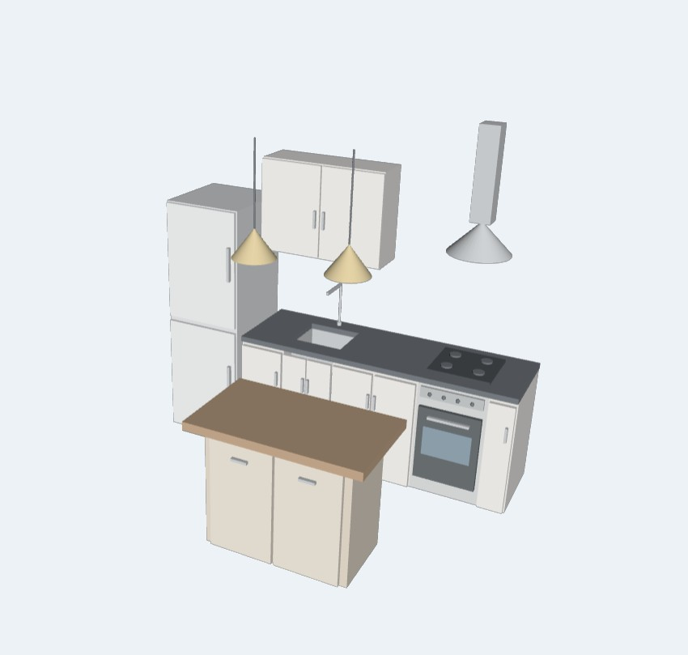
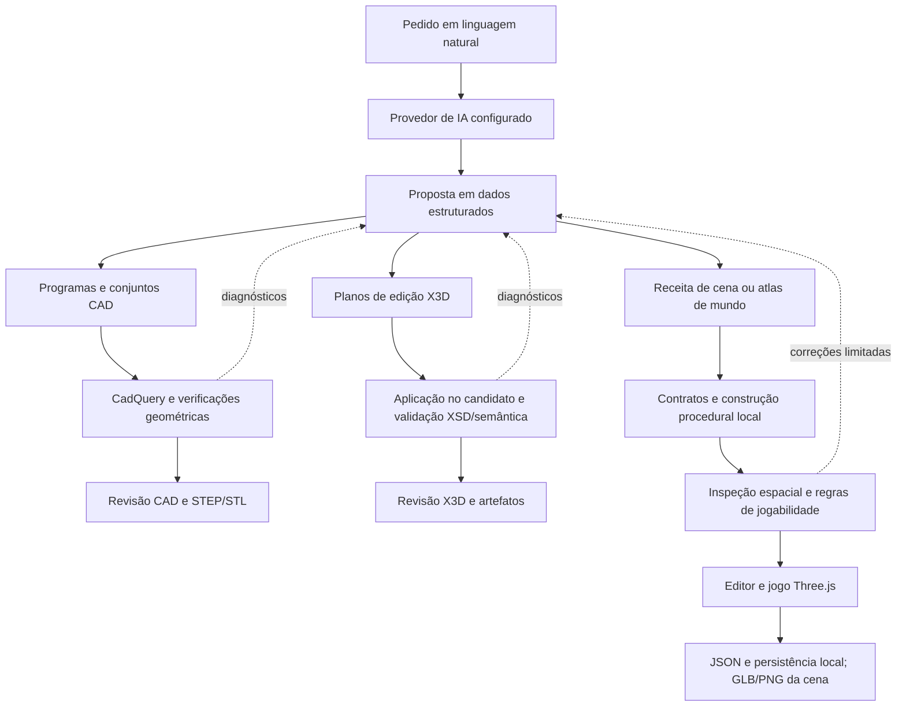
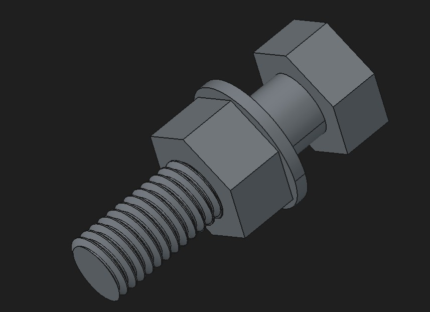
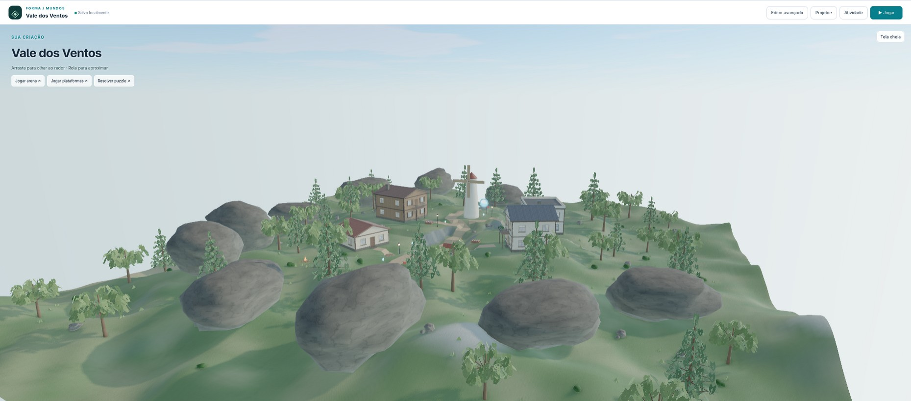

# Forma: da modelagem conversacional CAD e X3D à criação de mundos interativos com Three.js

**Autoria:** a confirmar pelos responsáveis pelo trabalho.

**Afiliação e contato:** a preencher para submissão.

**Data da atualização:** 3 de novembro de 2026.

**Código examinado:** `386f06b42e01080abe04f63f674b5f9390472319`, de 28 de outubro de 2026.

**Base de redação:** PDF *Forma-Modelagem_3d*, confrontado com o Markdown anterior, o código, o histórico e as evidências versionadas.

**Natureza do manuscrito:** estudo de caso técnico de desenvolvimento e avaliação exploratória de um artefato de software.

## Resumo

A modelagem tridimensional por linguagem natural exige transformar descrições em objetos que possam ser editados, inspecionados e exportados com segurança. Este artigo apresenta o Forma, uma aplicação web que reúne três ambientes de criação: CAD, X3D e Three.js. No CAD, instruções textuais dão origem a programas de construção avaliados pelo CadQuery/OpenCascade, com verificações de sólidos, exportação STEP e vínculos mecânicos declarados. No X3D, operações estruturadas permitem editar cenas sem comprometer a última versão válida. O estúdio Three.js oferece criação procedural de ambientes, personagens com pele e animação, som, interação e experiências jogáveis. Sua ampliação inclui mundos de aproximadamente 4 × 4 km, terreno carregado em blocos, vegetação por níveis de detalhe, mapa, persistência e exploração com coleta, fabricação e construção por kits. A pesquisa adota um estudo de caso técnico, fundamentado na implementação, nos testes e em resultados experimentais do projeto. Em uma avaliação CAD com inferência real, 15 dos 16 pedidos atenderam aos critérios adotados, correspondendo a 93,75% de sucesso observado e a um limite inferior unilateral exato de 73,60%, com 95% de confiança sob o modelo binomial. Para o Three.js, foram examinados testes automatizados, cenas de referência e medições registradas em uma GPU física, ainda sem experimento equivalente de geração livre por IA ou aprovação completa do protocolo de desempenho dos mundos. Os resultados indicam a viabilidade da proposta nos casos avaliados, mas não comprovam confiabilidade geral, correção integral de engenharia ou desempenho universal. A contribuição do Forma está em combinar interação em linguagem natural com representações estruturadas, motores especializados, verificações e mecanismos de recuperação.

**Palavras-chave:** modelagem conversacional; CAD paramétrico; X3D; Three.js; inteligência artificial; validação geométrica; mundos procedurais.

## Abstract

Natural-language three-dimensional modeling requires converting written requests into objects that can be edited, inspected, and exported safely. This paper presents Forma, a web application with three modeling environments: CAD, X3D, and Three.js. In CAD, natural-language instructions are translated into structured construction programs executed through CadQuery/OpenCascade and checked for solid validity, STEP interchange, and declared mechanical connections. In X3D, typed editing operations allow scenes to be modified without overwriting the last valid revision. The Three.js studio supports procedural environments, skinned and animated characters, audio, interaction, and playable experiences. Its expansion includes approximately 4 × 4 km worlds, streamed terrain, vegetation levels of detail, maps, persistence, and exploration with harvesting, crafting, and predefined construction kits. This technical case study draws on the implementation, automated tests, and recorded experimental results. In a live-AI CAD evaluation, 15 of 16 requests met the defined criteria, resulting in an observed success rate of 93.75% and an exact one-sided 95% lower confidence bound of 73.60% under the binomial model. Three.js was assessed through automated tests, reference scenes, and recorded measurements on a physical GPU, without an equivalent free-form live-AI experiment or complete acceptance under the world-performance protocol. These findings support feasibility for the cases examined but do not establish general reliability, complete engineering correctness, or universal performance. Forma's contribution is to combine natural-language interaction with structured representations, specialized engines, verification, and recovery mechanisms.

**Keywords:** conversational modeling; parametric CAD; X3D; Three.js; artificial intelligence; geometric validation; procedural worlds.

## 1. Introdução

A criação de modelos tridimensionais envolve decisões sobre dimensões, sistemas de coordenadas, sequência de operações, topologia, materiais e finalidade do objeto. Na modelagem mecânica, acrescentam-se condições de montagem, folgas, engate, retenção e compatibilidade entre movimento e geometria. Uma descrição textual plausível pode omitir ou contradizer qualquer desses requisitos. Consequentemente, produzir uma resposta bem formada ou uma imagem convincente é insuficiente para comprovar a validade do modelo resultante.

A pesquisa que deu origem ao Forma começou com uma questão mais simples: até que ponto seria possível descrever uma cena tridimensional em linguagem natural e visualizá-la diretamente em uma página web? O X3D foi escolhido como ponto de partida por oferecer uma representação declarativa, na qual objetos, dimensões e transformações podem ser organizados em uma estrutura compreensível e verificável. Os primeiros fluxos do projeto trabalharam com formas básicas, como caixas, esferas, cones e cilindros, além de operações de posicionamento e edição. Essa escolha não significa que o padrão X3D seja uma linguagem inferior às demais; foi o subconjunto inicialmente adotado que permitiu investigar o problema em condições menos complexas.

À medida que o projeto passou a lidar com pedidos de maior precisão, a composição visual deixou de ser suficiente. Modelar uma peça mecânica exige mais do que colocar objetos próximos uns dos outros: é necessário produzir sólidos com dimensões coerentes, realizar cortes, preservar furos, construir conexões e verificar se a geometria pode ser exportada. Foi essa necessidade que motivou a incorporação do CAD. Posteriormente, os exemplos com componentes independentes e movimentos mostraram outra frente possível de investigação: criar ambientes visuais mais ricos, capazes de reunir cenário, iluminação, animação e interação. O Three.js passou a atender a essa terceira finalidade.

A ampliação mais recente do estúdio passou a tratar também da continuidade da experiência. Personagens precisaram caminhar, conversar e reagir ao cenário; recursos coletados passaram a ter usos em receitas e equipamentos; e a escala dos ambientes exigiu carregar o terreno conforme o deslocamento do jogador. Nesse ponto, a questão deixou de ser apenas como gerar uma cena: tornou-se necessário organizar o que é descrito pela IA, o que é produzido por algoritmos locais e o que permanece como estado de uma partida.

As representações CAD baseadas em operações são especialmente relevantes nesse contexto, pois conservam parâmetros e etapas de construção, em vez de registrar somente a malha final. DeepCAD estuda a geração dessas sequências, enquanto Text2CAD investiga como obtê-las a partir de descrições textuais (WU; XIAO; ZHENG, 2021; KHAN et al., 2024).

Dessa trajetória surgiu a ideia central do Forma: a inteligência artificial interpreta o pedido, mas não deve ser a única responsável por declarar que o resultado está correto. O sistema transforma a descrição em dados estruturados e utiliza mecanismos próprios para construir, verificar e, quando possível, corrigir o modelo. O mesmo princípio acompanha os três ambientes, embora cada um exija critérios diferentes. Uma cena visual pode aceitar contatos intencionais; uma peça CAD precisa respeitar seu contrato geométrico; uma cena jogável ainda precisa lidar com percurso, eventos e movimento.

Este artigo apresenta o percurso de desenvolvimento do Forma e analisa como cada nova área surgiu de uma limitação ou de uma possibilidade observada na anterior. O objetivo é compreender como pedidos em linguagem natural podem ser convertidos em objetos tridimensionais, quais verificações são necessárias em cada etapa e que resultados podem ser sustentados pelos experimentos disponíveis. A investigação também discute os limites do sistema, sobretudo a diferença entre uma cena visualmente convincente, uma geometria válida e um modelo adequado a uma finalidade mecânica ou interativa.

As questões de investigação são:

1. Como separar interpretação textual e execução geométrica sem executar código arbitrário produzido pela IA?
2. Quais verificações permitem distinguir contrato válido, sólido válido, montagem sem interferências amostradas e vínculo mecânico verificado?
3. Como recuperar progresso e reparar falhas sem descartar silenciosamente requisitos funcionais?
4. Que desempenho e confiabilidade podem ser sustentados pelas evidências registradas?

A principal contribuição do Forma é uma arquitetura que mantém a IA responsável pela proposta e deixa a execução e a aceitação dos resultados a cargo de componentes controlados. Essa separação permite examinar desde contratos JSON e operações geométricas até exportações, vínculos mecânicos, cenas visuais e mecanismos de recuperação. O estudo apresenta ainda uma avaliação exploratória de geração CAD e testes de funcionalidades do estúdio Three.js. Não se pretende demonstrar superioridade sobre outras ferramentas sem uma comparação experimental específica.

## 2. Fundamentação e trabalhos relacionados

### 2.1. Representações geométricas e histórico de construção

Uma malha descreve superfícies discretizadas. Uma representação CAD baseada em operações descreve também uma sequência de construção. No Forma, o histórico próprio permanece na receita JSON; STEP transporta a geometria B-Rep e STL transporta sua aproximação triangular. A exportação STEP não deve ser confundida com a entrega de um histórico nativo de um CAD comercial.

CadQuery oferece uma interface de modelagem apoiada no OpenCascade e em representações por fronteira, B-Rep. O Forma usa essa infraestrutura para construir primitivas, executar operações booleanas, aplicar acabamentos e exportar sólidos. A validade emitida pelo kernel é uma propriedade da representação construída, distinta da adequação do projeto à fabricação. (CADQUERY, s. d.).

### 2.2. Geração de CAD por modelos de linguagem

DeepCAD representa modelos como sequências de operações e propõe uma abordagem generativa baseada em Transformer. Text2CAD condiciona a geração CAD em descrições textuais de diferentes níveis de detalhe. Text-to-CadQuery investiga a geração direta de programas CadQuery. A diferença operacional do Forma é interpor um contrato JSON restrito, interpretado por código controlado, entre o provedor linguístico e o motor geométrico. (WU; XIAO; ZHENG, 2021; KHAN et al., 2024; XIE; JU, 2025).

O contrato intermediário torna mais simples identificar operações permitidas, parâmetros obrigatórios e falhas de validação. Por outro lado, a liberdade de criação fica limitada aos recursos implementados. Para determinar se essa escolha produz resultados superiores à geração direta de código Python, seria necessário comparar as duas estratégias sob as mesmas condições experimentais.

### 2.3. X3D e composição de cenas

X3D é uma família de padrões para representação e intercâmbio de conteúdo tridimensional, com arquitetura e codificações definidas em normas próprias. O Forma serializa cenas XML X3D 4.0 com perfil Immersive e utiliza X3DOM para visualização HTML. O suporte do projeto cobre um subconjunto de objetos e operações, não toda a norma. (ISO/IEC, 2023; WEB3D CONSORTIUM, 2026).

Cenas visuais e peças mecânicas têm critérios de aceitação diferentes. Uma composição de primitivas pode conter interpenetrações intencionais, enquanto uma montagem CAD pode exigir folgas e conexões físicas verificáveis. O projeto mantém os dois domínios separados para evitar atribuir à validação X3D garantias próprias de sólidos CAD.

A Figura 1 apresenta uma cozinha composta no fluxo X3D do Forma. O exemplo ilustra uma cena declarativa com objetos cotidianos, iluminação suspensa e organização espacial, adequada para representar o tipo de composição visual tratado por esse ambiente.



*Figura 1 — Exemplo de cena produzida no ambiente X3D. Fonte: captura do Forma preservada do PDF de referência.*

### 2.4. Construção e avaliação de artefatos

A pesquisa aproxima-se da abordagem de Design Science, na qual um problema prático motiva a construção de um artefato e a avaliação de sua utilidade (HEVNER et al., 2004). No Forma, essa perspectiva se manifesta na relação entre os problemas de modelagem conversacional, as soluções implementadas e os testes usados para examinar seus resultados.

### 2.5. Renderização, animação e navegação no navegador

No estúdio visual, a cena é materializada como uma hierarquia de objetos Three.js. Essa biblioteca fornece recursos de geometria, materiais, animação e renderização, enquanto o Forma organiza os contratos e os comportamentos que utiliza. Uma malha com esqueleto associa vértices a ossos por pesos de influência, permitindo deformar o corpo durante a animação. Esse mecanismo é adequado à apresentação visual de personagens e tem uma finalidade distinta da validação de sólidos CAD (THREE.JS, s. d.).

A inspeção espacial utiliza hierarquias de volumes delimitadores, fornecidas pela biblioteca three-mesh-bvh, para reduzir o conjunto de triângulos examinados. A navegação dos personagens utiliza a integração Recast Navigation em WebAssembly para construir uma malha das superfícies caminháveis e consultar rotas. O Forma acrescenta regras de alcance, atividades e recuperação quando a navegação não fica disponível; a autoria das bibliotecas permanece com seus respectivos projetos (JOHNSON, s. d.; RECAST-NAVIGATION-JS, s. d.).

Na escala de mundo, níveis de detalhe permitem representar regiões distantes com menos geometria. A implementação combina uma quadtree para o terreno, transições entre resoluções e carregamento em workers. Esses mecanismos são descritos como decisões do artefato examinado. A existência de limites de complexidade e de uma meta de erro em tela não substitui a medição do desempenho efetivamente alcançado.

## 3. Materiais e métodos

### 3.1. Delineamento

A pesquisa foi conduzida como um estudo de caso aplicado, de caráter descritivo e exploratório, centrado no desenvolvimento do Forma. Em vez de tratar X3D, CAD e Three.js como soluções intercambiáveis, o estudo acompanha a ampliação progressiva dos problemas enfrentados: primeiro, a criação e a edição de cenas declarativas; depois, a construção e a verificação de sólidos e montagens; por fim, a composição de mundos interativos no navegador. Essa organização permite relacionar as mudanças de arquitetura às exigências de cada tipo de modelagem.

Foram considerados cinco grupos de materiais e procedimentos, cada um com uma finalidade específica.

A documentação funcional e os requisitos do sistema ajudam a identificar as operações disponíveis, as restrições de uso e as responsabilidades de cada módulo.

O código-fonte e o controle de versões permitem compreender as decisões de implementação, inclusive a separação entre geração linguística, validação e execução geométrica.

Os contratos em TypeScript e Python foram examinados para identificar limites de valores, referências entre objetos e condições que provocam a rejeição de uma proposta.

Testes automatizados, exemplos e verificadores geométricos permitem observar comportamentos específicos, como a preservação de uma cena válida ou a identificação de uma montagem incompatível.

Por fim, o conjunto de experimentos CAD com inferência real fornece medidas de aprovação, duração, chamadas ao modelo e verificações do motor. A amostra é pequena e foi utilizada durante o desenvolvimento, o que limita sua generalização.

No ambiente X3D, o Forma utiliza componentes da biblioteca x3d_mcp, desenvolvida pelo Web3D Consortium e incorporada como dependência do projeto. O uso dessa biblioteca aproveita validadores e conversores existentes, sem atribuir ao Forma a autoria desses componentes externos.

O recorte atual corresponde à revisão `386f06b42e01080abe04f63f674b5f9390472319`, incorporada em 28 de outubro de 2026 e examinada em 3 de novembro de 2026. O histórico alcançável contém 74 commits. O PDF de referência descreve o projeto até a revisão `2dc4c9f`, de 15 de outubro; o Markdown anterior mantinha o recorte de 13 de outubro e notas posteriores. A atualização confronta esses materiais com as mudanças de código, os contratos, os testes e os registros de medição. A inspeção cobre os módulos dos três ambientes e suas integrações, sem representar auditoria formal de todas as combinações possíveis de execução.

O submódulo X3D permanece fixado em `74da0ec46f477f0048aee813ecfc5fc87e655537`. O campo de versão do pacote raiz é `0.6.0`, enquanto o roteiro e o código incluem trabalho da etapa 0.7. Por isso, o identificador Git é usado como referência do estado analisado, sem equiparar a presença das funcionalidades à conclusão de um marco do roteiro.

### 3.2. Critérios de análise do sistema

O sistema foi analisado considerando o papel de cada ambiente e o que ele efetivamente permite produzir. No X3D, a atenção está na estrutura da cena e na segurança das alterações; no CAD, na integridade dos sólidos, nas relações entre componentes e nos arquivos de engenharia; no Three.js, na composição do espaço, nos materiais, na iluminação, na animação e na interação. Em todos eles, a geração por IA é acompanhada por regras que delimitam o que pode ser aceito.

Para caracterizar cada recurso, foram consideradas suas regras de entrada, as verificações executadas e as saídas que o usuário consegue obter. Funcionalidades descritas apenas como possibilidades futuras não foram tratadas como capacidades implementadas. Da mesma forma, a existência de um teste automatizado foi interpretada como evidência do caso exercitado, e não como garantia de funcionamento em todas as situações.

### 3.3. Procedimentos e alcance dos experimentos

A avaliação com IA real utiliza os resultados de 16 pedidos CAD registrados em [cad-2026-10-08.json](docs/benchmarks/cad-2026-10-08.json). Cada tentativa contém informações sobre o estado final, a duração, as chamadas ao modelo, as inspeções geométricas e os artefatos produzidos. Os indicadores foram conferidos a partir desses registros. Não foi realizada uma nova bateria de geração com IA real para atualizar este artigo.

Em 3 de novembro de 2026 foram executados os testes JavaScript/TypeScript e golden, a checagem de tipos, o lint web, o build de produção, os testes do domínio Python e uma seleção direcionada da API. Os resultados desta execução são apresentados separadamente dos registros de 13, 15, 23, 27 e 28 de outubro. O ambiente atual utiliza Windows/PowerShell, Node.js 24.20.0 e Python 3.12.14 do ambiente virtual da API. O Python 3.13.2 do sistema foi utilizado apenas nas ferramentas auxiliares de leitura documental.

Para desempenho visual, foram examinados os relatórios versionados da linha de base 0.7, uma medição preliminar e uma inspeção funcional de Aurora. Esses registros utilizam uma NVIDIA GeForce GT 710 e configurações explicitadas na seção de resultados. Não foi executado um novo benchmark de GPU nesta atualização. As verificações de navegador citadas pertencem às revisões documentadas, sem repetição integral nesta análise.

Não foram realizados experimentos com participantes humanos, medições de produtividade ou avaliações perceptuais. Também não foram obtidas novas medições controladas de custo ou consumo energético. A memória de GPU estimada pelo instrumento de benchmark não corresponde à medição da memória máxima de todo o sistema. Assim, as conclusões se restringem ao funcionamento técnico e aos resultados efetivamente observados.

### 3.4. Critérios operacionais de aceitação

Foram diferenciados cinco níveis:

1. **Sintático:** JSON legível e compatível com o schema.

2. **De domínio:** IDs, referências, quantidades, parâmetros e sequências admissíveis.

3. **Geométrico:** sólido conectado, topologia válida, volume positivo e operações efetivas.

4. **De intercâmbio e montagem:** STEP reimportável e consistente; interferências e vínculos verificados quando aplicáveis.

5. **De entrega no benchmark:** aprovação, requisitos instrumentados satisfeitos e exportação não vazia sem erro registrado.

Um resultado pode passar em um nível e falhar em outro. A exportação parcial de rascunho é recuperação de trabalho, não aprovação da montagem. `mechanicalStatus=verified` significa aprovação do perfil mecânico implementado e das poses amostradas.

Esses níveis descrevem principalmente a cadeia CAD. No Three.js, foram considerados separadamente a validade do documento, a composição espacial inspecionada, a coerência das ações de jogo, a recuperação de estado e os critérios de desempenho medidos. Uma cena renderizável pode conter objetivos inacessíveis ou receitas sem ingredientes; uma partida funcional pode apresentar baixa taxa de quadros. A aprovação em uma dessas dimensões não é usada como substituta das demais.

### 3.5. Etapas de desenvolvimento e estratégia de verificação

O desenvolvimento seguiu um caminho de complexidade crescente. A primeira etapa concentrou-se na representação de objetos 3D dentro da web. Utilizando X3D e X3DOM, foi possível trabalhar com uma cena composta por primitivas, propriedades visuais e transformações, acessível pelo navegador e modificável a partir de comandos em linguagem natural. O interesse inicial não era obter peças prontas para fabricação, mas compreender como a descrição textual poderia se transformar em uma estrutura editável. Os contratos ModelSpec e ModelPlan surgiram nesse contexto, permitindo separar o pedido interpretado pela IA das mudanças realmente aplicadas à cena.

Essa experiência evidenciou uma dificuldade importante: gerar uma descrição coerente não significa gerar um objeto correto. Referências inexistentes, dimensões inadequadas ou operações incompatíveis podem produzir resultados inválidos mesmo quando a resposta da IA parece convincente. Por isso, a primeira etapa passou a incluir validação estrutural e semântica, controle das revisões e preservação da última cena válida. Os testes buscaram verificar comportamentos observáveis, como criar, mover, editar e exportar objetos, sem confundir a aparência da prévia com uma garantia sobre sua consistência interna.

A segunda etapa ampliou a investigação para o CAD. O objetivo passou a ser testar o comportamento da geração por linguagem natural diante de tarefas em que a precisão geométrica tem consequências concretas. O Forma incorporou CadQuery/OpenCascade e programas de construção com operações tipadas para criar peças com furos, cortes, roscas, engrenagens e acabamentos. Em vez de pedir à IA um programa arbitrário e executá-lo diretamente, a aplicação passou a validar as instruções, construir o sólido em um motor geométrico e avaliar suas propriedades antes de aceitar o resultado. A exportação STEP e STL acrescentou uma maneira prática de verificar e utilizar a geometria produzida.

Com o avanço dos exemplos CAD, o foco deixou de ser apenas a peça isolada. Pedidos envolvendo bases, suportes, eixos, parafusos e componentes móveis exigiram representar um conjunto de corpos e considerar suas relações. Foram acrescentadas verificações de interferência, amostras de movimento e vínculos mecânicos declarados. A construção de exemplos que passaram por essas verificações foi um resultado encorajador para continuar o projeto, embora não represente certificação de funcionamento físico ou confiabilidade geral. Os problemas encontrados também orientaram melhorias nos diagnósticos, no reparo localizado e na recuperação de componentes que já haviam sido construídos corretamente.

A terceira etapa voltou a privilegiar a experiência visual, agora em um nível de detalhamento diferente daquele explorado com o X3D inicial. O Three.js trouxe terrenos procedurais, biomas, estruturas arquitetônicas, materiais físicos, iluminação, animações e ações de interação. Em lugar de gerar apenas uma lista extensa de objetos, o sistema passou a combinar um plano de cena, componentes parametrizados e algoritmos locais de posicionamento. A nova complexidade exigiu verificar também o uso do espaço: objetos atravessando paredes, construções suspensas, caminhos incompatíveis com o relevo ou elementos importantes inacessíveis prejudicam a experiência mesmo quando a cena pode ser renderizada.

O avanço do estúdio visual levou à organização de uma cadeia de processamento para os pedidos de IA. Em solicitações complexas, uma etapa propõe a distribuição geral do ambiente; outra prepara a receita dos objetos e de suas propriedades; verificações locais procuram problemas geométricos ou inconsistências; e uma etapa limitada de refinamento pode corrigir falhas identificadas. Essas tarefas são coordenadas pela aplicação e compartilham contratos de dados, em vez de executar livremente código escrito pela IA. A divisão do trabalho torna o processo mais compreensível, facilita a recuperação de erros e evita que uma tentativa de melhoria substitua automaticamente uma cena melhor.

A metodologia de verificação acompanhou essa ampliação. No X3D, verificam- se a estrutura e a semântica das cenas; no CAD, os sólidos, o intercâmbio de arquivos e as relações mecânicas; no Three.js, os contratos de cena, os comportamentos programados e as interseções detectáveis em poses amostradas. Os resultados são apresentados separadamente, porque a aprovação de uma montagem CAD não mede, por si só, a qualidade visual de uma cena jogável. Dessa forma, o desenvolvimento pode ser descrito como uma sequência de desafios relacionados, mas não como um único experimento capaz de demonstrar a confiabilidade de todos os ambientes.

Na sequência, os desafios passaram a envolver personagens e continuidade do mundo. A etapa 0.5 acrescentou áudio, combate, diálogos, poderes e exemplos com objetivos distintos. A 0.6 introduziu pele procedural, expressões, mãos articuladas, animação por estados, navegação e uma interface de jogo mais completa. A etapa 0.7 passou a separar o atlas do mundo dos locais detalhados, utilizando terreno em blocos, níveis de detalhe e persistência. Em 28 de outubro, o exemplo Aurora recebeu coleta, fabricação, natação e, posteriormente, exploração livre com construção por kits.

Essa evolução também produziu correções transversais: o cancelamento CAD passou a encerrar o trabalho nativo após a sinalização da desconexão; a preparação do viewport passou a anteceder a entrada no jogo; e o estado de uma partida passou a ser restaurado separadamente do projeto autoral. Tais mudanças são relevantes porque falhas de operação podem impedir o uso de uma geometria ou de uma cena que, isoladamente, é válida.

| Marco no histórico | Problema tratado e mudança incorporada |
|---|---|
| Setembro a 13/10; até `ea609ae` | Contratos X3D, validação, construção CAD, montagens, reparos e rascunhos |
| 14–15/10; `b60d929`, `2dc4c9f` | Estúdio Three.js, materiais, animações, arquitetura habitável, terreno e planejamento espacial |
| 16/10; `4f2a2e0`, `8d164f2` | Compatibilidade dos checks, regressões de interface e indicação de geração ativa |
| 22/10; `7824f31`, `38ac234`, `9102ffd`, `58f667d` | Mundos vivos, documento 1.4, HUD, navegação, pele e animação de personagens |
| 23/10; `e5b7802`, `7003f88`, `b3c857d` | Correções de movimento, redução de bloqueios, benchmark e contrato de mundo 2.0 |
| 27/10; `9eb41c5` | Biomas, rios, vegetação, atlas, locais, mapa, montaria e persistência; desempenho ainda pendente |
| 28/10; `f230f7c`, `55dc314`, `386f06b` | Jogabilidade de Aurora, preparo antes de jogar, exploração livre, fabricação e construção |

As datas indicam os registros de integração no Git. O agrupamento reconstrói a evolução técnica e não pressupõe que cada commit seja um experimento independente ou que o projeto tenha seguido uma metodologia formal específica desde o início.

## 4. Arquitetura e organização do Forma

### 4.1. Funcionalidades e responsabilidades

O Forma reúne construção CAD de peças e conjuntos, edição de cenas X3D e composição de ambientes Three.js. Cada ambiente oferece uma interface própria e utiliza um conjunto diferente de operações e validadores.

Os provedores de IA podem executar localmente no navegador, por meio de endpoints compatíveis ou por clientes autenticados no computador que hospeda a API. A escolha do provedor não elimina as etapas de validação.

Na criação X3D, a biblioteca especializada é utilizada diretamente pelo backend local. Um servidor MCP remoto pode ser configurado quando necessário, mas não é exigido para a operação padrão.

No CAD, peças são definidas por sequências de operações paramétricas, e conjuntos incluem componentes, posições, movimentos e, quando aplicável, relações mecânicas.

Os artefatos disponíveis dependem do ambiente: STEP e STL para peças e conjuntos CAD; X3D, HTML, ClassicVRML e JSON para cenas declarativas; JSON, GLB e PNG para projetos Three.js.

A persistência CAD utiliza SQLite e revisões controladas. O X3D trabalha com sessões temporárias, enquanto o Three.js pode conservar projetos e rascunhos no armazenamento do navegador.

Checkpoints, rascunhos e diagnósticos permitem recuperar parte do trabalho CAD. No Three.js, o histórico de edições e a conservação da melhor candidata procuram evitar a perda de uma cena útil após um reparo malsucedido.

A aceitação de um sólido CAD depende de critérios geométricos e de intercâmbio; as cenas X3D passam por verificações estruturais e semânticas; e o Three.js utiliza contratos de cena e inspeção espacial de objetos e animações.

Esses mecanismos têm limites distintos. O Forma não realiza análise estrutural, dimensionamento de peças por esforços ou solução geral de restrições mecânicas. No Three.js, a colisão de corpos móveis é aproximada, e o desempenho depende do navegador, da GPU e da complexidade da cena.

No estado atual, o terceiro ambiente inclui dois formatos de projeto: cenas 1.x e mundos 2.0. As cenas oferecem edição visual, reprodução e jogo local. Os mundos acrescentam uma descrição global de terreno e regiões, locais detalhados, exploração e salvamento do progresso no IndexedDB. O uso desses recursos não depende de uma resposta contínua da IA durante a partida; a inferência é utilizada para criar e editar os dados do projeto.

### 4.2. Decisões de arquitetura

A arquitetura do Forma foi definida a partir de uma constatação que se repetiu durante o desenvolvimento: o modelo de linguagem consegue propor estruturas úteis, mas a aprovação dessas estruturas precisa depender de regras verificáveis. Essa separação já era importante ao editar uma cena X3D simples e tornou-se ainda mais necessária quando passaram a existir peças mecânicas, conjuntos com movimento e ambientes interativos. Por isso, cada pedido percorre uma representação estruturada antes de alcançar o motor de execução, e uma tentativa malsucedida não deve substituir automaticamente um resultado válido.

Na edição X3D, os contratos ModelSpec e ModelPlan definem a cena e as operações permitidas. A proposta da IA é aplicada inicialmente a um candidato; somente depois de validado ele passa a representar o estado atual. A identificação dos objetos por ID também facilita alterações posteriores, como mover, duplicar ou excluir elementos específicos.

Como a geração depende de modelos sujeitos a erros de formato e limites de saída, a aplicação admite normalizações conservadoras e retentativas controladas. Cenas X3D extensas podem ser construídas em lotes validados. Dessa maneira, o sistema conserva as etapas aceitas e identifica o que ainda falta, sem considerar uma composição incompleta como concluída.

A biblioteca x3d_mcp fornece funções de construção, validação e conversão para o ambiente X3D. A execução local dessas funções simplifica a instalação, pois dispensa a inicialização obrigatória de um serviço MCP adicional. A integração conserva a possibilidade de comunicação remota e respeita as exigências de compatibilidade da biblioteca.

No backend local, o ModelSpec é serializado e enviado diretamente aos validadores e conversores disponíveis. Isso reduz a quantidade de serviços necessária para utilizar a aplicação. Embora a organização seja mais simples, não há uma medição controlada que quantifique o impacto dessa escolha sobre a latência.

O transporte MCP remoto permanece acessível pela configuração X3D_BACKEND=mcp. Assim, o Forma pode trabalhar com a biblioteca local ou com um serviço especializado externo. As limitações dos conversores utilizados, inclusive as relacionadas ao formato X3DJ, continuam dependendo dos recursos efetivamente suportados pela implementação integrada.

Na modelagem CAD, a descrição textual precisa resultar em operações geométricas executáveis. Uma sequência pode ser válida como JSON e ainda assim gerar um corte sem efeito ou um sólido desconectado. Por isso, o motor fornece diagnósticos sobre a etapa rejeitada, as dimensões e os limites espaciais; essas informações orientam correções específicas, sem autorizar a remoção silenciosa de elementos pedidos.

Em conjuntos CAD, a validade de cada componente não é suficiente. Depois de posicionar os corpos, o verificador também examina interferências, amostras de movimento e a consistência da exportação do conjunto. Esse controle permite distinguir uma peça bem formada de uma montagem que realmente atende aos critérios implementados.

A verificação mecânica acrescenta relações como ancoragem, contato, alinhamento, engate e compatibilidade entre roscas. Um conjunto sem colisões aparentes pode, por exemplo, conter um suporte sem conexão com a base ou uma porca incompatível com o fuso. Por essa razão, os vínculos declarados são avaliados com consultas ao material e à geometria construída, dentro de um escopo mecânico limitado.

A construção de conjuntos complexos também exige lidar com falhas parciais. Se um componente não puder ser concluído, os demais podem permanecer disponíveis como rascunho, acompanhados das operações pendentes. Checkpoints, reparos por ID e limites de chamadas diminuem a necessidade de começar novamente e ajudam a impedir que uma tentativa de correção destrua trabalho válido.

A integridade do resultado final envolve mais que um sólido aceito pelo kernel. Furos cegos exigem fundo preservado, roscas precisam manter suas características funcionais e exportações devem ser reimportáveis. Nos testes CAD, essas verificações ajudaram a distinguir a aprovação geométrica do atendimento aos requisitos declarados. O caso M4, discutido adiante, exemplifica a importância de separar a folga de passagem da folga de rosca.

As três áreas não representam apenas formatos diferentes de exportação. Elas mostram como o mesmo problema, transformar uma intenção textual em um modelo tridimensional, muda quando o objetivo passa de uma cena declarativa para uma peça mecânica ou um ambiente interativo. A arquitetura preserva uma ideia comum: a IA pode propor e ajudar a corrigir, enquanto os motores e verificadores determinam o que foi efetivamente construído e quais condições foram atendidas.

### 4.3. Organização do monorepositório

A interface web utiliza React e TypeScript com Vite. A API é implementada em Python/FastAPI, com contratos CAD e X3D compartilhados entre Pydantic e JSON Schema. A construção CAD utiliza CadQuery/OpenCascade e possui visualizador WebGL; o X3D é exibido por X3DOM. O estúdio Three.js concentra no navegador a edição, o renderizador, a inspeção espacial e o modo jogo, sem depender do kernel CAD para construir suas cenas.

O código do estúdio está concentrado em `apps/web/src/three`. A subpasta `world` reúne o contrato 2.0, o terreno, os workers, o atlas e a persistência. Os três ambientes compartilham a configuração de provedor, mas mantêm representações e critérios próprios. As áreas são carregadas sob demanda; depois de abertas, conservam seu estado na navegação. Durante uma geração, a troca de área fica bloqueada para evitar ações concorrentes sobre o provedor.

*Tabela 1 — Organização do repositório Forma.*

| Módulo | Responsabilidade |
|---|---|
| `apps/web` | Interface, configuração de IA, controladores, editores, prévias e downloads |
| `apps/api` | HTTP, validação, motores, persistência, artefatos e supervisão de processos |
| `packages/agent` | Provedores compartilhados, geração CAD/X3D, planejamento, reparo e checkpoints |
| `packages/domain` | Tipos, schemas, parsers e invariantes CAD/X3D compartilhados |
| `apps/web/src/three` | Contratos e geração do estúdio, execução visual, personagens e jogo |
| `apps/web/src/three/world` | Mundos, terreno em blocos, vegetação, atlas e IndexedDB |
| `services/x3d-mcp` | Biblioteca upstream fixada e execução remota opcional |
| `scripts`, `tests`, `examples`, `docs` | Automação, avaliação, regressões, exemplos e rastreabilidade |



*Figura 2 — Fluxo lógico dos três domínios. Fonte: elaboração própria com base na revisão examinada.*

O diagrama apresenta o fluxo comum de geração e verificação. Cada ambiente acrescenta etapas próprias: o CAD constrói sólidos, o X3D serializa cenas e o Three.js materializa objetos para renderização e interação. Erros de comunicação, cancelamentos e limites de uso interrompem o processo, mas não são classificados automaticamente como falhas da geometria. Nos mundos, algoritmos locais produzem o relevo e distribuem o conteúdo; a IA não enumera todos os vértices do terreno.

### 4.4. Dependências e reprodutibilidade

Os manifestos declaram React 19, TypeScript 6, Vite 8, Three.js `^0.186.1`, three-mesh-bvh `^0.9.16`, recast-navigation `0.43.1`, CadQuery `>=2.8,<3`, FastAPI, Pydantic e WebLLM. Essas declarações são versões ou intervalos de manifesto; o conjunto efetivamente instalado deve ser recuperado dos lockfiles e do ambiente. O projeto documenta Node.js 24 e Python 3.12 ou superior como requisitos de execução.

Os arquivos `package-lock.json` e `uv.lock`, a identificação da versão do código e o submódulo X3D permitem recuperar as dependências necessárias. Para experimentos com provedores externos, também é necessário registrar o modelo e a configuração utilizados, pois esses elementos podem mudar independentemente da aplicação. O build atual continua emitindo aviso de bundles grandes; o carregamento sob demanda não elimina o custo de transferir e preparar esses módulos.

## 5. Representações intermediárias e contratos

### 5.1. Cenas e planos X3D

ModelSpec 1.0 descreve objetos identificados, propriedades da cena, dimensões, transformações e materiais. Seu catálogo primitivo inclui caixa, esfera, cilindro e cone. ModelPlan descreve operações de criação, exclusão, duplicação, alteração de dimensões, translação, rotação, escala, material, nome e propriedades da cena, além de esclarecimento e ausência de alteração.

A separação permite validar a intenção operacional antes da serialização X3D. A transformação de um plano em candidato não deve modificar a revisão vigente até que o candidato seja aprovado. IDs fornecem referências estáveis para edições conversacionais.

A configuração padrão limita projetos a 300 objetos e planos a 100 operações; o agente possui continuação em lotes de até 25 operações, com limite de 12 lotes. Esses tetos delimitam recursos da aplicação, sem prometer a geração satisfatória de qualquer cena desse tamanho.

### 5.2. Programas CAD

CadProgramSpec 3.0 define unidades em milímetros, identificação da peça e sequência de até 32 etapas. A primeira etapa é a única operação base; etapas seguintes podem unir, cortar ou modificar o sólido, conforme o recurso. A base não admite padrão. IDs de etapas devem ser únicos.

O contrato limita o total de instâncias de padrões a 256, o total de passos de rosca a 160, dentes de engrenagem/cremalheira a 1.024, voltas de mola a 64 e segmentos de sweep a 128 por programa, considerando padrões. Perfis poligonais admitem até 32 pontos. São limites de complexidade implementados, não propriedades universais dessas técnicas.

O catálogo contém 21 tipos de recurso:

*Tabela 2 — Catálogo de operações CAD.*

| Categoria | Recursos disponíveis |
|---|---|
| Primitivas | `box`, `cylinder`, `sphere`, `cone` |
| Perfis e transições | `polygon_prism`, `revolve_profile`, `regular_prism`, `loft` |
| Recursos vazados e cortes | `tube`, `torus`, `slot`, `hole`, `thread` |
| Geometria mecânica | `spur_gear`, `rack` |
| Varreduras | `pipe_bend`, `helical_spring`, `sweep` |
| Acabamentos | `fillet`, `chamfer`, `shell` |

Os modificadores possuem restrições próprias: operação modify, transformações nulas e ausência de padrões. selectionBox restringe centros de arestas selecionadas para fillet/chamfer. Não é seleção persistente por identidade topológica de faces ou arestas.

### 5.3. Conjuntos CAD e mecânica

CadAssemblySpec 4.0 contém de dois a oito componentes e até 128 etapas totais. Cada componente reutiliza o contrato de programa, possui posição e pode declarar movimento. Ao menos um componente deve ser fixo. Grupos de movimento precisam compartilhar intervalo e valor do comando.

O contrato opcional mechanics identifica uma peça ancorada e até 24 conexões. Cada vínculo contém componentes, recursos referenciados, tipo, folga máxima, engate mínimo e método de fixação. Um grafo não direcionado representa as conexões; uma busca a partir da peça ancorada exige alcançar todos os componentes. Conectividade declarada é necessária, mas não suficiente: a geometria correspondente também é inspecionada.

A interface exige vínculos por padrão na criação mecânica. Contratos antigos sem mechanics são preservados e identificados como não verificados. Rascunhos parciais usam contrato próprio, permitindo um componente disponível sem violar a exigência de dois componentes de um conjunto aprovado.

### 5.4. Coerência entre linguagens

Modelos Pydantic são a fonte dos schemas CAD compartilhados. `scripts/generate-cad-schemas.py` gera os contratos; validadores TypeScript e Python exercitam fixtures comuns. A geração enviada ao modelo pode empregar um schema compacto, mas a resposta passa posteriormente pelo contrato completo.

Essa camada reduz divergências entre navegador, agente e API. Não substitui as verificações geométricas: dimensões formalmente positivas podem descrever um corte sem efeito, uma união desconectada ou um acabamento impossível.

### 5.5. Documentos de cena e de mundo

O estúdio utiliza `ThreeSceneDocument` 1.4 para cenas e `ThreeWorldDocument` 2.0 para mundos. O primeiro conserva nós com IDs, hierarquia, geometria, transformações, materiais e ações. Acrescenta campos para personagens, rotinas, emissores, vento, ciclo diário e regras de jogabilidade. Arquivos das versões 1.0 a 1.3 continuam aceitos por validação e migração. A cena admite até 2.000 nós, 32 luzes pontuais/spot e 32 MiB de JSON; o orçamento estimado das geometrias do documento é distinto da quantidade de triângulos desenhada por quadro com sombras e outros passes.

O documento 2.0 descreve semente, terreno, regiões, locais, rotas, ambiente global e orçamentos. Um local pode conter sua própria cena 1.x. O contrato aceita dimensões de até 16.384 m por eixo, 64 regiões, 256 locais, 512 rotas e 128 MiB de JSON. Esses tetos de validação são superiores ao exemplo de 4.096 × 4.096 m e não demonstram viabilidade de operação no tamanho máximo. O atlas produzido pela IA usa limites menores: até oito regiões, 12 locais, 16 rotas e três locais inicialmente detalhados.

Abrir uma cena antiga não a converte automaticamente em mundo. Existe conversão explícita para um mundo sem terreno, com um único local, preservando o conteúdo da cena. A composição dos locais no runtime ainda está sujeita ao teto global de 2.000 nós; locais que não cabem ficam na lista de omitidos. O nível de detalhe visual não remove essa restrição da composição lógica.

## 6. Metodologia de geração e edição

### 6.1. Abstração dos provedores

Uma interface de provedor permite escolher WebLLM com WebGPU, endpoint HTTP compatível com OpenAI ou clientes locais Codex/Claude Code. O nome compatível indica formato de integração, não identidade obrigatória do fornecedor do modelo. Os endpoints externos recebem pedidos do navegador e dependem de chave, modelo e CORS adequados.

Na ponte local, a API chama clientes oficiais instalados e autenticados, com argumentos controlados e entrada por stdin. Ferramentas são desabilitadas, não há shell intermediário e o JSON final é recuperado dos mecanismos próprios de cada cliente. Variáveis de credenciais de faturamento são filtradas. Rotas locais exigem loopback, Host adequado e Origin permitido quando presente.

O uso de clientes de assinatura não elimina os limites da conta. O JSON produzido continua sendo entrada não confiável. Políticas de geração, limites de saída e retentativas podem variar entre provedores; a aplicação não demonstra equivalência de qualidade entre eles.

### 6.2. Fluxo CAD

O fluxo CAD foi organizado para que a complexidade do pedido determine a quantidade de planejamento necessária. Uma peça simples pode ser representada por uma sequência de operações sobre um único sólido. Já uma montagem exige decompor o pedido em componentes, definir suas posições e estabelecer as relações que deverão ser verificadas. Para conjuntos com três ou mais componentes, há uma etapa adicional de revisão do plano antes da construção. Essa divisão busca reduzir erros de interpretação que seriam mais difíceis de corrigir depois de gerar todos os corpos.

Depois do planejamento, cada componente recebe uma receita estruturada. O sistema confere o contrato, identifica requisitos explícitos, executa a construção geométrica e inspeciona o resultado. Quando surge uma falha corrigível, o diagnóstico retorna ao processo de reparo dentro de limites predefinidos. Se parte do conjunto estiver pronta, os corpos concluídos podem ser conservados enquanto se trabalha nas pendências. Dessa maneira, a geração não depende de uma única resposta longa nem exige recomeçar toda a montagem após um erro localizado.

Esse fluxo permite aproveitar correções locais antes de solicitar uma nova resposta à IA. Na criação de conjuntos, um novo planejamento pode ser limitado aos componentes afetados, enquanto a correção direta de interferências preserva o plano existente.

### 6.3. Requisitos explícitos e decisões inferidas

O sistema diferencia uma medida pedida pelo usuário de uma medida sugerida no plano. Preparação de stock ou redução de acabamento pode ajustar decisões inferidas, mas não deve alterar silenciosamente requisitos explícitos.

cad-explicit-requirements.ts verifica recursos literais e parâmetros no formato campo=valor antes do kernel. Essa verificação é conservadora: não interpreta integralmente qualquer descrição em prosa. A fidelidade completa depende de oráculos adicionais e revisão do resultado.

A interface CAD usa noQuestions=true. Uma resposta indevida de esclarecimento pode receber até duas tentativas internas de resolução; insistência termina em falha técnica com preservação do contexto. O SDK mantém compatibilidade com esclarecimentos quando configurado. O comportamento X3D conserva sua política própria de perguntas.

### 6.4. Orçamento e prevenção de ciclos

*Tabela 3 — Limites de geração e correção CAD.*

| Operação | Chamadas de IA | Verificações | Prazo |
|---|---:|---:|---:|
| Criação e edição | 20 | 48 | 20 min |
| Correção de montagem | 5 | 16 | 4 min |

Esses tetos globais coexistem com limites locais de reparo e políticas do provedor. A estratégia determinística de montagem tem seus próprios limites padrão de 16 etapas e 48 validações; não representa autorização para ultrapassar o orçamento global da ação que a invoca.

Identidades canônicas ignoram ordem de campos JSON, preservando a ordem das operações. Caches limitados reutilizam inspeções equivalentes, e repetição de candidatos interrompe ciclos. Inspeções canceladas ou que falham tecnicamente são removidas do cache para não bloquear retomadas válidas.

### 6.5. Fluxo X3D

O agente gera um ModelPlan, que passa por validação e aplicação sobre um candidato. O backend local produz XML controlado a partir do ModelSpec; validadores upstream verificam schema e semântica. Um autofix específico de containerField pode ser aplicado antes de nova validação. Persistindo erros, a revisão não é substituída.

Cenas extensas podem usar continuação por lotes. Há contadores de truncamento, continuação, reparos e lotes omitidos. No benchmark X3D, omitir um lote implica falha, mesmo quando outros foram aplicados. A existência do protocolo e do corpus de 32 pedidos não comprova que suas metas de desempenho e acerto tenham sido atingidas.

### 6.6. Geração visual em duas escalas

Nas cenas Three.js, a aplicação utiliza planejamento quando o pedido exige organização espacial, seguido de construção da receita e, quando necessário, uma tentativa de refinamento. São até duas chamadas lógicas ao construtor e uma chamada adicional de planejamento nos pedidos complexos; retentativas internas de transporte podem acrescentar requisições. O prazo da ação de cena pode ser configurado em dois, cinco ou dez minutos. O sistema conserva a melhor candidata construída quando uma chamada de ajuste falha ou o prazo termina; cancelamento explícito do usuário interrompe a aplicação desse trabalho.

Nos mundos, o primeiro resultado é um atlas compacto. Algoritmos locais calculam o terreno e procuram posições compatíveis com regras como costa, rio, vale ou floresta. Os locais selecionados são então detalhados pelo pipeline de cenas. Alterações posteriores usam patches de regiões, locais e rotas, preservando o que não foi citado.

A geração de mundo tem uma política diferente do prazo das cenas: as etapas são retomáveis e não possuem limite global de tempo ou número de tentativas. Falhas recebem espera progressiva de dois até 60 segundos; limites de taxa ou cota consideram o horário informado pelo provedor. O usuário pode cancelar. Essa escolha aumenta a possibilidade de continuidade, mas não impõe um teto total de chamadas ou consumo. Os checkpoints concluídos são encaminhados à persistência local, sem significar que uma requisição em andamento possa continuar após fechar o navegador.

## 7. Construção geométrica e verificação CAD

### 7.1. Operações e integridade do sólido

O interpretador constrói os recursos, aplica transformações e padrões e executa uniões ou cortes sequenciais. Cada corpo precisa permanecer um sólido válido e conectado, com volume finito e positivo. Uniões desconectadas e cortes que dividem a peça são rejeitados. Operações sem mudança efetiva também produzem diagnóstico.

Perfis poligonais recebem verificação de arestas degeneradas e auto-interseções. Acabamentos utilizam seletores enumerados e são executados pelo kernel; não há garantia de que qualquer raio ou seleção formalmente válida seja geometricamente realizável. Erros reportam a etapa e informações úteis à correção.

### 7.2. Sistemas de coordenadas

As transformações incluem referencial do recurso, movimento e posição do componente. Cilindros e roscas são centrados; furos partem da entrada e avançam em Z local negativo. Essa diferença é relevante: interpretar o centro de uma rosca como sua entrada pode deslocar o corte e deixar material indevido no receptor.

Para movimentos agrupados, um comando comum é multiplicado por fatores físicos. Um par fuso/porca usa o avanço por volta $L=pz$, em que $p$ é o passo e $z$ o número de entradas. Na convenção documentada para rosca direita e porca sem rotação, tomando $q$ em milímetros e o ângulo em graus:

$$
\theta(q)=-\frac{360}{pz}q,\qquad x(q)=q.
$$

O sinal depende da convenção de eixo e montagem. Essa relação cinemática declarada precisa ser compatível com o perfil e o material efetivamente construídos.

### 7.3. Recursos especiais

Roscas. Perfis métricos e trapezoidais, sentidos direito/esquerdo e múltiplas entradas são construídos geometricamente. A implementação utiliza seções polares e extrusões torcidas segmentadas em até uma volta. Verificações adicionais de volume, conectividade e perfil respondem a casos em que a validade do kernel isoladamente não detectou perda da forma helicoidal. Cortes internos usam o perfil correspondente com folga radial. Os perfis truncados não certificam classes ISO, tolerâncias de fabricação ou resistência.

A Figura 3 mostra um parafuso modelado no fluxo CAD do Forma. Esse tipo de peça é útil para exemplificar a geração de recursos mecânicos mais exigentes, como rosca externa, cabeça prismática, superfícies de apoio e coerência geométrica entre os componentes.



*Figura 3 — Exemplo CAD com rosca e superfícies de apoio. Fonte: captura do Forma preservada do PDF de referência; a imagem não substitui as verificações geométricas.*

Furos. Furos simples, rebaixados e escareados podem declarar término cego/passante e fundo mínimo. As verificações consultam o sólido final, após operações posteriores e transformações. Não basta declarar uma profundidade correta se outro corte eliminar o fundo ou uma união preencher o canal.

Engrenagens e cremalheiras. O catálogo produz engrenagens retas com perfil evolvente e cremalheiras. A presença dos dentes e suas dimensões não constitui verificação de engrenamento, transmissão de torque ou capacidade de carga.

Curvas, molas e sweeps. Curvas de tubo utilizam arcos de 1° a 270°. As molas são formadas por um arame circular varrido em hélice, com 1 a 32 voltas por recurso e extremidades abertas. O sweep percorre de 2 a 16 pontos em uma trajetória segmentada, com junções em esquadria. Essa implementação não utiliza interpolação spline; a geometria exportada é conferida por verificações de consistência do arquivo.

### 7.4. Interferências e amostragem do movimento

Cada componente é construído localmente uma vez por inspeção. As poses transformam os sólidos disponíveis. São examinadas a posição atual e as frações 0, 0,25, 0,50, 0,75 e 1 do intervalo quando existe movimento.

O verificador usa caixas conservadoras para eliminar pares seguramente separados. Para candidatos restantes, calcula a interseção real: $V_{ij}(q)=\operatorname{Vol}(S_i(q)\cap S_j(q))$

Interseções acima de 0,1 mm³ são rejeitadas. Interseção inválida, volume não finito ou volume negativo além da tolerância também impedem aprovação. O limiar não é uma tolerância industrial de ajuste. Pares com a mesma pose são reutilizados; o diagnóstico conserva os registros por amostra.

No pior caso, a enumeração envolve $O(mn^2)$ pares para $n$ componentes e $m$ poses. O custo real depende fortemente das operações geométricas, especialmente roscas e booleanas. Não foi produzida uma curva experimental de escalabilidade.

A amostragem usa uma fração comum para os componentes móveis e não enumera o produto cartesiano de todas as posições independentes. Portanto, além dos intervalos entre amostras, combinações não amostradas de comandos independentes também podem conter colisões.

### 7.5. Verificação de vínculos mecânicos

O verificador combina referências declaradas com consultas ao sólido final e usa as poses da inspeção de interferências.

*Tabela 4 — Critérios operacionais dos vínculos mecânicos.*

| Tipo de vínculo | Critérios verificados |
|---|---|
| Fixo por adesivo | Contato plano com área comum mínima, ou encaixe admitido com material/engate; adesivo declarado |
| Fixo parafusado | Contato, pelo menos dois furos coaxiais, passagem e material compatíveis |
| Fixo em base roscada | Passagem/rosca métrica compatíveis, acesso, material, engate útil e fundo quando declarado |
| Fixo capturado | Batentes a pequenas translações e antirrotação testada geometricamente |
| Guia linear | Coaxialidade, folga, material e engate; duas guias separadas para impedir giro do carro |
| Mancal rotativo | Munhão/furo compatíveis e retenção axial nos dois sentidos |
| Transmissão roscada | Parâmetros complementares, perfil exposto, engate, folga e cinemática coerente |

Consultas de material incluem quatro direções e três estações axiais para pares de recursos; roscas acrescentam cristas/vales nas fases helicoidais. Padrões receptores podem ser usados quando existe exatamente uma instância coaxial; padrões positivos e correspondências ambíguas têm restrições.

A prova de rebaixo/escareado acompanha o raio efetivo do perfil ao longo da profundidade. Assim, um alojamento legítimo não é confundido com ausência de parede de um furo simples. Assento ausente, alojamento preenchido e entrada enterrada continuam inválidos.

A conectividade do grafo, o alinhamento e as consultas de material não resolvem todos os graus de liberdade nem provam uma sequência de instalação. Parafusos comerciais declarados podem não ser sólidos exportados. A aprovação depende de sua instalação e de decisões externas de engenharia.

### 7.6. Fidelidade STEP e discretização STL

Após exportar STEP, o sistema reimporta o arquivo e compara quantidade de sólidos, validade, volume e seis coordenadas extremas das caixas. Em conjuntos, as comparações são realizadas por componente e globalmente. Utiliza-se `math.isclose` com tolerância relativa de $10^{-5}$ e absoluta de $10^{-4}$, aplicadas nas unidades da grandeza comparada.

Em termos escalares, o teste verifica:

$$
|a-b| \leq \max\left(10^{-5}\max(|a|,|b|),\ 10^{-4}\right).
$$

A comparação de volume e limites detecta perdas relevantes, mas não prova identidade topológica completa ou igualdade local de superfícies. Geometrias diferentes podem compartilhar essas medidas; por isso, testes específicos também consultam pontos de material e perfis.

STL deriva do STEP validado. A tesselação utiliza deflexão linear absoluta configurada de 0,1 mm e tolerâncias angulares tentadas em 0,1, 0,2, 0,35 e 0,5 rad, começando pela mais fina. O limite padrão é 64.000.000 bytes para STL e 10.000.000 bytes para STEP/artefatos gerais. A prévia possui discretização própria e não deve ser usada como medida exata da geometria.

## 8. Reparo, recuperação e integridade das revisões

### 8.1. Política de progresso verificável

Estratégias locais tratam posicionamento, encaixes cilíndricos, pares roscados e folga de movimento. Propostas passam novamente pela inspeção. Para aceitar progresso parcial, a política proíbe novos pares/poses em conflito, aumento relevante de interferências existentes e introdução de defeitos mecânicos.

Para um volume anterior $v$, a comparação usa a tolerância $\max(0{,}001,10^{-6}v)$ mm³. Deve haver redução verificável de volume, quantidade de colisões ou defeitos. A comparação de defeitos mecânicos é implementacional e depende de diagnósticos estruturados; não constitui uma prova formal de equivalência funcional.

O reparo conserva IDs, corpos não afetados e recursos funcionais. Roscas, dentes, molas e varreduras não podem ser simplificados silenciosamente para obter aprovação. Exclusões precisam de autorização compatível com o pedido, considerando negações. O backend decide a validade e não altera por conta própria a receita submetida para fazê-la passar.

### 8.2. Acabamentos e edições incrementais

Reparos de fillet/chamfer podem testar até três tamanhos menores quando a dimensão foi inferida. Medidas explícitas não recebem essa redução automática. Uma chamada focada pode alterar seleção, tamanho ou posição da etapa na sequência, conservando o restante.

A edição incremental local usa substituição/inserção/remoção por ID, aplicada deterministicamente antes da validação. Etapas omitidas na resposta permanecem. IDs desconhecidos, conflitos e remoções não autorizadas são rejeitados. Outros caminhos de integração mantêm envio de programa completo e políticas próprias de reparo de formato.

### 8.3. Falha M4 e reconciliação de contrato

O benchmark revelou uma montagem com passagem Ø4,5 mm para parafuso M4 e maxClearance=0,1 mm. A folga radial da passagem é: $c=(4{,}5-4)/2=0{,}25$ mm.

A folga da rosca interna de 0,1 mm é uma condição distinta. O reparo reconcilia somente o limite inferido da conexão para 0,25 mm, conservando corpos e diâmetros. Um máximo explicitamente exigido pelo usuário não pode ser ampliado por essa inferência.

Depois do ajuste do limite inferido, o mesmo candidato foi verificado com dois sólidos, volume de 25.627,289341 mm³, STEP de 1.588.958 bytes e estado mecânico aprovado. O contrato incompatível foi mantido como falha na avaliação original. A verificação do reparo demonstra o comportamento do sistema, mas não constitui uma nova entrega bem-sucedida por IA.

### 8.4. Checkpoints, rascunhos e persistência

Checkpoints registram plano, componentes concluídos, candidatos, etapa pendente e contexto de reparo. Quota, cancelamento ou falha de inspeção podem interromper a ação sem repetir a geração de componentes concluídos. O resultado nativo validado pode ser conservado até confirmação de salvamento.

Há três camadas distintas de continuidade:

*Tabela 5 — Formas de recuperação de trabalho CAD.*

| Forma de continuidade | Conteúdo preservado | Persistência |
|---|---|---|
| Revisão CAD salva | Receita, STEP e medidas em SQLite | Sobrevive ao reinício |
| Rascunho recuperável | Receita disponível, pedido e diagnóstico no navegador ou JSON | Permite reconstruir prévia/exportação após reload |
| Checkpoint completo do agente CAD | Estado interno de geração e reparo | Memória da aba; não sobrevive ao reload |

A exportação de rascunhos constrói componentes independentemente. Uma falha interrompe apenas o corpo afetado, preservando o prefixo geométrico válido anterior. O ZIP contém receita original, sólidos disponíveis, STEP/STL globais e por componente e relatório de etapas/peças omitidas. STEP é reimportado; não há aprovação global nem gravação de revisão. O teto padrão do ZIP é 128.000.000 bytes. Se apenas o STL exceder o limite, a omissão é registrada e os demais materiais podem ser conservados.

O armazenamento CAD usa SQLite com revisões e controle de revisão esperada; atualizações usam transação BEGIN IMMEDIATE. Uma edição inválida não substitui a revisão válida. Sessões X3D ficam em memória, com expiração padrão após 3.600 s de inatividade; um manifesto JSON permite transporte e importação, sem constituir persistência automática da conversa no servidor.

## 9. Validação X3D e operação segura

### 9.1. Estrutura, semântica e política espacial

O backend local serializa objetos conhecidos para XML, aplica escala de exibição de 0,001 por padrão e converte rotações para a representação X3D. Validações XSD e semântica verificam o candidato. O pipeline de correção limitado não executa código textual da IA.

A política espacial distingue modo visual e separação estrita. Caixas delimitadoras são aproximações conservadoras: sua sobreposição não comprova interseção de objetos curvos ou rotacionados. No modo visual, avisos não deslocam automaticamente a cena; no estrito, a separação exigida pode bloquear a alteração. Isso evita destruir conexões visuais legítimas por uma inferência textual global.

O HTML de prévia é exibido em iframe com `sandbox="allow-scripts"`. A página depende de X3DOM carregado pela internet. Essa prévia não prova execução offline nem correção física da cena.

### 9.2. Isolamento do trabalho nativo

Requisições CAD são enfileiradas por processo da API. Um lock de arquivo do sistema operacional coordena workers entre processos que compartilham CAD_WORKER_LOCK_PATH. A espera padrão é 60 s; timeout retorna ocupação, sem desencadear correção paga de geometria.

Os workers têm teto configurado padrão de 2.048 MB, prazo de 240 s e kernel com duas threads, ajustável de uma a oito. Windows utiliza Job Objects; POSIX utiliza limite de espaço de endereçamento e mecanismos de encerramento, com sinal de morte do pai em Linux. Desconexão HTTP sinaliza cancelamento, observado em esperas de até 100 ms, seguido do encerramento da árvore de processos.

Esses mecanismos restringem workers nativos. Não são um teto agregado de RAM de toda a máquina. Processos em máquinas diferentes ou com locks diferentes são independentes. Prazos do cliente e do backend têm papéis distintos.

O cancelamento corrige a limitação de documentos anteriores que descreviam desconexão sem encerramento imediato do trabalho nativo. O intervalo de consulta não é uma garantia de prazo exato para finalizar todos os processos em qualquer sistema operacional.

### 9.3. Limites de implantação

A ponte de IA local restringe origens e execução de processos. Ainda são necessários controles adicionais de autenticação, autorização e propriedade dos projetos antes de uma implantação multiusuário. O uso de SQLite, CORS e sandbox na prévia não substitui esses mecanismos, e a resistência do sistema a ataques não foi avaliada por testes de intrusão.

## 10. Estúdio Three.js: representação, execução e inspeção de cenas

### 10.1. Inclusão do terceiro domínio e separação arquitetural

A terceira etapa surgiu quando a experiência com cenas declarativas e construções mecânicas abriu espaço para uma pergunta diferente: seria possível aproveitar a modelagem conversacional para criar mundos que o usuário pudesse explorar, editar e utilizar como experiências interativas? O CAD já havia demonstrado a possibilidade de construir e verificar certas peças e montagens, inclusive com componentes móveis. Entretanto, sua finalidade não era produzir vegetação, terrenos, iluminação de ambiente, animações visuais ou interações de jogo. O Three.js foi incorporado para investigar esse conjunto de necessidades.

No novo estúdio, a geometria deixa de ser pensada apenas como objeto individual. Uma solicitação pode envolver um terreno completo, caminhos, construções, árvores, materiais, fontes de luz e comportamentos ligados a portas, itens ou personagens. O usuário descreve a ideia e acompanha a cena no navegador, enquanto o editor permite ajustes manuais em objetos e propriedades. A representação continua estruturada em um documento JSON com referências estáveis, mas o motor visual usa Three.js e WebGL2, com recursos próprios de renderização, animação e interação.

*Quadro 1 — Diferenças operacionais entre os ambientes.*

| Domínio | Representação e motor | Verificação e entrega |
|---|---|---|
| CAD | Programas 3.0 e conjuntos 4.0; CadQuery/OpenCascade | Sólidos B-Rep, STEP/STL, conexões e interferências amostradas |
| X3D | ModelSpec/ModelPlan; X3D 4.0 e X3DOM | Contrato, semântica e revisão válida; X3D/HTML/ClassicVRML/JSON |
| Three.js | Cena 1.4 e mundo 2.0; renderizador WebGL2 | Contratos, inspeções espaciais, regras de jogo e persistência; JSON e GLB/PNG da cena |

A escolha também alterou a forma de trabalhar com IA. Em pedidos pequenos, uma receita pode ser suficiente; em ambientes extensos, é útil separar decisões sobre distribuição espacial, escolha dos elementos, construção e revisão. Essas etapas são coordenadas pela aplicação. A divisão das tarefas não comprova que vários agentes autônomos e independentes atuem em todos os pedidos.

A Figura 4 apresenta o Vale dos Ventos, utilizado no PDF como exemplo do estúdio. A cena reúne terreno, vegetação, edificações, caminhos e elementos interativos. A captura é preservada como registro daquela etapa; os mundos extensos e a jogabilidade posteriores são descritos a partir do código e dos testes atuais.



*Figura 4 — Cena Vale dos Ventos. Fonte: captura do Forma preservada do PDF de referência, anterior às ampliações de personagens e mundos.*

### 10.2. Contrato de cena, geometria e materiais

O documento de cena utiliza o contrato 1.4, com migração das versões 1.0 a 1.3. Cada nó possui identificação estável, referência de pai, transformações, dimensões, tipo geométrico e propriedades opcionais de material, animação, interação, comportamento ou pré-fabricado. A hierarquia permite aplicar mudanças por ID e definir subárvores reutilizáveis. O motor recusa referências inexistentes e configurações inválidas antes de admiti-las no estado autoral.

O catálogo inclui primitivas, terrenos, perfis extrudados e de revolução, tubos por curva, malhas triangulares, textos, luzes e grupos. Materiais físicos oferecem parâmetros como rugosidade, metalicidade, transparência, emissão e mapas procedurais. A iluminação contempla dia, noite e espaço, luzes pontuais e spot, neblina, reflexões e pós-processamento. A geometria é descrita por parâmetros e dados, sem execução de JavaScript arbitrário produzido pelo modelo.

Casas, árvores, mobiliário, estruturas e personagens são construídos a partir de pré-fabricados parametrizados. Repetições em linha, grade, arranjo radial e dispersão permitem expandir receitas compactas. A arquitetura habitável considera vãos, pisos, escadas e portas; caminhos se ajustam ao relevo e podem ser reconstruídos após edições. Os terrenos locais oferecem biomas temáticos. Já os mundos 2.0 utilizam uma descrição climática e uma função global de altura, apresentada adiante. Os dois mecanismos coexistem e não devem ser confundidos.

A separação entre plano semântico, documento e geometria materializada favorece a inspeção por etapas. Ela também torna visíveis os limites: uma casa visualmente detalhada não recebe a verificação B-Rep do CAD, e a existência de um componente no catálogo não demonstra que a IA o empregará corretamente em qualquer pedido.

### 10.3. Planejamento conversacional, edição contextual e reparo

O processo de criação no Three.js pode ser entendido como uma cadeia de tarefas complementares. Primeiro, o sistema interpreta a intenção do usuário e, quando a complexidade do pedido justifica, prepara um plano espacial com elementos, posições aproximadas e relações entre partes do cenário. Em seguida, transforma esse planejamento em uma receita estruturada, expande os pré-fabricados e as repetições procedurais e constrói a cena com o motor local. Por fim, executa verificações que procuram referências inválidas, sobreposições indevidas e problemas de composição. Para cenas 1.x, o fluxo oferece até três chamadas lógicas nos pedidos complexos — planejamento, construção e refinamento — e prazo total configurável de 2, 5 ou 10 minutos. Retentativas de transporte e a política de geração de mundos são mecanismos distintos, conforme a seção 6.6.

A mesma organização é utilizada quando o pedido é uma alteração, e não uma criação completa. O agente recebe informações relevantes da cena existente e propõe modificações identificadas pelos IDs dos objetos. Assim, solicitar uma nova porta, mudar a iluminação ou reposicionar parte do cenário não precisa apagar os elementos já construídos. Na correção de problemas geométricos, o sistema procura preservar os objetos e aceita mudanças apenas quando os verificadores indicam melhora sem introdução de novos conflitos. Essa preocupação surgiu justamente da necessidade de manter o progresso durante pedidos mais longos e detalhados.

Além das verificações geométricas, o Forma utiliza regras para identificar situações que tendem a prejudicar a experiência, como um terreno excessivamente plano para o cenário solicitado, ambientes noturnos sem iluminação adequada ou fases que não oferecem os elementos necessários a seus objetivos. Quando esses sinais aparecem, a aplicação pode tentar um refinamento da receita. Trata-se de uma análise limitada por regras, e não de um julgamento automático de qualidade artística. O objetivo é tornar o processo de criação mais consistente sem esconder do usuário os problemas que ainda não puderam ser resolvidos.

As regras de direção passaram a considerar o gênero do pedido. Uma experiência de exploração livre pode usar `playStyle="sandbox"`, sem campanha obrigatória; aventuras dirigidas podem manter missões e conclusão; puzzles podem adotar uma interface discreta e ações com efeitos específicos. O agente recebe instruções para implementar essas mecânicas, e uma auditoria verifica fontes de ingredientes e utilidade das saídas de fabricação. Essa análise trata dependências declaradas: não prova, por si só, que todos os recursos serão fisicamente alcançáveis em qualquer mundo.

### 10.4. Inspeção espacial, contatos e limites de colisão

A função inspectSceneGeometry executa rejeição preliminar por caixas delimitadoras e refina candidatos com estruturas MeshBVH e testes de interseção de geometria. As poses de animação são amostradas em frações do intervalo e o trabalho usa limites de tempo e de pares. O algoritmo distingue contatos declarados, peças estáticas de uma mesma montagem e objetos decorativos marcados como não colidíveis de interseções inesperadas. Para corpos fechados em condições específicas, também verifica contenção. Trata-se de um verificador amostrado e dependente do catálogo, não de uma prova contínua de ausência de colisão.

O módulo sceneLayout tenta apoiar objetos em terrenos e pisos e afastar alguns pares que apresentam interseção, sem deslocar arbitrariamente elementos fixos ou caminhos. O procedimento admite até quatro ciclos de ajuste e nova inspeção, mantendo uma alteração apenas quando há progresso. Problemas não resolvidos permanecem disponíveis no diagnóstico, em vez de serem ocultados pela interface.

Nos testes sintéticos de posicionamento, uma vila construída peça a peça passou de 56 pares de objetos em conflito para 17 após a identificação de composições e para 1 após o ajuste espacial. Outra cena, com 573 objetos, passou de 7 conflitos para 0 em duas rodadas. Esses testes demonstram o funcionamento do algoritmo em condições controladas, sem representar a taxa de acerto de geração livre por IA (FORMA, 2026c; JOHNSON, s. d.).

### 10.5. Animação, interatividade e modo jogo

O contrato permite rotações, oscilações, flutuação, órbitas e sequências de keyframes, com reprodução automática ou acionada. Interações tipadas podem ser disparadas por clique, proximidade ou tecla e executar ações como alternar animação, coletar objetos, emitir mensagens ou mostrar e ocultar elementos. Referências inválidas e configurações incoerentes são rejeitadas pelos validadores.

O modo jogo oferece primeira e terceira pessoa, deslocamento, corrida, salto, agachamento, esquiva, escalada e voo quando permitido. Portas, chaves, portões, pontos de controle, plataformas móveis e de impulso, objetivos e ondas de sobrevivência compõem experiências distintas. O combate inclui armas corpo a corpo, arco, blaster e cajado, projéteis, estilos de ataque, resistência, cura e poderes. Esses recursos são configuráveis e não precisam aparecer em toda cena.

A etapa 0.5 acrescentou som sintetizado por Web Audio, com efeitos, música e ambiência, além de diálogos e clima. Cripta do Rei Esqueleto, Mercado de Valemar, Ilhas Celestes e Ermo dos Saqueadores exercitam combinações diferentes dessas regras. A reprodução depende da ativação de áudio pelo usuário e das condições do navegador.

O estado da partida registra coleta, inimigos, eventos e objetivos separadamente do documento editado. Assim, jogar não transforma automaticamente os objetos removidos ou uma derrota em alteração permanente do projeto. Nos mundos, esse estado pode ser salvo e recuperado. A colisão de objetos móveis continua aproximada; não há física geral de corpos rígidos, simulação mecânica equivalente à do CAD ou multiplayer.

### 10.6. Intercâmbio e recuperação dos projetos

Projetos de cena e de mundo podem ser importados e exportados em JSON. O JSON 2.0 preserva atlas, terreno, regiões, rotas e cenas dos locais. A exportação GLB opera sobre a cena materializada: leva geometrias, materiais compatíveis, luzes e clipes selecionados, mas não empacota o runtime de jogo, o streaming ou todo o terreno de um mundo como aplicação autônoma. PNG registra o enquadramento atual (KHRONOS GROUP, 2021).

Os personagens procedurais exportados em GLB incluem a pele de maior detalhe, o esqueleto, índices e pesos de influência e clipes de ociosidade e caminhada. Regiões do material são convertidas em cores de vértice e materiais PBR comuns. Microtexturas e efeitos próprios dos shaders são aproximados; decisões de NPCs, ataques, missões e estado da partida não acompanham o arquivo. A importação externa continua limitada a GLB estático, com recusa de esqueletos, clipes e referências externas não suportados. Exportar o personagem nativo e importar um rig externo são capacidades diferentes.

Cenas 1.x utilizam rascunhos no armazenamento local do navegador; malhas e texturas podem exceder sua quota, com aviso para exportar JSON. Mundos e checkpoints concluídos da sua geração usam IndexedDB. O progresso é salvo separadamente e inclui posição, mapa, inventário e ações já realizadas. O histórico de desfazer e refazer ajuda na autoria, mas não substitui backup externo nem controle de versões multiusuário. Falhas de armazenamento são apresentadas na interface e o trabalho pode continuar em memória.

### 10.7. Testes e limitações do estúdio Three.js

Os testes do estúdio verificam contratos, edição, terrenos, caminhos, personagens, interação, importação e exportação. Em 15 de outubro, uma bateria de 81 testes de terrenos, caminhos e execução de planos foi registrada como aprovada. Uma versão do Vale dos Ventos continha 982 objetos e 1.430 triângulos de caminhos, sem problemas encontrados pela auditoria espacial aplicada. Esses valores descrevem exemplos e revisões específicas, sem constituir limites de escala universais (FORMA, 2026e).

As suítes posteriores acrescentam testes de pele, poses, navegação, HUD, mundo, fabricação, construção e recuperação. Testes de navegador exercitam o renderizador real, mas utilizam respostas programadas da IA e, em grande parte, SwiftShader. Portanto, demonstram a integração nos casos previstos, sem medir a geração livre por um provedor ou o desempenho de uma GPU física. A taxa de 15 em 16 pedidos pertence exclusivamente à avaliação CAD.

A ampliação para mundos trouxe medições com GPU física, tratadas na seção 12. A distinção continua necessária: um teste funcional pode confirmar que o jogador anda, fabrica e recupera o progresso mesmo quando a taxa de quadros está abaixo da meta. As etapas 0.6 e 0.7 possuem implementações utilizáveis, mas os critérios artísticos e o protocolo completo de desempenho do roteiro não estão demonstrados.

### 10.8. Personagens, animação e navegação

A necessidade de personagens mais convincentes levou à substituição de peças visuais rígidas por pele procedural nas famílias orgânicas. O sistema constrói superfícies a partir de campos de distância, suaviza a malha e associa os vértices a um esqueleto com até quatro influências. Três níveis de detalhe compartilham o mesmo rig; um cache evita reconstruir modelos idênticos. Humanoides, lobo, cervo, aranha e dragão recebem esse caminho. Esqueleto, golem, drone e robô conservam peças rígidas por decisão de modelagem.

Olhos, pálpebras, sobrancelhas, boca, cabelo, barba, roupas e mãos articuladas complementam o corpo. As mãos adotam gestos coerentes com repouso, empunhadura e interação. O avatar utiliza a mesma infraestrutura dos personagens da cena. A pele segue dimensões, materiais e transformações autorais, enquanto proxies continuam disponíveis para seleção e colisão. Não há teste de colisão por triângulo da superfície deformada.

A animação utiliza estados e transições orientados pela intenção do runtime: locomoção, salto, queda, aterrissagem, ataque, esquiva, dano, morte, conversa, atividades, escalada e natação. O apoio dos pés recebe cinemática inversa, o olhar acompanha alvos e molas acrescentam movimento secundário a cabelo e capas. Eventos de passos e golpes permitem sincronizar som e efeitos. Uma correção posterior impede que o personagem armado execute gestos ociosos que levavam a arma através do próprio corpo.

A navegação utiliza uma malha Recast construída a partir dos colisores estáticos de uma área limitada. Rotas e atualizações são coordenadas com as atividades e a percepção dos NPCs; quando a malha não pode ser gerada, o runtime conserva a orientação direta. Rotinas permitem trabalhar, sentar, conversar, patrulhar e dormir segundo o horário, com reações como cumprimento, fuga e alerta. Isso não representa planejamento social autônomo por IA durante a partida nem uma navmesh contínua de todo o mundo.

Os testes verificam topologia, pesos, deformação, rosto, dedos, níveis de detalhe, cache, exportação e integração. A geração inicial das malhas ainda é síncrona. A importação e o redirecionamento automático de esqueletos externos permanecem pendentes, assim como a avaliação artística cega prevista no roteiro (FORMA, 2026f).

### 10.9. Interface de jogo e ambiente em movimento

O crescimento das ações exigiu uma interface que tornasse o estado da partida compreensível. O HUD passou a apresentar vida, estamina, efeitos ativos, mira, dano, chefe, objetivos e prompts contextuais. Bússola, rótulos sobre personagens, diálogos com retrato, inventário, receitas, atalhos e telas de pausa ou término utilizam um modelo de dados separado do ciclo de renderização. Há suporte a teclado e gamepad, além de preferências de áudio, sensibilidade e qualidade.

Nem toda experiência exige a mesma quantidade de informação. O contrato permite HUD completo ou discreto. No modo discreto, elementos como bússola e barra de atalhos são ocultados, enquanto feedback necessário, pausa e controles contextuais permanecem. No sandbox, a interface também evita tratar todos os NPCs e inimigos distantes como destinos obrigatórios.

O mundo visual recebeu vento em shader, grama instanciada, água animada, partículas, fauna ambiente e ciclo de dia e noite. A posição das luzes práticas e o som acompanham condições do cenário. Esses efeitos possuem tetos e redução de qualidade conforme a configuração; não constituem simulação física geral de vegetação, tecido ou fluidos. As consultas de água utilizadas pela movimentação e pela colocação de objetos são discutidas junto à jogabilidade.

### 10.10. Terreno, biomas e carregamento dos mundos

A escala dos mundos exigiu abandonar a ideia de construir uma única malha detalhada para todo o território. O terreno utiliza uma função de altura semeada, compartilhada entre thread principal e workers. Blocos com resoluções diferentes são selecionados por uma quadtree CDLOD; o nível mais fino tem espaçamento de um metro entre vértices e os seguintes dobram essa distância. O erro geométrico projetado orienta a seleção, com meta de até um pixel por nível. Uma transição gradual aproxima o nível seguinte e saias cobrem as junções. Essa meta pertence ao algoritmo e não comprova ausência perceptual de defeitos em toda configuração.

Até quatro workers produzem os blocos. A thread principal recebe os dados transferíveis e os envia à GPU dentro de um orçamento de dois milissegundos por quadro. Uma textura de alturas e malhas instanciadas permitem compartilhar material e geometria; blocos são antecipados e descartados conforme distância e residência. A origem de renderização acompanha o jogador para reduzir perda de precisão, enquanto a lógica conserva coordenadas de maior precisão.

A colisão próxima utiliza os mesmos valores de altura e a mesma divisão dos triângulos empregados pela superfície desenhada. Antes de liberar o movimento, o runtime aguarda o apoio necessário. Isso reduz divergências entre o chão visível e o chão consultado pelo jogador, sem equivaler a uma prova de estabilidade em qualquer velocidade ou dispositivo.

Um processamento macro em grade de oito metros acrescenta erosão hidráulica simplificada, drenagem, lagos, rios, temperatura e umidade. Pesos de biomas alimentam oito camadas de material, com mistura por inclinação e condições locais. A água de rios e lagos é construída a partir desse campo. As correções recentes preservam o relevo de grandes depressões e reconciliam o nível da água com as margens; cachoeiras e margens de alta resolução continuam fora do alcance implementado.

Vegetação é distribuída por células semeadas, respeitando espécie, bioma, declive, água, estradas e áreas reservadas. Próximo ao jogador utiliza o pré-fabricado completo; à distância passa a geometrias simplificadas e impostores de múltiplas vistas. A grama ocupa uma janela próxima. Locais distantes usam representações combinadas de menor custo, enquanto sombras se concentram no entorno do jogador. As mudanças de nível são decisões de renderização e não novas respostas da IA (FORMA, 2026g).

### 10.11. Atlas, locais e continuidade da exploração

A IA descreve o mundo por um atlas de regiões, lugares e ligações. O sistema procura locais compatíveis com o terreno real, aplica áreas de apoio e traça rotas por busca A*, considerando inclinação e água. O detalhamento de cada lugar utiliza o gerador de cenas e recebe descrição, região, espaço disponível e orçamento. IDs e referências são prefixados ao compor os locais, evitando conflitos entre portas, NPCs, rotinas e objetivos.

O ajuste de conteúdo procura preservar subárvores funcionais; quando o conteúdo obrigatório não cabe, a etapa solicita outra tentativa. Isso não elimina o teto global de nós do runtime. Estradas atravessam rios por vaus, sem construção automática de pontes. Desse modo, o atlas organiza o território, mas não certifica uma travessia completa de todos os pontos em qualquer mundo produzido.

Um mapa calculado em worker mostra terreno e lugares descobertos, com névoa de guerra. A viagem rápida prepara o destino antes da transição. Uma montaria procedural permite percorrer distâncias maiores, com animação e recursos preparados antes do uso. Clima, música e ambiência podem mudar por região, enquanto o ciclo diário permanece global.

O mundo aberto e os checkpoints concluídos são guardados no IndexedDB. O progresso é salvo separadamente, periodicamente e ao sair, incluindo posição, descobertas e estado da partida. Ao reabrir, o sistema valida os dados e reconstrói a cena com seu terreno. Jogar e o atalho correspondente aguardam essa recuperação, a preparação das colisões e a compilação dos materiais. Essa ordem corrige a entrada precoce que colocava o jogador próximo de altura zero antes de instalar o relevo de Aurora.

Persistir mundo e progresso não significa persistir o estado completo de todos os agentes do Forma. O checkpoint CAD continua volátil na aba, sessões X3D continuam temporárias e o armazenamento do navegador pode falhar ou ser apagado. A continuidade depende da camada utilizada e dos artefatos efetivamente salvos.

### 10.12. Coleta, fabricação e construção em Aurora

Aurora inicialmente recebeu uma campanha de quatro missões, com coleta, fabricação, combate e ativação do farol. Na revisão atual, o exemplo foi transformado em exploração livre: o jogador pode investigar ruínas, fabricar equipamentos ou cuidar de um acampamento, sem campanha obrigatória, chefe final ou vitória automática ao recolher o fragmento. As aventuras dirigidas continuam disponíveis no contrato e nos testes. A distinção é relevante porque a documentação da campanha anterior ainda registra aquele comportamento.

Árvores, rochas e outros recursos próximos podem ser extraídos e deixam de colidir quando removidos. O inventário registra quantidades e as receitas consomem ingredientes antes de produzir o resultado. O exemplo possui onze receitas, incluindo machado, arco, espada, cura e kits de fogueira, abrigo, baú, cerca e iluminação. O catálogo associa a saída da fabricação a um uso executável; uma auditoria procura ingredientes sem fonte e resultados sem utilidade.

A barra oferece cinco posições fixas, com a primeira reservada a mãos vazias e quatro atalhos configuráveis. Equipar depende da propriedade do item. Kits mostram uma prévia de colocação e só são consumidos após verificar apoio, ausência de água, desnível amostrado de até 45 cm e sobreposição com cenário e construções. Há limite de 64 construções por partida. Fogueiras oferecem cura próxima; abrigos permitem descanso e retorno; baús armazenam itens; cercas participam das colisões. São peças predefinidas, sem um sistema geral de montagem estrutural por blocos.

A água controla natação, mergulho e fôlego, utilizando consultas compatíveis com os triângulos da superfície local. O progresso dos mundos inclui extração, inventário, equipamento, construções, conteúdo dos baús, mecanismos, vida, ponto de retorno e mapa. Reiniciar começa uma partida limpa. Cenas 1.x mantêm as mecânicas durante a sessão, mas o salvamento durável de progresso descrito aqui pertence aos mundos.

O preset antigo de Aurora possui migração específica por identidade, preservando nós e transformações editados. Mundos personalizados não são convertidos apenas por conter palavras semelhantes no nome. Ainda não há fome, sede, durabilidade, consumo de munição, escavação do terreno ou física de queda de árvores. Esses limites evitam atribuir ao sandbox uma profundidade de simulação que ainda não foi implementada (FORMA, 2026h).

### 10.13. Preparação de recursos e orçamento de desempenho

O crescimento do estúdio revelou bloqueios que não eram visíveis apenas nos testes de contrato: compilação de shaders, atualização repetida de matrizes, sombras cúbicas, captura do céu, vegetação sem descarte espacial e consultas de mira contra objetos desnecessários. O projeto passou a preparar programas e texturas antes de jogar, manter sondas e vagas de sombra estáveis, dividir lotes de vegetação e reutilizar estruturas de colisão.

A compilação e a anexação de conteúdo são divididas em fatias para permitir resposta da página entre etapas. A seleção do terreno e o envio de blocos possuem instrumentação própria. Esses mecanismos reduziram custos em medições registradas, mas ainda existem tarefas longas e desempenho limitado na GPU examinada.

O protocolo da etapa 0.7 combina comparação com as cenas anteriores e orçamentos absolutos. Entre os critérios estão CPU de até oito milissegundos na passada com resolução reduzida, até 600 draw calls, até 1,5 milhão de triângulos somando passes, streaming de até dois milissegundos por quadro e ausência de tarefas superiores a 100 milissegundos ou detalhe pendente. Os critérios são metas de aceitação. A implementação de LOD e streaming, isoladamente, não permite afirmar que foram atingidos.

## 11. Protocolo de avaliação

### 11.1. Testes automatizados

A verificação do Forma combina testes unitários de TypeScript e Python, testes de contratos compartilhados, verificações estáticas e testes de navegador com Playwright. Cada grupo cobre propriedades específicas da aplicação, como coerência dos schemas, preservação de revisões, comportamento da interface e exportação dos arquivos.

Nos testes automatizados de integração, a IA pode ser representada por respostas controladas para permitir a reprodução de cenários específicos. Os componentes de interface, os validadores e os motores envolvidos continuam sendo exercitados conforme o caso. Esses testes são úteis para identificar regressões, mas não devem ser confundidos com a medição da capacidade de um modelo real diante de pedidos novos.

Os oráculos incluem volumes analíticos, presença/ausência de material, conectividade, contagem de sólidos, limites espaciais, reimportação STEP, vínculos, conservação de operações e recusa de regressões. São oráculos complementares, com cobertura restrita aos casos construídos.

### 11.2. Corpus CAD com IA real

O corpus versionado contém 16 pedidos: furos cegos, engrenagem de 24 dentes, rebaixo lateral cego, tubo, curva tubular, mola esquerda, sweep tubular 3D, chanfro regional, placa com alojamentos passantes, fixação M4 em base cega, cremalheira, porca sextavada roscada, eixo com rasgo, rasgo oblongo, suporte estático de três corpos e adaptador por loft vazado.

Os 16 pedidos CAD foram executados em 8 de outubro de 2026, utilizando o provedor local-codex com a seleção client-default, no Windows. O motor empregou uma thread e limite de memória de 1.536 MB por worker. O identificador exato do modelo utilizado não foi registrado, assim como as características completas do hardware e os parâmetros de geração. Essa ausência limita a reprodução exata dos resultados.

Os pedidos foram utilizados durante o desenvolvimento do Forma e, portanto, não constituem um conjunto de teste reservado. Os casos são identificados individualmente, permitindo relacionar cada solicitação ao resultado correspondente sem depender de sua posição no arquivo.

### 11.3. Definição das métricas

O sucesso de entrega implementado requer estado `validated`, ausência de problemas de requisitos, ZIP com tamanho positivo e ausência de erro de exportação. Os requisitos verificam campos e estruturas da receita, contagem de instâncias, orientação equivalente de eixos e, quando declarados, medidas reais e estado mecânico. Nem todos os detalhes textuais de cada pedido possuem um oráculo independente.

A taxa observada é $\hat p=s/n$. O limite inferior unilateral de Clopper–Pearson a 95% é obtido por inversão da cauda binomial:

$$
\sum_{k=s}^{n}\binom{n}{k}L^k(1-L)^{n-k}=0{,}05,
$$

para $s>0$, com $L=0$ quando não há sucessos. O uso da distribuição binomial pressupõe observações adequadas ao modelo, incluindo independência e uma probabilidade interpretável para a população de interesse. Essas hipóteses não são estabelecidas pelo corpus de desenvolvimento. [NIST/SEMATECH: limites binomiais exatos](https://itl.nist.gov/div898/software/dataplot/refman2/auxillar/exacbici.htm).

O script calcula percentis por posto mais próximo: $x_{\lceil nq\rceil}$, em ordem crescente. Assim, seu campo `medianDurationMs` é o percentil 50 por essa convenção, e não a média dos dois valores centrais quando $n$ é par. `durationMs` cobre geração e inspeção, sem tempo posterior de download/exportação.

### 11.4. Protocolo de desempenho dos mundos

O script de benchmark prepara um build de produção, abre Chrome com GPU física e rejeita renderizadores por software. Uma sonda ativada apenas no modo de medição registra intervalos entre quadros, tempo de CPU, draw calls, triângulos e tempo de GPU quando a extensão necessária está disponível. Nos mundos, também registra seleção, streaming e falta de nível de detalhe. A memória gráfica é estimada pelos recursos únicos de geometria e textura; tarefas longas são obtidas por `PerformanceObserver`.

O protocolo prevê três execuções de 60 segundos por cenário, em duas passadas: resolução nativa e resolução interna reduzida para isolar parte do custo de CPU. Rotas fixas percorrem os pontos de interesse. A comparação considera ruído medido e não regressão das cenas 1.x, além dos limites absolutos dos mundos. As linhas de base com janela visível e headless são conservadas separadamente.

Uma leitura pontual de FPS ou uma amostra com capturas de tela não substitui esse protocolo. Nesta análise, os relatórios foram lidos como evidência histórica da revisão indicada, sem atribuir seus valores automaticamente à implementação atual ou a outras GPUs.

## 12. Resultados

### 12.1. Avaliação inicial com IA real

*Tabela 6 — Resultados individuais dos 16 pedidos CAD.*

| Caso | Resultado | Duração (s) | Chamadas IA | Verificações CAD |
|---|---|---:|---:|---:|
| Placa com quatro furos cegos | Aprovado | 20,839 | 1 | 1 |
| Engrenagem evolvente de 24 dentes | Aprovado | 17,804 | 1 | 1 |
| Rebaixo lateral cego | Aprovado | 16,655 | 1 | 1 |
| Tubo e parede | Aprovado | 11,715 | 1 | 1 |
| Curva de tubo vazado | Aprovado | 14,066 | 1 | 1 |
| Mola de mão esquerda | Aprovado | 14,324 | 1 | 1 |
| Sweep tubular 3D | Aprovado | 15,127 | 1 | 1 |
| Chanfro por região | Aprovado | 14,497 | 1 | 1 |
| Placa com alojamentos passantes | Aprovado | 21,378 | 1 | 1 |
| Base roscada M4 e placa | Falhou | 169,750 | 4 | 3 |
| Cremalheira reta | Aprovado | 13,044 | 1 | 1 |
| Porca sextavada roscada | Aprovado | 25,559 | 1 | 1 |
| Eixo com rasgo | Aprovado | 17,898 | 1 | 1 |
| Rasgo oblongo | Aprovado | 13,727 | 1 | 1 |
| Suporte estático de três corpos | Aprovado | 142,023 | 5 | 4 |
| Adaptador vazado por loft | Aprovado | 21,834 | 1 | 1 |

Fonte: `docs/benchmarks/cad-2026-10-08.json`, bloco `initialEvaluation`, associado aos prompts por ID.

*Tabela 7 — Indicadores da avaliação CAD.*

| Indicador | Valor |
|---|---:|
| Tentativas iniciais executadas | 16/16 |
| Entregas aprovadas | 15/16 |
| Taxa observada | 93,75% |
| Limite inferior unilateral exato, 95% | 73,6043% |
| Chamadas de IA | 23 |
| Verificações CAD | 21 |
| Percentil 50, posto mais próximo | 16,655 s |
| Percentil 95, posto mais próximo | 169,750 s |
| Casos aprovados com uma chamada | 14 |

Pela convenção usual de média dos dois valores centrais, a mediana dessas 16 durações é 17,2295 s. O percentil 95 coincide com o maior valor por causa do tamanho da amostra e da regra de posto. Portanto, os números devem ser comparados somente com medições de escopo e estimador compatíveis.

A falha M4 combinou contrato de folga incompatível com a passagem e resposta JSON inválida no replanejamento. O rascunho completo foi conservado, mas não contou como entrega aprovada.

### 12.2. Tentativa posterior e regressão determinística

Uma nova tentativa de gerar a montagem M4 foi interrompida por indisponibilidade temporária do provedor. Houve duas chamadas, nenhuma inspeção CAD e duração de 77,318 s. Esse episódio mostra que a conclusão de um pedido também depende do serviço de IA, mesmo quando a correção geométrica já está disponível.

Ao considerar todas as 17 tentativas registradas, a proporção bruta de aprovações passa a 88,24%. Entretanto, as tentativas ocorreram em condições diferentes e não formam uma única amostra homogênea. O reparo geométrico do caso M4 foi verificado separadamente, sem ser contabilizado como uma geração bem-sucedida.

A tentativa posterior e a regressão M4 são mantidas separadas da série inicial. Não houve nova inferência CAD para reclassificar a falha original como sucesso.

### 12.3. Verificação automatizada do sistema

A verificação realizada em 3 de novembro de 2026 repetiu as suítes locais indicadas na Tabela 8, usando a revisão do cabeçalho. Os resultados de testes presentes no PDF, produzidos em outubro, permanecem históricos e não foram somados às novas contagens.

*Tabela 8 — Verificações locais da revisão atual, sem nova inferência real.*

| Verificação | Resultado |
|---|---|
| `npm test`: web | 449 aprovados |
| `npm test`: agente | 363 aprovados |
| `npm test`: domínio TypeScript | 82 aprovados |
| `npm test`: golden | 12 aprovados |
| Total JavaScript/TypeScript e golden | 906 aprovados, nenhuma falha |
| Domínio Python, pelo ambiente da API | 123 aprovados em 6,42 s |
| `npm run typecheck` | Aprovado nos três workspaces |
| `npm run lint:web` | Aprovado |
| `npm run build` | Aprovado; mantém avisos de bundles grandes |
| API: X3D local, regressão M4 e acabamentos regionais | 11 aprovados em 62,98 s; dois avisos de depreciação de dependências |

As suítes exercitam os contratos, o controle de revisões, os reparos, os provedores com respostas controladas e as regras locais de cenas e mundos. Elas não constituem 906 gerações independentes por um modelo real. Os testes Python do domínio não carregam o kernel CAD; a seleção da API possui escopo próprio. A suíte integral da API e todos os testes de navegador não foram repetidos nesta atualização.

A checagem de tipos e o build demonstram que os módulos examinados são compatíveis com a configuração de compilação. O aviso de bundle permanece como limitação de distribuição. Nenhuma dessas aprovações substitui avaliação artística, teste reservado de geração por IA ou medição do protocolo de desempenho. Os comandos, versões e totais desta execução estão conservados no [registro de verificação de 3 de novembro](docs/artigo/verificacao-2026-11-03.json).

### 12.4. Casos complementares de teste

Os exemplos CAD incluem suportes, mecanismos roscados, prensas e um estágio linear com oito corpos, 12 conexões e curso de ±30 mm. O estágio utiliza duas guias, fuso e volante removível para exercitar relações entre componentes. A presença do exemplo não significa que todo mecanismo semelhante esteja correto ou que tenha participado do mesmo experimento com IA real.

Um caso X3D de célula industrial contém 59 objetos e 64 operações. Ele permite testar a diferença entre a política visual, que preserva sobreposições admissíveis, e a política estrita, que pode rejeitá-las. O cenário funciona como regressão para essa classe de composição.

Nas revisões de 28 de outubro, os registros de navegador cobrem preparo antes de jogar, recuperação de Aurora, mapa, montaria, caminhada, natação, coleta e fabricação. Na alteração final de sandbox, cinco casos distintos passaram em execuções focadas, incluindo fabricação/equipamento, colocação e armazenamento em baú, HUD discreto e preservação das cenas antigas. A suíte completa de navegador não foi repetida depois dessa alteração.

Os mesmos registros informam que, no CI anterior da revisão `55dc314`, TypeScript e domínio Python passaram, enquanto o job da API foi encerrado pelo runner e o navegador terminou com 70 aprovações e 13 falhas por prazo. Isso descreve o resultado documentado daquele CI, sem consulta de um status remoto atual. A aprovação local desta análise não transforma esse registro em aprovação do CI completo.

### 12.5. Medições de desempenho disponíveis

As medições com GPU física constituem uma ampliação em relação ao PDF, que ainda se restringia a testes de renderização em software para o Three.js. Os registros utilizam uma NVIDIA GeForce GT 710 de 2 GB, em Windows e Chrome com ANGLE/Direct3D 11. A linha de base da etapa 0.7 identifica também Intel Core i7-8700 e 16 GB de RAM. Os arquivos e configurações são apresentados no apêndice de rastreabilidade.

*Tabela 9 — Registros de desempenho e limites de interpretação.*

| Registro | Condições e observação | Alcance |
|---|---|---|
| Correções do runtime, 23/10 | Em desenvolvimento, Vale dos Ventos passou de cerca de 6 para 13,5 FPS; Floresta, de 10 para 14 FPS, nas condições documentadas | Antes/depois registrado naquela revisão; não mede o mundo final nem outras GPUs |
| Linha de base 0.7, 23/10 | Três execuções de 60 s por cena e passada; 1.920 × 1.080 na passada nativa | Referência anterior aos mundos; limitada principalmente pela GT 710 |
| Medição preliminar, 27/10 | Aurora em voo, 20 s; sem déficit de LOD, máximo de 2.144.153 triângulos e tarefa de 222 ms na carga | Falhou nos limites de geometria e bloqueio; antecede ajustes posteriores |
| Inspeção funcional, 28/10 | Aurora, 1.600 × 900, 137 quadros; mediana 66,7 ms, até 1.422.205 triângulos e 373 draw calls; déficit de LOD zero | Aproximadamente 15 FPS nessa amostra; não é o protocolo comparativo completo |
| Inspeção final do sandbox, 28/10 | Leitura pontual em 1.500 × 850: cerca de 12 FPS, 1.269.812 triângulos e 193 draw calls | Inspeção concomitante a outras verificações; sem isolamento experimental |

Na amostra funcional de 137 quadros, uma tarefa de 473 ms ocorreu antes de `sceneReady`; o registro também contém uma tarefa de 553 ms depois desse marco, durante a sequência de entrada no jogo. Portanto, há bloqueios acima do orçamento de 100 ms mesmo quando a amostra não apresenta falta de detalhe. O arquivo identifica explicitamente `isPerformanceGate=false`.

Os registros não permitem declarar a etapa 0.7 aprovada. Faltam a repetição comparativa completa na revisão final, a passada de CPU isolada correspondente, outras classes de GPU, a travessia completa e a geração de atlas e locais com provedor real. Os orçamentos foram preservados, e a implementação das funcionalidades é apresentada separadamente da conclusão desses critérios.

## 13. Discussão

### 13.1. Separação de responsabilidades

A passagem de X3D para CAD e, depois, para Three.js mostrou que a dificuldade da geração 3D não está apenas em produzir um objeto que apareça na tela. Cada ambiente acrescentou uma classe diferente de exigências: consistência da cena, integridade do sólido, coerência da montagem e, por fim, composição espacial e comportamento interativo. Em todos esses casos, a decisão mais importante foi separar o papel da IA, responsável por interpretar e propor, do papel dos componentes que executam e verificam a proposta.

Essa separação oferece diagnósticos mais precisos do que uma prévia visual isolada, mas também impõe limites. O catálogo de operações é finito, e os validadores podem deixar de detectar problemas não previstos. Por isso, a aprovação automática continua dependente da qualidade das verificações implementadas.

Nos mundos, essa separação inclui mais uma escala. A IA define a identidade e a organização do território; os algoritmos locais calculam alturas, biomas e posições; o runtime executa as ações e mantém o progresso. A divisão permite retomar um local sem reconstruir todo o atlas. Ao mesmo tempo, um atlas válido não demonstra qualidade da distribuição, suficiência de conteúdo ou desempenho do mundo materializado.

### 13.2. Distinção entre fidelidade e validade

Um sólido válido pode violar um pedido de furo cego; uma montagem sem interferências pode ter apoios suspensos; um movimento animado pode não corresponder ao avanço da rosca. O projeto trata essas diferenças por verificações de término, material, grafo e relações cinemáticas.

Ainda assim, requisitos escritos em linguagem livre não são completamente formalizados. A taxa do benchmark mede o subconjunto instrumentado de fidelidade, não a conformidade total de um projeto de engenharia com a descrição original.

No Three.js, a mesma distinção aparece quando uma receita é estruturalmente válida, mas seu ingrediente não tem fonte ou o equipamento fabricado não realiza a ação prometida. A auditoria de jogabilidade e o catálogo de usos procuram reduzir essas inconsistências. Ainda assim, disponibilidade declarada, acesso espacial, qualidade artística e equilíbrio de jogo são propriedades diferentes.

### 13.3. Recuperação e custo operacional

A conservação de rascunhos, corpos concluídos e resultados validados evita repetir trabalho em falhas previsíveis. Reparos locais podem resolver classes específicas sem nova inferência. A exportação parcial oferece acesso à geometria disponível, com omissões explícitas.

Ainda não há uma medição controlada da economia de tempo ou de chamadas obtida com esses mecanismos. Uma comparação entre configurações com e sem cache, checkpoints e reparos determinísticos permitiria quantificar seus efeitos sobre a duração, o custo e a taxa de conclusão.

A retomada dos mundos amplia a continuidade para além da aba, mas possui política de custo distinta da geração CAD: etapas de mundo podem repetir chamadas até o cancelamento. Portanto, recuperação não implica limite total de consumo. Essa diferença precisa permanecer explícita ao comparar tempo e número de requisições entre os fluxos.

### 13.4. Interpretação da taxa de sucesso

Quinze sucessos em 16 casos constituem evidência exploratória favorável. O limite inferior de 73,60% mostra a incerteza de uma amostra pequena mesmo sob hipóteses binomiais. A seleção pelo desenvolvimento e a alteração do sistema enfraquecem uma interpretação populacional direta.

Para $n$ sucessos em $n$ tentativas, o limite unilateral é $L=0{,}05^{1/n}$. Com 299 sucessos, obtém-se aproximadamente 0,99003. Essa conta apenas ilustra o tamanho necessário nesse cenário idealizado; repetir pedidos correlacionados ou ignorar falhas não estabelece 99% de confiabilidade geral.

### 13.5. Alcance científico

O Forma permite observar um caminho de ampliação da modelagem conversacional na web. Os ensaios com cenas X3D forneceram uma base para representar alterações de maneira controlada; a construção CAD acrescentou verificação geométrica e requisitos de montagem; o estúdio Three.js abriu espaço para terrenos, animações e experiências jogáveis. O interesse científico dessa trajetória está menos na quantidade de recursos reunidos e mais na maneira como diferentes formas de criação podem compartilhar princípios de estruturação, inspeção e recuperação. Os experimentos disponíveis ainda não demonstram ganhos de produtividade, qualidade industrial certificada ou superioridade sobre ferramentas concorrentes.

A fundamentação teórica relaciona o Forma a pesquisas sobre geração de CAD e tecnologias de gráficos 3D na web. Uma comparação sistemática com todas as alternativas existentes permanece como possibilidade de pesquisa futura.

O estágio atual também evidencia que ampliar o catálogo e melhorar a execução são problemas relacionados, mas distintos. A pele procedural e os mundos extensos aumentaram a expressividade, enquanto medições revelaram custos de preparação, sombras e envio de conteúdo à GPU. A baixa taxa de quadros da placa examinada impede tratar a presença desses mecanismos como prova de desempenho satisfatório. Esse resultado orienta a próxima avaliação sem invalidar os comportamentos funcionais já exercitados.

## 14. Ameaças à validade e limitações

**Validade de construto.** Sucesso CAD significa passar nos critérios implementados, com graus diferentes de instrumentação por pedido. ZIP não vazio é um critério operacional de entrega complementado pelo pipeline geométrico; não representa inspeção independente de cada arquivo por outro CAD. No Three.js, documento válido, partida funcional, fidelidade visual e desempenho são dimensões separadas.

**Validade interna.** O corpus CAD orientou melhorias. Agente e verificadores foram alterados ao longo das avaliações. Falhas de provedor, schema e geometria têm origens diferentes, e o sucesso final não isola a contribuição de cada componente. As medições de desempenho também pertencem a revisões e configurações diferentes.

**Validade externa e estatística.** Dezesseis pedidos de desenvolvimento não representam a variedade de mecanismos, usuários e provedores. O identificador exato do modelo padrão não foi registrado. A inferência binomial requer hipóteses não estabelecidas por essa amostra e o percentil 95 é instável. Não há avaliação equivalente de geração livre por IA para X3D ou Three.js, nem medição de desempenho em outras classes de GPU.

**Verificação geométrica.** Poses CAD e visuais são amostradas. Não há prova contínua ou exploração de todas as combinações independentes. Volume e limites STEP não provam igualdade completa de superfícies; consultas de material podem deixar defeitos locais sem cobertura. A pele deformada utiliza proxies de colisão e objetos móveis têm aproximações próprias.

**Engenharia mecânica.** Não há FEA, dimensionamento por carga, fadiga, desgaste, pré-carga, rigidez de mola, certificação de roscas, solver geral de vínculos ou prova de instalação e remoção. Engrenagens são geradas, mas seu engrenamento não é verificado.

**Mundos e jogabilidade.** O contrato admite territórios maiores do que os exemplos medidos. A cena composta conserva o teto de 2.000 nós e pode omitir locais que não cabem. Rotas utilizam vaus, sem pontes. A grade macro de oito metros limita a resolução de rios e margens. Construções são kits com colisão aproximada, sem escavação, fome, sede, durabilidade, consumo de munição ou física de queda de árvores. A auditoria de ingredientes não prova alcance físico e suficiência quantitativa de todos os recursos.

**Desempenho.** A GT 710 é o único hardware gráfico físico documentado. Janelas visíveis, headless, resoluções, qualidade e revisão alteram os resultados. A estimativa de memória gráfica não é uma medição exata de VRAM ou pico de RAM. Há tarefas acima de 100 ms e o protocolo completo de não regressão permanece pendente. A geração inicial das peles ainda é síncrona.

**Operação e recuperação.** Checkpoints CAD completos dependem da aba; sessões X3D permanecem temporárias. Mundos utilizam IndexedDB, sujeito a quota, remoção e falhas do navegador. A geração de mundos não tem teto global de tentativas. Locks CAD coordenam somente processos que compartilham o caminho configurado. Faltam controles de autenticação e propriedade para implantação multiusuário.

**Intercâmbio e avaliação visual.** GLB não exporta o jogo completo, o atlas ou o runtime de streaming; materiais próprios são aproximados. Importação externa de rig e redirecionamento de clipes não estão implementados. Não houve avaliação perceptual cega, estudo com usuários ou comprovação de qualidade comercial.

**Escopo e reprodutibilidade.** Suítes cobrem operações selecionadas, sem esgotar as combinações possíveis. Nem todas foram repetidas nesta análise, e o CI histórico não está integralmente aprovado. A identificação do modelo CAD e parte das configurações experimentais permanecem incompletas. Serviços externos podem alterar novos resultados independentemente da revisão do código.

## 15. Trabalhos futuros

A próxima avaliação deve congelar código, prompts, modelos e configuração; separar corpus de desenvolvimento e teste reservado; registrar hardware e versões; e definir antecipadamente critérios, tentativas e tratamento de falhas. Provedores devem ser comparados com oráculos equivalentes, e a exportação deve ter sua latência medida separadamente. Para o Three.js, são necessários pedidos livres padronizados e avaliação de fidelidade visual, organização espacial, utilidade das interações e recuperação.

O desempenho dos mundos exige repetir o protocolo comparativo na revisão final, incluindo cenas 1.x, rotas completas, resolução nativa e passada de CPU isolada. Outras GPUs são necessárias para verificar as metas por classe de hardware. As tarefas longas de carga e preparação devem ser investigadas sem reduzir silenciosamente o orçamento. Também falta medir a geração de atlas e locais com um provedor real. A presença de terreno em blocos, mapa e montaria permite realizar esses ensaios, mas não os substitui.

No CAD, permanecem prioritários esboços 2D com restrições, seleção topológica persistente, classes de ajuste, verificação de engrenamento e sequência de montagem. A validação deve ser ampliada com revisão especializada e verificações independentes em outro kernel. Uma ablação pode isolar reparos determinísticos, revisão de planos, checkpoints e caches.

No X3D, persistência de projetos e conversa em SQLite e distribuição local do X3DOM continuam pendentes. No estúdio visual, importação de esqueletos e redirecionamento de clipes, exportação de experiência jogável independente, ampliação da composição de locais, pontes e maior profundidade de construção constituem trabalhos futuros. Terrenos, navegação de NPCs, HUD, fabricação e salvamento de mundos já implementados deixam de ser apresentados como propostas.

Gestão de projetos, persistência integral de checkpoints CAD, autenticação e propriedade em implantação compartilhada ainda exigem desenvolvimento. Estudos com usuários podem investigar esforço e produtividade mediante protocolo próprio. As metas artísticas da 0.6 e os critérios de saída da 0.7 devem permanecer abertos até que as avaliações correspondentes sejam concluídas.

## 16. Conclusão

O desenvolvimento do Forma começou com a exploração de cenas tridimensionais declarativas na web e avançou para problemas progressivamente mais exigentes. O X3D permitiu investigar a criação e a edição de objetos por comandos textuais; o CAD acrescentou peças, conjuntos e movimentos sujeitos a verificações geométricas; o Three.js ampliou a experiência para ambientes detalhados, personagens animados, som, interação e cenas jogáveis. Os mundos extensos acrescentaram terreno em blocos, organização por atlas, níveis de detalhe e persistência, enquanto Aurora passou a oferecer exploração livre, fabricação e construção por kits.

A passagem entre essas etapas reforçou a necessidade de representar as propostas da IA por dados estruturados e verificar os resultados com instrumentos adequados à sua finalidade. O estado atual separa a descrição do projeto, a geometria materializada e o progresso da partida. Essa organização permite conservar revisões, recuperar trabalho e identificar limites em vez de depender exclusivamente da aparência da prévia.

Na avaliação CAD com IA real, 15 de 16 pedidos atenderam aos critérios operacionais definidos. Na revisão atual, 906 testes JavaScript/TypeScript e golden, 123 testes do domínio Python, verificações estáticas e build foram aprovados, com seleção adicional da API apresentada separadamente. Os testes e registros do Three.js sustentam o funcionamento das capacidades exercitadas, mas não estabelecem uma taxa equivalente de geração livre com IA.

As medições disponíveis em GPU física mostram que os critérios completos de desempenho dos mundos ainda não foram atingidos ou demonstrados na revisão final. Persistem limitações de engenharia, generalização, profundidade da simulação e avaliação artística. O resultado científico é um artefato em evolução, com capacidades rastreáveis e critérios de aceitação distintos, cujas próximas etapas dependem tanto de novos mecanismos quanto de experimentos capazes de avaliar seu uso.

## Referências

CADQUERY. **Concepts**. CadQuery Documentation, [s. d.]. [Documentação oficial](https://cadquery.readthedocs.io/en/stable/primer.html). Acesso em: 3 nov. 2026.

FORMA. **MCPx3d: código-fonte, contratos e documentação do ambiente Forma**. 2026a. Revisão examinada: `386f06b42e01080abe04f63f674b5f9390472319`. [Repositório identificado no PDF](https://github.com/arthursantos67/MCPx3d); [arquitetura local](docs/architecture.md). Análise local em: 3 nov. 2026.

FORMA. **Avaliação CAD com IA real, 8 de outubro de 2026**. 2026b. [Dados](docs/benchmarks/cad-2026-10-08.json) e [interpretação](docs/project-improvements-2026-10-08.md).

FORMA. **Estúdio Three.js: autoria, jogo, edição e inspeção**. 2026c. [Documento do projeto](docs/threejs-studio.md).

FORMA. **Revisão do gerador Three.js, 15 de outubro de 2026**. 2026d. [Documento do projeto](docs/threejs-production-upgrade.md).

FORMA. **Verificações do Forma: resultados por revisão**. 2026e. [Registros de execução](docs/verification.md).

FORMA. **Personagens e skins da 0.6**. 2026f. [Implementação e limites](docs/threejs-characters-hud.md); [movimento e combate](docs/threejs-motion-fixes.md).

FORMA. **Mundos vastos — Three.js 0.7**. 2026g. [Contrato, arquitetura, medições e pendências](docs/threejs-worlds.md); [desempenho do runtime](docs/threejs-performance.md).

FORMA. **Exploração, fabricação e padrões por gênero, 28 de outubro de 2026**. 2026h. [Sandbox atual](docs/threejs-sandbox.md); [registro anterior de campanha e correções de entrada](docs/threejs-gameplay.md).

FORMA. **Forma-Modelagem_3d**. Manuscrito em PDF fornecido para esta atualização, 45 páginas. Revisão de código indicada no documento: `2dc4c9f`, 15 out. 2026. Fonte da redação-base e das três capturas preservadas. O PDF recebido não integra o histórico Git examinado.

HEVNER, Alan R.; MARCH, Salvatore T.; PARK, Jinsoo; RAM, Sudha. **Design science in information systems research**. MIS Quarterly, v. 28, n. 1, p. 75–106, 2004. [Registro da publicação](https://aisel.aisnet.org/misq/vol28/iss1/6/).

ISO/IEC. **ISO/IEC 19775-1:2023: Extensible 3D (X3D), Part 1: Architecture and base components**. Geneva: ISO, 2023. [Catálogo oficial](https://www.iso.org/standard/82562.html). Referência preservada do PDF.

JOHNSON, Garrett. **three-mesh-bvh**. GitHub, [s. d.]. [Repositório da biblioteca](https://github.com/gkjohnson/three-mesh-bvh). Acesso em: 3 nov. 2026.

KHAN, Mohammad Sadil et al. **Text2CAD: Generating Sequential CAD Models from Beginner-to-Expert Level Text Prompts**. NeurIPS, 2024. [Registro e artigo](https://arxiv.org/abs/2409.17106).

KHRONOS GROUP. **glTF 2.0 Specification**, versão 2.0.1, 2021. [Especificação](https://registry.khronos.org/glTF/specs/2.0/glTF-2.0.html). Referência preservada do PDF; a exportação implementada deve ser confrontada com seu subconjunto suportado.

NIST/SEMATECH. **Exact binomial confidence limits**. Dataplot Reference Manual, [s. d.]. [Referência estatística](https://itl.nist.gov/div898/software/dataplot/refman2/auxillar/exacbici.htm). Acesso em: 3 nov. 2026.

RECAST-NAVIGATION-JS. **Recast Navigation JS: WebAssembly port**. GitHub, [s. d.]. [Repositório e documentação](https://github.com/isaac-mason/recast-navigation-js). Acesso em: 3 nov. 2026.

THREE.JS. **Three.js documentation**. [Documentação oficial](https://threejs.org/docs/). Acesso em: 3 nov. 2026.

WEB3D CONSORTIUM. **X3D Standards for Version V4.0**. [Catálogo oficial](https://www.web3d.org/standards/version/V4.0). Acesso em: 3 nov. 2026.

WU, Rundi; XIAO, Chang; ZHENG, Changxi. **DeepCAD: A Deep Generative Network for Computer-Aided Design Models**. ICCV, 2021. [Registro e artigo](https://arxiv.org/abs/2105.09492).

XIE, Haoyang; JU, Feng. **Text-to-CadQuery: A New Paradigm for CAD Generation with Scalable Large Model Capabilities**. arXiv:2505.06507, 2025. [Registro e artigo](https://arxiv.org/abs/2505.06507).

## Apêndice A — Rastreabilidade das principais afirmações

Os caminhos abaixo são relativos à raiz do projeto. Permitem verificar a origem das afirmações sem depender de arquivos privados de cache.

| Tema | Fontes principais |
|---|---|
| Escopo vigente | [README](README.md), [PRD](PRD.md), [estado e prioridades](ISSUES.md) |
| Trajetória de desenvolvimento | Histórico Git até `386f06b`; marcos `3f56703`, `ed2df6d`, `cf8c925`, `18b6b27`, `0acc0e8`, `67e48d3`, `f05b05f`, `b395bfe`, `4425ef0`, `2dc4c9f`, `7824f31`, `9102ffd`, `b3c857d`, `9eb41c5` e `386f06b`, confrontados com auditorias e testes |
| Escopo histórico | [PRD Web3D v1](docs/archive/PRD-AI-Web3D-Modeler-v1.0.md), [arquivo histórico](docs/archive/README.md) |
| Arquitetura e evolução | [Arquitetura](docs/architecture.md), [auditoria de 06/10](docs/audit-2026-10-06.md), [auditoria de 08/10](docs/audit-2026-10-08.md) |
| Programas e limites | [Contrato Python](packages/domain/python/src/domain/cad_program.py), [contrato TS](packages/domain/ts/src/cad-program.ts) |
| Conjuntos, movimentos e grafo | [Contrato Python](packages/domain/python/src/domain/cad_assembly.py), [contrato TS](packages/domain/ts/src/cad-assembly.ts) |
| Cenas e planos | [ModelSpec](packages/domain/python/src/domain/model_spec.py), [ModelPlan](packages/domain/python/src/domain/model_plan.py) |
| Schemas compartilhados | [Gerador](scripts/generate-cad-schemas.py), [schemas](packages/domain/schemas) |
| Geração de programas | [Gerador CAD](packages/agent/src/generate-cad-program.ts), [geração de conjunto](packages/agent/src/generate-cad-assembly.ts) |
| Intenção e preparação | [Requisitos explícitos](packages/agent/src/cad-explicit-requirements.ts), [preparação](packages/agent/src/cad-design-preparation.ts) |
| Construção e round-trip de peças | [Adaptador de programas](apps/api/src/api/cad_program_adapter.py), [recursos](apps/api/src/api/cad_features.py) |
| Roscas, dentes e varreduras | [Roscas](apps/api/src/api/cad_threads.py), [engrenagens](apps/api/src/api/cad_gears.py), [sweeps](apps/api/src/api/cad_sweeps.py) |
| Término e fundo de furos | [Verificador](apps/api/src/api/cad_holes.py), [testes](apps/api/tests/test_cad_holes.py) |
| Poses e interferências | [Adaptador de conjuntos](apps/api/src/api/cad_assembly_adapter.py), [regressões de trabalho](apps/api/tests/test_cad_interference_work.py) |
| Vínculos mecânicos | [Verificador nativo](apps/api/src/api/cad_mechanics.py), [método e limites](docs/mechanical-assemblies.md) |
| Progresso de reparo | [Política central](packages/agent/src/assembly-repair.ts), [encaixes roscados](packages/agent/src/assembly-thread-fits.ts) |
| Acabamentos e alterações pontuais | [Reparo de acabamento](packages/agent/src/cad-finish-repair.ts), [patch](packages/agent/src/cad-program-patch.ts) |
| Orçamento, identidade e controlador | [Orçamento](packages/agent/src/cad-action-budget.ts), [identidade](packages/agent/src/cad-identity.ts), [controlador](apps/web/src/cad/CadAgentController.ts) |
| Regressão M4 | [Reconciliador](packages/agent/src/cad-fastener-contract.ts), [fixture](tests/fixtures/cad/m4-contract-regression.json), [teste nativo](apps/api/tests/test_cad_fastener_regression.py) |
| Rascunhos e recuperação | [Backend](apps/api/src/api/cad_drafts.py), [armazenamento web](apps/web/src/cad/cadDraftStorage.ts), [documentação](docs/cad-drafts.md) |
| Persistência CAD | [SQLite e revisões](apps/api/src/api/cad_projects.py), [serviço de artefatos](apps/api/src/api/cad_service.py) |
| Sessões X3D | [Serviço de sessões](apps/api/src/api/projects.py), [configuração](apps/api/src/api/config.py) |
| X3D local e validação | [Backend](apps/api/src/api/x3d_backend.py), [pipeline](apps/api/src/api/x3d_validation.py), [política espacial](apps/api/src/api/overlap.py) |
| Continuação de cenas | [Geração](packages/agent/src/generate-scene.ts), [planos](packages/agent/src/generate-model-plan.ts) |
| Provedores e ponte local | [Provider](packages/agent/src/provider.ts), [cliente local](packages/agent/src/local-cli-provider.ts), [ponte](apps/api/src/api/local_ai.py), [documentação](docs/ai-providers.md) |
| Worker, cancelamento e lock | [Supervisor](apps/api/src/api/cad_process.py), [middleware](apps/api/src/api/cad_work.py), [lock](apps/api/src/api/cad_worker_slot.py), [limites](apps/api/src/api/process_limits.py) |
| STL e visualização | [Tesselação STL](apps/api/src/api/cad_stl.py), [WebGL CAD](apps/web/src/cad/CadMeshView.tsx), [iframe X3D](apps/web/src/viewer/X3DPreviewFrame.tsx) |
| Corpus e métricas reais | [Prompts CAD](tests/golden/cad-benchmark-prompts.json), [runner](scripts/benchmark-cad.mjs), [métricas](scripts/cad-benchmark-metrics.mjs), [dados](docs/benchmarks/cad-2026-10-08.json) |
| Golden X3D | [Corpus](tests/golden/benchmark-prompts.json), [protocolo](tests/golden/benchmark-report.md) |
| Testes e verificações históricas | [Protocolo](docs/testing.md), [registros](docs/verification.md), [CI](.github/workflows/ci.yml) |
| Estágio linear de referência | [Receita](examples/cad/functional_linear_stage.json), [gerador](examples/cad/generate_functional_sample.py) |
| Cena 1.4 e mundo 2.0 | [Cena](apps/web/src/three/sceneDocument.ts), [mundo](apps/web/src/three/world/worldDocument.ts), [testes de mundo](apps/web/tests/three/worldDocument.test.ts) |
| Geração, direção e edição visual | [Pipeline de cena](apps/web/src/three/sceneGeneration.ts), [planejamento](apps/web/src/three/scenePlanning.ts), [direção](apps/web/src/three/sceneDirection.ts) |
| Pele, rig e animação | [Pele](apps/web/src/three/sceneSkin.ts), [geometria](apps/web/src/three/sceneSkinGeometry.ts), [animador](apps/web/src/three/sceneCharacterAnimator.ts), [integração](apps/web/tests/three/sceneSkinIntegration.test.ts) |
| Navegação, rotinas e HUD | [Navegação](apps/web/src/three/sceneNavigation.ts), [rotinas](apps/web/src/three/sceneRoutines.ts), [modelo HUD](apps/web/src/three/sceneHud.ts), [interface](apps/web/src/three/ThreeHud.tsx) |
| Som e mundo em movimento | [Áudio](apps/web/src/three/sceneAudio.ts), [vento](apps/web/src/three/sceneWind.ts), [água](apps/web/src/three/sceneWater.ts), [fauna](apps/web/src/three/sceneFauna.ts), [ciclo diário](apps/web/src/three/sceneDayCycle.ts) |
| CDLOD, streaming e colisão | [Quadtree](apps/web/src/three/world/cdlod.ts), [renderizador](apps/web/src/three/world/terrainRenderer.ts), [streaming](apps/web/src/three/world/terrainStream.ts), [colisor](apps/web/src/three/world/terrainCollider.ts) |
| Clima, vegetação e locais | [Passe macro](apps/web/src/three/world/worldMacro.ts), [vegetação](apps/web/src/three/world/vegetationRenderer.ts), [composição](apps/web/src/three/world/worldScene.ts), [LOD dos locais](apps/web/src/three/world/locationLod.ts) |
| Atlas e retomada | [Gerador de mundo](apps/web/src/three/world/worldGeneration.ts), [testes](apps/web/tests/three/worldGeneration.test.ts) |
| Coleta, fabricação e construção | [Regras](apps/web/src/three/sceneGameplay.ts), [auditoria](apps/web/src/three/sceneGameplayAudit.ts), [equipamento](apps/web/src/three/sceneLoadout.ts), [apoio](apps/web/src/three/sceneConstruction.ts), [sandbox](apps/web/tests/three/sceneSandbox.test.ts) |
| Exemplo e migração Aurora | [Exemplo](apps/web/src/three/world/worldAdventure.ts), [testes](apps/web/tests/three/sceneGameplay.test.ts), [estado atual](docs/threejs-sandbox.md) |
| Persistência e preparo antes de jogar | [IndexedDB](apps/web/src/three/world/worldStore.ts), [progresso](apps/web/src/three/sceneProgress.ts), [workspace](apps/web/src/three/ThreeWorkspace.tsx), [viewport](apps/web/src/three/ThreeViewport.tsx) |
| Testes de navegador do estado atual | [Sandbox](tests/browser/three-sandbox.spec.ts), [mundos](tests/browser/three-world.spec.ts), [aventura](tests/browser/three-adventure.spec.ts), [personagens](tests/browser/three-skins.spec.ts) |
| Exportação e limites GLB | [Exportador](apps/web/src/three/sceneExport.ts), [pele](apps/web/src/three/sceneSkinExport.ts), [importador](apps/web/src/three/importGlb.ts) |
| Benchmark de FPS e CPU | [Executor](scripts/benchmark-three-fps.mjs), [sonda](apps/web/src/three/sceneBench.ts), [testes](apps/web/tests/three/sceneBench.test.ts) |
| Linhas de base 0.7 | [Janela visível](docs/benchmarks/0.7-baseline.json), [headless](docs/benchmarks/0.7-baseline-headless.json) |
| Medições preliminar e funcional | [27/10](docs/benchmarks/0.7-preflight-2026-10-27.json), [28/10](docs/benchmarks/0.7-gameplay-smoke-2026-10-28.json) |
| Figuras do PDF | [Proveniência das imagens](docs/artigo/figuras/README.md) |
| Verificação desta atualização | [Registro local de 03/11/2026](docs/artigo/verificacao-2026-11-03.json) |

## Apêndice B — Divergências documentais resolvidas

| Afirmação potencialmente desatualizada | Estado adotado após confronto com código e registros |
|---|---|
| Forma possui somente CAD e X3D | Há três ambientes, incluindo estúdio Three.js e mundos 2.0 |
| Estúdio visual é uma extensão futura em nota de rodapé | Implementação integrada ao corpo do artigo e às seções de método e resultados |
| Documento Three.js atual é 1.1, 1.2 ou 1.3 | Cena atual 1.4; mundo 2.0; importação mantém compatibilidade com cenas antigas |
| Instanciamento, LOD e exportação de pele ainda são planos | Implementados; importação externa de rig e redirecionamento continuam pendentes |
| Aurora exige quatro missões e vitória no farol | Histórico da campanha; o exemplo atual é sandbox com descobertas opcionais |
| Não há fabricação ou equipamentos fabricáveis | Há receitas, equipamentos, consumíveis, kits e atalhos; profundidade de atributos e munição continua limitada |
| Árvores do mundo não têm colisão | Vegetação próxima participa da colisão e deixa de colidir após extração |
| Mundo/progresso somem necessariamente após reload | Mundo e progresso usam IndexedDB; checkpoint completo CAD continua volátil |
| Todos os testes visuais usam software e não há GPU medida | Há registros em GT 710; os testes de navegador em software continuam distintos desses benchmarks |
| Mundos 0.7 estão concluídos porque as fases foram implementadas | Critérios artísticos, provedor real e protocolo completo de desempenho continuam pendentes |
| 15/16 é resultado de todo o Forma ou da versão atual | Avaliação CAD de 08/10; não foi repetida nesta atualização nem se aplica aos mundos |
| As 505 aprovações do PDF são a contagem atual | Registro histórico; nesta execução passaram 906 testes JS/TS/golden e 123 do domínio Python |
| Desconexão HTTP não encerra worker CAD | Código atual sinaliza cancelamento e encerra a árvore de processos |
| Servidor MCP é obrigatório | Biblioteca local é o padrão; transporte MCP remoto permanece opcional |
| Todo conjunto aprovado tem certificação mecânica | `verified` é restrito ao perfil implementado; dados sem contrato mecânico continuam `unverified` |
| JSON exportado equivale a jogo completo em GLB | GLB exporta a cena e clipes selecionados, sem runtime, atlas ou jogo autônomo |
| CI ou GPU estão aprovados pelos checks locais | Resultados locais, CI histórico e medições de desempenho têm alcances distintos |

Há trechos de README, roteiro e documentos de campanha que descrevem etapas anteriores. Eles foram tratados como registros datados. Este artigo atualiza o relato científico; não reescreve automaticamente todos esses documentos nem presume aprovação dos trabalhos ainda listados como pendentes.

## Apêndice C — Reprodução

### C.1. Preparação

Em um checkout separado destinado à reprodução, recuperar a revisão examinada:

```bash
git checkout 386f06b42e01080abe04f63f674b5f9390472319
git submodule update --init --recursive
npm ci
uv sync --project apps/api
npm run dev
```

Usar as versões documentadas e registrar sistema operacional, hardware, lockfiles, caminhos de lock e limites. A API padrão fica em `127.0.0.1:8001`; a interface em `127.0.0.1:5173`. No Windows com política de scripts restritiva, usar `npm.cmd`; `python -m uv` é alternativa quando uv não está no PATH.

### C.2. Verificações sem inferência real

```bash
npm test
npm run typecheck
npm run lint:web
npm run build
uv run --project apps/api pytest packages/domain/python/tests -q
```

Para a seleção nativa usada nesta análise, executar pelo Python do ambiente da API, sequencialmente e com o supervisor de testes. Exemplo em PowerShell:

```powershell
apps/api/.venv/Scripts/python.exe scripts/run-cad-tests.py --timeout 180 apps/api/tests/test_local_x3d.py apps/api/tests/test_cad_fastener_regression.py apps/api/tests/test_cad_finish_selection.py -q
```

O executor aplica limite de memória e prazo à árvore de processos. Para baterias extensas, usar seleções pequenas conforme [o protocolo de testes](docs/testing.md). Para o navegador Three.js, instalar Chromium e executar a configuração isolada:

```bash
npx playwright install chromium
npx playwright test --config playwright.three.config.ts
```

A suíte completa de navegador requer também a API e seus motores. Essas instruções indicam como reproduzir os checks; não afirmam que todos tenham sido executados nesta atualização.

### C.3. Conferência das métricas CAD registradas

O comando abaixo lê o relatório e recalcula o limite, sem nova inferência ou reconstrução das geometrias históricas:

```powershell
@'
import fs from 'node:fs';
import { lowerSuccessBound } from './scripts/cad-benchmark-metrics.mjs';
const r = JSON.parse(fs.readFileSync('docs/benchmarks/cad-2026-10-08.json', 'utf8'));
console.log(r.initialEvaluation.summary);
console.log(lowerSuccessBound(15, 16, 0.95));
'@ | node --input-type=module
```

Os nomes dos casos e seus dados completos permanecem no JSON. Em outros shells, salvar o trecho JavaScript em um arquivo `.mjs` na raiz do projeto e executá-lo com Node.js.

### C.4. Novos experimentos

Uma nova avaliação CAD com cliente autenticado e API iniciada utiliza:

```bash
npm run benchmark:cad -- --run --suite
```

Esse comando consome o provedor configurado. Não foi executado nesta análise. Fixar `CAD_BENCHMARK_MODEL`, escolher novo diretório em `CAD_BENCHMARK_OUTPUT`, conservar falhas e registrar a revisão. Para estudo confirmatório, reservar corpus e protocolo antes da execução.

O desempenho Three.js usa `node scripts/benchmark-three-fps.mjs`, com opções de duração, repetições, cenários, comparação e saída definidas no executor. Usar GPU física, Chrome, build e condições correspondentes à linha de base. Não comparar diretamente medições com janela visível e headless nem executar renderizações concorrentes durante uma rodada controlada. O protocolo integral não foi repetido para esta atualização.

## Apêndice D — Redação, figuras e informações para submissão

O manuscrito preserva a organização e a narrativa do PDF: a apresentação do problema precede a evolução de X3D para CAD e Three.js, e cada novo recurso é relacionado à necessidade que motivou sua implementação. As ampliações foram incorporadas às seções correspondentes, substituindo as notas de evolução que mantinham o estúdio fora do recorte principal. Tabelas e equações foram recompostas em Markdown, e as três capturas foram extraídas sem alteração de seus bytes para manter a origem visual.

As capturas são históricas. Não foram produzidas novas figuras de GPU ou screenshots de Aurora nesta atualização. O fluxo arquitetural foi redesenhado como diagrama textual para refletir os contratos atuais. Os apêndices concentram caminhos e comandos de reprodução, mantendo o corpo voltado ao funcionamento e à análise.

Autoria, afiliação, contato, financiamento e contribuições individuais devem ser confirmados pelos responsáveis antes da submissão; não foram inferidos dos metadados do repositório. As referências precisam ser adaptadas à norma do veículo. A revisão Git identifica o código examinado, enquanto este manuscrito e suas imagens constituem uma atualização posterior no workspace.

Uma submissão que exija comparação quantitativa com o estado da arte, usuários ou validação industrial dependerá de novos experimentos. A atualização da redação não preenche essas lacunas empíricas.
