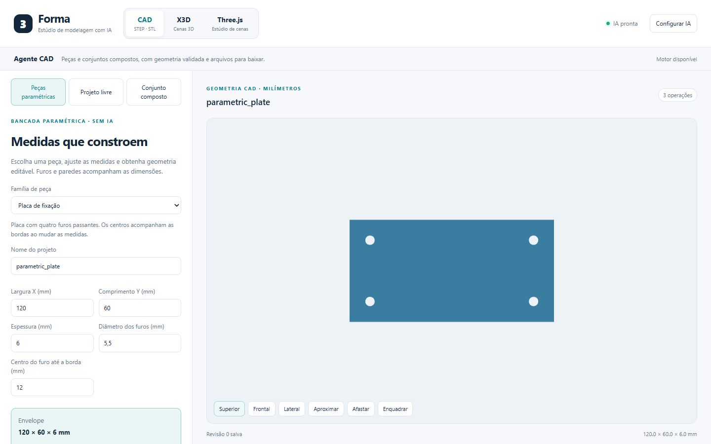
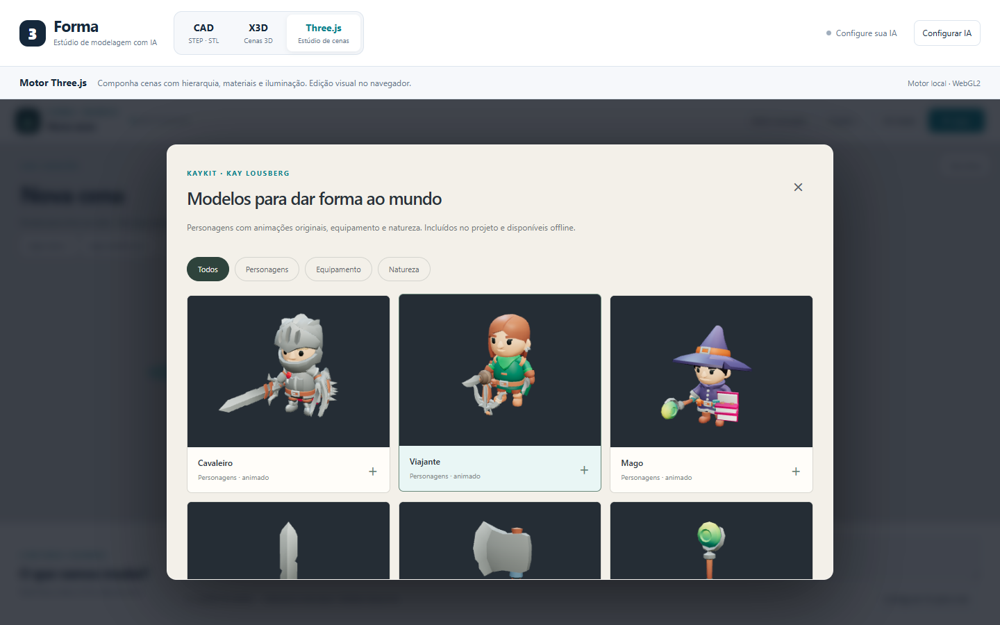
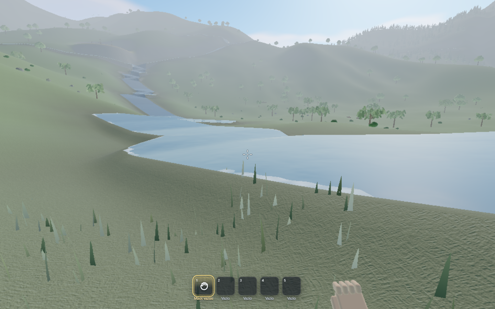

<div align="center">

# Forma · MCPx3d

**Crie peças CAD, cenas X3D e mundos interativos com IA e edição visual.**

[](https://github.com/arthursantos67/MCPx3d/actions/workflows/ci.yml)


[Começar](#começar) · [Como usar](#como-usar) · [Configurar IA](#configurar-ia) · [Documentação](docs/README.md) · [PRD](PRD.md)

</div>

O Forma reúne três espaços de criação. A IA propõe dados estruturados; os motores da aplicação constroem e verificam o resultado. Você também pode usar peças paramétricas, exemplos prontos e o editor Three.js sem configurar IA.

| Espaço | O que você faz | O que pode exportar |
|---|---|---|
| **CAD** | Peças por medidas ou conversa, conjuntos de 2–8 componentes, movimentos e vínculos mecânicos | STEP, STL e projeto JSON; ZIP de rascunho quando há geometria recuperável |
| **X3D** | Cenas por conversa, alterações incrementais e receitas reutilizáveis | X3D, HTML, ClassicVRML e manifesto JSON |
| **Three.js** | Cenas animadas, modelos, terrenos, mundos exploráveis e experiências jogáveis | Projeto JSON, GLB e captura PNG |

<details>
<summary><strong>Veja o estúdio</strong></summary>





</details>

## Começar

Instale **Git**, **Node.js 24**, **Python 3.12** e **uv**. O uv também pode ser instalado com `python -m pip install uv`; os scripts aceitam `python -m uv` quando o executável não está no PATH.

```bash
git clone --recurse-submodules https://github.com/arthursantos67/MCPx3d.git
cd MCPx3d
npm ci
npm run dev
```

Abra **[http://127.0.0.1:5173](http://127.0.0.1:5173)**. A API roda em **[http://127.0.0.1:8001](http://127.0.0.1:8001/api/health)**, com referência interativa em **[OpenAPI /docs](http://127.0.0.1:8001/docs)**. A primeira inicialização instala as dependências Python, incluindo CadQuery. `Ctrl+C` encerra os serviços.

Já clonou sem o submódulo? Execute `git submodule update --init --recursive` antes de iniciar. O backend X3D padrão usa a biblioteca local; o [servidor MCP é opcional](docs/x3d-mcp.md).

> No PowerShell com restrição de scripts, use `npm.cmd` e `npx.cmd` nos comandos que começam por `npm` e `npx`.

## Como usar

### CAD: da descrição ao arquivo

1. Abra **CAD → Projeto livre** e descreva a peça com medidas, unidades e recursos desejados. Use **Conjunto composto** para solicitar uma montagem diretamente.
2. Acompanhe a construção e inspecione a prévia. Conjuntos recebem verificações de interferência e, quando exigido, dos vínculos mecânicos.
3. Após aprovação e salvamento, baixe **STEP** ou **STL** do projeto ou de um componente.
4. Para mudar medidas ou movimentos manualmente, valide e salve uma nova revisão antes de baixar novamente.

**Experimente:** “Crie uma placa de 120 × 80 × 10 mm com quatro furos passantes de 6 mm, a 12 mm das bordas.”

**Sem IA:** em **Peças paramétricas**, escolha placa, cantoneira, flange, caixa aberta ou bucha, ajuste as medidas e valide/salve. O projeto JSON conserva os parâmetros para reabrir.

<details>
<summary>Se a geração CAD parar</summary>

Mantenha a aba aberta e retome o mesmo pedido para reutilizar componentes concluídos. **Baixar rascunho STEP/STL (ZIP)** recupera os sólidos disponíveis e inclui um relatório de omissões; esse arquivo não representa uma montagem aprovada. Exporte também o JSON antes de fechar a aba. Veja o [guia CAD](docs/cad.md#recuperação-e-rascunhos).

</details>

### X3D: descreva e refine uma cena

1. Abra **X3D**, configure a IA e descreva a cena, ou aplique uma receita da biblioteca.
2. Peça alterações na mesma conversa: posição, tamanho, material, inclusão ou remoção de objetos.
3. Inspecione a prévia e baixe o formato desejado. Exporte o **manifesto JSON** para importar a cena depois de reiniciar a API.

**Experimente:** “Crie uma sala com mesa central, quatro cadeiras e uma estante na parede do fundo.”

O HTML exportado carrega X3DOM pela internet. Sessões X3D são temporárias e expiram após uma hora de inatividade por padrão. [Guia X3D](docs/x3d.md).

### Three.js: monte, anime e explore

1. Abra **Three.js · Estúdio de cenas**. Escolha um exemplo em **Projeto**, descreva uma cena com IA ou ative **Editor avançado** para edição manual.
2. Use **Criar nova cena**, **Editar cena atual** ou **Corrigir cena** para controlar a ação da IA. **Projeto → Verificar cena** inspeciona localmente, sem IA.
3. Abra a **Biblioteca de modelos**, importe um GLB estático ou edite objetos, materiais, luzes e animações.
4. Clique **▶ Jogar** para explorar. Exporte **JSON** para continuar o trabalho, **GLB** para outras ferramentas ou **PNG** para uma imagem.

**Experimente:** “Crie uma ilha com farol, uma trilha até a praia e cristais coletáveis.”

| Durante o jogo | Controle padrão |
|---|---|
| Andar / olhar | WASD / mouse |
| Correr / pular | Shift / Espaço |
| Interagir / atacar | E / clique; botão direito para ataque pesado |
| Inventário / atalhos | B / 1–5 ou roda do mouse |
| Câmera / voo | V / F, quando permitido pela cena |
| Pausar / ajuda / silenciar | Esc / ? / M |

No editor, **W/E/R** selecionam mover, girar e escalar. O [guia Three.js](docs/threejs.md) explica mundos, persistência e limites. Edição, reprodução e jogo funcionam no navegador sem API; o viewport exige WebGL2.

## Configurar IA

Em **Configurar IA**, escolha o provedor, execute **Testar conexão** e depois **Salvar e aplicar**. O teste faz uma chamada pequena ao modelo e pode consumir uso da conta.

| Opção | Requisito | Onde roda |
|---|---|---|
| **WebLLM** | Navegador com WebGPU e recursos para carregar o modelo | No navegador |
| **Endpoint compatível com OpenAI** | URL, chave, modelo e CORS permitindo a origem do frontend | Pedido direto do navegador ao endpoint |
| **Codex / Claude Code** | Cliente oficial instalado e autenticado no computador da API | Ponte pela API local, restrita a loopback |

Para os clientes locais, faça login no terminal do servidor e reinicie a API após a instalação. Deixe **Modelo** vazio para usar o padrão do cliente. **Verificar instalação e login** confere disponibilidade; **Testar conexão** verifica uma resposta JSON. [Configuração e diagnóstico](docs/ai-providers.md).

## Desenvolvimento

```bash
npm run lint:web
npm run typecheck
npm test
npm run build
```

Para iniciar cada serviço separadamente: `npm run dev:api` e `npm run dev:web`. Configure variáveis em [apps/api/.env.example](apps/api/.env.example) e [apps/web/.env.example](apps/web/.env.example), copiando o arquivo necessário para `.env` na mesma pasta.

Testes Python, navegador, verificações de documentação e execução com poucos recursos estão em [docs/testing.md](docs/testing.md). Execute as etapas em sequência em máquinas com pouca RAM.

## Estrutura

```text
apps/web/           Interface React, workspaces e runtime Three.js
apps/api/           API FastAPI, motores CAD/X3D e persistência
packages/agent/     Provedores, geração e reparo de dados estruturados
packages/domain/    Schemas, tipos e validações TypeScript/Python
services/x3d-mcp/   Biblioteca upstream fixada e servidor opcional
examples/cad/      Projetos JSON e geradores de exemplos CAD
scripts/           Desenvolvimento, validação e ferramentas de manutenção
tests/             Integração de navegador, fixtures e corpus de avaliação
docs/              Guias de uso e referências técnicas
```

## Ajuda rápida

<details>
<summary>A API não inicia ou não encontra a biblioteca X3D</summary>

Confirme Python 3.12 e uv, execute `git submodule update --init --recursive` e depois `npm run dev:api`. Verifique o terminal e `http://127.0.0.1:8001/api/health/engines`.

</details>

<details>
<summary>A IA está pronta, mas o CAD recusou a proposta</summary>

Conexão com o provedor e validação geométrica são etapas separadas. Confira o diagnóstico da peça/montagem, preserve o JSON e ajuste o pedido. Roscas complexas podem consumir minutos. Uma proposta recusada conserva a última revisão válida.

</details>

<details>
<summary>Onde ficam os projetos?</summary>

CAD e receitas usam SQLite em `apps/api/data/`. Cenas X3D ficam na memória da API. Rascunhos Three.js e progresso de mundos usam o armazenamento do navegador. Exporte JSON para transportar projetos e faça backup dos bancos CAD antes de trocar de máquina. A API é destinada a uso privado e não possui contas por usuário.

</details>

<details>
<summary>O navegador avisa sobre WebGL2, WebGPU ou armazenamento</summary>

WebGL2 é necessário para Three.js; WebGPU é necessário apenas para WebLLM. Se o navegador não comportar o modelo local, escolha outro provedor. Projetos grandes podem exceder a quota de armazenamento: exporte JSON. Em máquinas com pouca RAM, evite carregar modelos WebLLM enquanto executa CAD ou testes de navegador.

</details>

**Referências:** [Documentação](docs/README.md) · [Requisitos do produto](PRD.md) · [Arquitetura](docs/architecture.md) · [Exemplos CAD](examples/cad/README.md).
