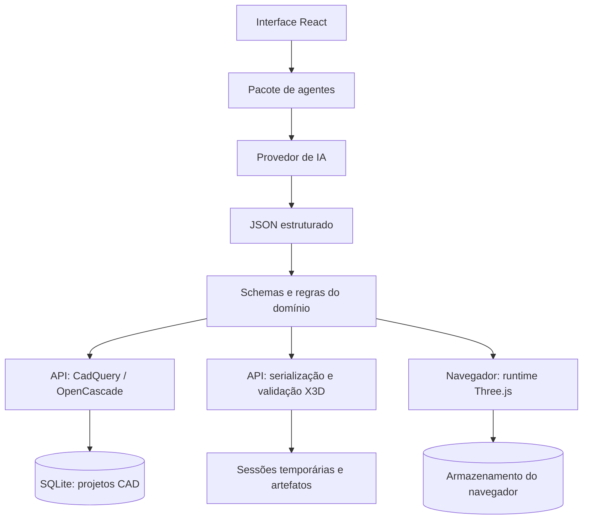

# Arquitetura

## Componentes

| Área | Responsabilidade |
|---|---|
| `apps/web/src/cad` | Coordenação CAD, edição, prévia e recuperação |
| `apps/web/src/x3d`, `chat` | Workspace X3D e conversa |
| `apps/web/src/three` | Documento, geração, editor, inspeção, jogo e exportação |
| `apps/web/src/three/world` | Terreno, workers, streaming, vegetação e persistência de mundos |
| `apps/web/src/ai`, `settings`, `workspace` | Provedores, configuração e navegação |
| `apps/api/src/api/routes` | Fronteira HTTP e coordenação dos serviços |
| `packages/agent` | Provedores, classificação, planejamento, geração e reparo |
| `packages/domain` | Schemas JSON e validações TS/Python |
| `services/x3d-mcp/vendor` | Dependência upstream fixada |

## CAD

Rotas recebem contratos e chamam os serviços de inspeção, construção, malha e persistência. `cad_service.py` centraliza validação/exportação; adaptadores constroem sólidos; `cad_mechanics.py` verifica vínculos; `cad_projects.py` guarda revisões.

Operações nativas usam workers descartáveis com limite de memória/prazo e fila serializada. Um lock de arquivo coordena processos que compartilham seu caminho. Desconexão sinaliza cancelamento. Inspeções de interferência usam caixas conservadoras para rejeitar pares separados e interseção real para confirmar conflitos em poses amostradas.

O agente mantém checkpoints por ação, reutiliza componentes e aceita reparos somente com progresso verificado. Schema, preservação de requisitos e inspeção nativa são fronteiras separadas. A prévia tessela sólidos com orçamento próprio; STEP/STL aprovados derivam da revisão persistida.

## X3D

`ModelPlan` é aplicado ao `ModelSpec` deterministicamente. O backend local serializa XML e chama validadores XSD/semânticos da biblioteca fixada. O backend MCP é selecionado por configuração. A validação precede a publicação da revisão em ambos.

Artefatos usam cache por projeto/revisão/formato, TTL e deduplicação de requisições. Tarefas finalizam e liberam entradas mesmo quando o cliente deixa de esperar. A prévia roda em iframe sandbox. A política espacial trabalha com caixas e não demonstra colisão exata.

## Three.js

Documento e regras são validados no navegador. Geração expande receitas estruturadas; edição aplica patches; inspeção usa amostragem espacial/temporal, inclusive workers. O renderer compartilha recursos, prepara shaders e libera geometrias/texturas ao trocar de cena.

O modo jogo deriva estado de runtime sem alterar o documento autoral. Mundos distribuem geração em workers e carregam terreno/vegetação/locais por distância e orçamento. Persistência de mundos usa IndexedDB; rascunhos de cena usam localStorage.

## Dados

| Informação | Local | Duração |
|---|---|---|
| Projetos/revisões CAD e STEP | SQLite `apps/api/data/cad.sqlite3` | Entre reinícios |
| Receitas X3D | SQLite `apps/api/data/recipes.sqlite3` | Entre reinícios |
| Sessões e artefatos X3D | Memória/cache da API | Até expiração, exclusão ou reinício |
| Configuração e rascunhos de cena | localStorage | Até remoção ou limite do navegador |
| Mundos e progresso | IndexedDB | Até remoção ou limite do navegador |
| Checkpoint completo da IA | Memória da aba | Até fechar/recarregar |

Atualizações de projetos usam revisão esperada para impedir sobrescrita concorrente. Uma falha de construção não publica uma revisão inválida.

## Fronteiras de execução

WebLLM e endpoints externos são acessados pelo navegador. Clientes locais usam uma ponte restrita a loopback; credenciais da assinatura permanecem no cliente oficial. Dados gerados não são executados como ferramentas, shell ou código. A API não possui contas nem isolamento por usuário e deve ser usada em contexto privado.

[Contratos](../packages/domain/README.md) · [Rotas](../apps/api/README.md) · [PRD](../PRD.md).
