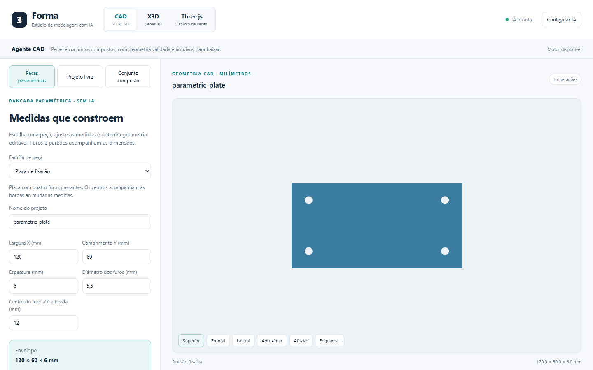

# CAD utilizável por medidas — 6 de novembro de 2026

## Escolha do motor e diagnóstico

Foi escolhido o CAD. CadQuery/OpenCascade já fornece sólidos B-rep, verificação topológica e STEP intercambiável. Isso permite comparar resultados com dimensões e volumes independentes. No Three.js, obter uma experiência convincente exigiria trabalhar simultaneamente em geração, jogabilidade, física e direção artística. A escolha desta revisão prioriza um fluxo com resultado útil e verificável.

O CAD existente oferece muitos recursos, mas a interação principal exige que a IA decomponha a peça, escreva um programa e acerte coordenadas absolutas, além das medidas solicitadas. Alterar a largura de uma base não cria uma relação paramétrica com a posição dos furos. Uma receita pode estar sintaticamente correta e ainda ter cortes fora do material, ressaltos separados ou alojamentos incompatíveis. Repetir pedidos de correção não substitui essas relações de projeto.

Também foi reproduzido um falso negativo no kernel: em um bloco de 1.000 × 1.000 × 1.000 mm, adicionar ou cortar metade de um cubo de 0,5 mm altera 0,0625 mm³. A implementação anterior comparava a diferença com `volume_total × 1e-9`, ou 1 mm³ nesse exemplo, e rejeitava ambas as operações como se nada tivessem feito. O acabamento de um pequeno ressalto sobre esse bloco tinha o mesmo problema.

## O que mudou

**CAD → Peças paramétricas** é uma bancada sem dependência de IA. Cinco famílias possuem relações explícitas entre medidas:



| Família | Relações e verificações |
|---|---|
| Placa de fixação | Quatro furos passantes; distância dos centros às bordas preservada ao mudar largura/comprimento; furos separados e parede externa contínua |
| Cantoneira em L | Altura total inclui a base; parede e base se sobrepõem; dois furos na base e dois na parede; altura/comprimento livres suficientes |
| Flange circular | Diâmetro externo, furo central, círculo de furação e quantidade relacionados; verificação radial e entre vizinhos |
| Caixa aberta | Fundo e quatro paredes uniformes; cavidade positiva e aberta em cima |
| Bucha espaçadora | Diâmetro externo, interno e altura; parede radial contínua |

O compilador fica no domínio TypeScript, em `packages/domain/ts/src/cad-parametric.ts`. Ele verifica o documento de origem, resolve todas as posições, calcula envelope e volume analíticos e emite um `CadProgramSpec` 3.0 comum. Prévia, inspeção, persistência e exportação recebem esse mesmo programa. Não há um segundo renderizador que apenas simula a peça.

As medidas aceitam números finitos dentro dos limites de cada campo; contagem de furos é inteira. Valores incompatíveis impedem aplicar/salvar e exibem a relação violada. A geometria anterior não é modificada ao digitar uma combinação inválida. Não há redução automática de diâmetros, retirada de furos ou mudança silenciosa das dimensões para obter aprovação.

**Aplicar medidas** constrói a prévia; **Validar e salvar** compara o resultado real da inspeção com envelope e volume esperados antes de persistir. A tolerância de comparação é o maior entre 0,001 na unidade correspondente e 1 ppm do valor esperado. A inspeção e o salvamento usam o cache existente para evitar reconstruir o mesmo STEP. Downloads ficam disponíveis para a geometria aplicada e salva. Uma edição cria uma nova revisão pelo controle de concorrência existente; a revisão anterior permanece no banco.

**Guardar e reabrir medidas** exporta/importa um documento `forma-parametric-1`. O JSON conserva os parâmetros e as relações; o STEP conserva a geometria resultante, e o STL sua aproximação triangular. A última origem aplicada também é guardada no navegador. Importações têm limite de 32 KB e rejeitam campos, famílias, formatos ou medidas desconhecidos, sem substituir a origem atual em caso de erro. Exemplo: [flange de 140 mm](../examples/cad/parametric-flange.json).

O programa resultante continua disponível em **Projeto livre → Editar construção**, inclusive para edição por IA. Alterações livres não são incorporadas automaticamente à família: reaplicar suas medidas recompila a peça definida pela origem paramétrica. Exporte o JSON paramétrico para conservar essa origem entre computadores.

O visualizador CAD também ganhou vistas **Superior**, **Frontal** e **Lateral**, além de giro livre, zoom e enquadramento.

## Correção do kernel

`cad_material_change.py` centraliza a detecção de alteração material para cortes, uniões e acabamentos. Operações com diferença de volume inequívoca conservam o caminho rápido. Quando a diferença escalar é pequena em relação ao bloco, o motor calcula o sólido de material adicionado/removido por diferença B-rep e verifica sua validade, volume finito e volume positivo acima de 1e-9 mm³. Assim, o tamanho total da base não apaga detalhes pequenos da decisão de validade.

A correção se aplica também aos programas livres e aos componentes dos conjuntos. Cortes que não atingem material, uniões inteiramente contidas, repetições sem efeito e operações que separam o sólido continuam sujeitos às verificações existentes. Não há união automática de peças que deveriam permanecer independentes.

## Verificação reproduzível

Os vetores compartilhados em `tests/fixtures/cad-parametric.json` contêm 15 casos: um padrão e duas variações de cada família, incluindo medidas próximas dos limites geométricos. Os testes TypeScript conferem que a origem compila exatamente para esses vetores; os testes Python executam o programa real, verificam volume/envelope e um único sólido válido, exportam e reimportam STEP e verificam a estrutura do STL. Os padrões de furos declaram término passante e passam pelas sondagens do motor na geometria final.

Regressões adicionais reproduzem os dois falsos negativos em stock grande, um acabamento pequeno e operações sem efeito que devem continuar falhando. O navegador testa as cinco famílias sem chamadas de IA, edição com nova revisão, downloads reais, recuperação após reload, importação/exportação paramétrica e preservação do estado após medidas/arquivo inválidos.

```powershell
npm.cmd test
npm.cmd run typecheck
npm.cmd run lint:web
npm.cmd run build
npm.cmd run test:cad:parametric
# Use o Chromium instalado pelo Playwright ou configure o Chrome local:
$env:PLAYWRIGHT_CHROMIUM_EXECUTABLE='C:\Program Files\Google\Chrome\Application\chrome.exe'
npx.cmd playwright test tests/browser/cad-parametric.spec.ts --project=cad-x3d
```

Para atualizar os vetores após mudar deliberadamente o compilador: `node scripts/generate-cad-parametric-fixtures.mjs`. Execute depois as duas suítes: regenerar o JSON sozinho não prova correção geométrica.

### Resultados locais

| Verificação | Resultado |
|---|---|
| `npm test`, todas as workspaces e golden tests | 970 aprovados: web 508, agente 363, domínio TS 87, golden 12 |
| Kernel/API, seleção de programas e acabamentos | 17 aprovados, 147 s |
| Kernel/API, paramétricos, detalhes pequenos, furos e rascunhos | 53 aprovados, 130 s |
| Navegador: bancada e regressão do projeto livre | 4 aprovados, 1,5 min |
| Typecheck TS, lint web, Ruff da API e mypy da API | Aprovados; mypy verificou 55 arquivos de origem |
| Build de produção e `git diff --check` | Aprovados |

Os 70 testes nativos são uma seleção direcionada, não a suíte completa da API. Uma primeira seleção maior foi interrompida pelo prazo de 300 s após 37 testes; seus resultados parciais não entram na contagem acima. Houve também uma espera de prévia excedida quando testes de navegador e da API competiram pelo mesmo lock do kernel; a rodada final do navegador foi executada separadamente e passou. Permanecem avisos de depreciação do TestClient nas dependências Python e de chunks grandes no build. Não foram utilizados modelos reais de IA para medir geração livre.

## Limites que permanecem

Esta é uma camada paramétrica para cinco famílias, não um solver geral de esboços ou mates. A folga geométrica mínima de 1 mm é uma escolha explícita dessas famílias, não uma prova de resistência ou especificação de fabricação. Caixa não inclui tampa; cantoneira não inclui dobra/raio industrial; flange não corresponde automaticamente a uma norma de tubulação. Não há análise de esforços ou compensação de impressão 3D.

O projeto livre conserva seu agente e suas limitações. Não foi medida uma nova taxa de sucesso de pedidos arbitrários com modelo real nesta revisão. Os testes sem IA demonstram a construção/exportação das famílias e os casos corrigidos do kernel; não demonstram que qualquer descrição livre será modelada corretamente. O Three.js foi preservado e não foi objeto desta intervenção.
