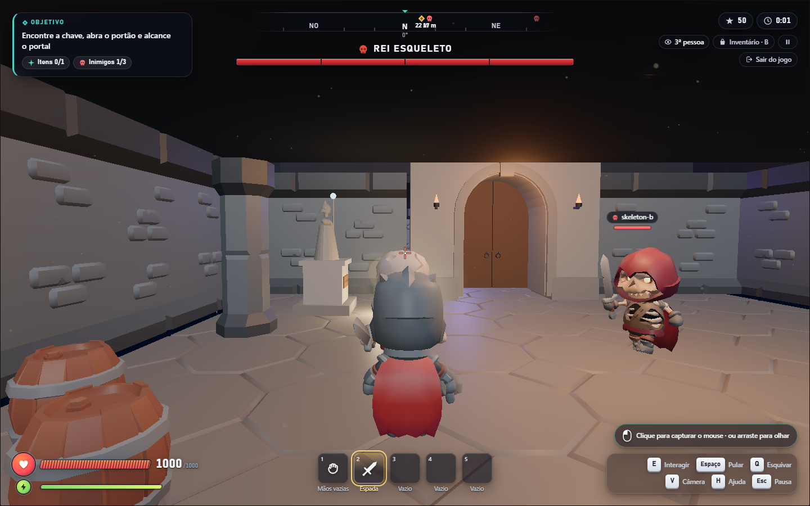
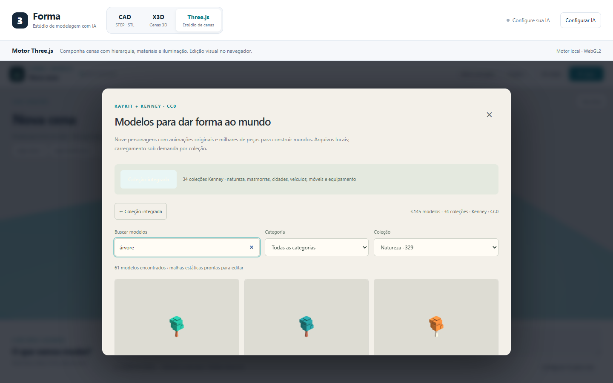
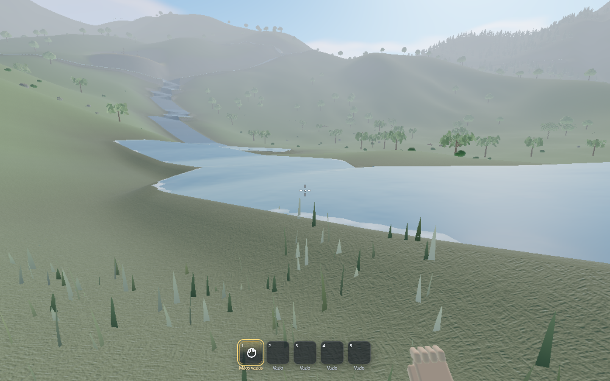
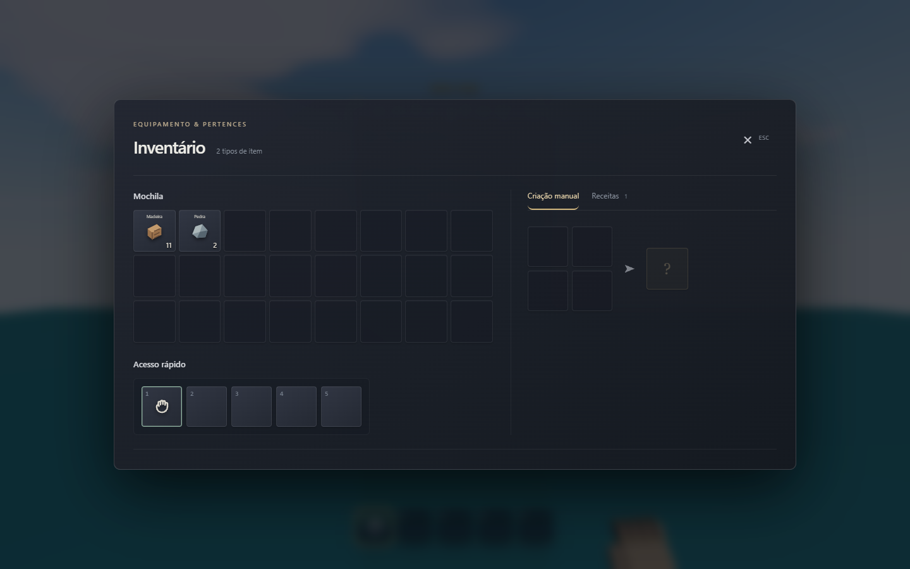

# Three.js: combate, catálogo e mundo aberto — 6/11/2026

Esta etapa continua a [revisão de movimento, inventário e geração](threejs-reliability-2026-11-06.md). Os números e limitações daquele relatório correspondem à primeira etapa; as alterações abaixo ampliam a biblioteca e corrigem problemas encontrados ao jogar.

## Combate e cripta

O deslocamento dos humanoides usa um volume corporal, sem incluir o comprimento das armas e dos braços. Os modelos nativos fornecem altura e caixas de dano a partir dos ossos. O ataque resolve alcance, arco e linha de visão no instante de impacto; a posição da mão no clipe não pode tornar um adversário ao alcance impossível de acertar. O contato visual continua limitado ao alcance da arma. Uma parede bloqueia o ataque mesmo a curta distância.

Os clipes nativos acompanham preparação, impacto e recuperação do ataque. O encaixe na mão compensa a conversão de unidades do rig, preservando o tamanho físico da espada. Os esqueletos também usam os modelos e equipamentos nativos.

A nova Cripta do Rei Esqueleto usa pisos, paredes, pilares e barris do KayKit Dungeon Remastered, teto e iluminação ajustada. O chefe é um esqueleto guerreiro ampliado. Portão, chave, baú e objetivo continuam funcionais. Reabra o exemplo pelo menu Projeto para criar essa versão; cenas salvas pelo usuário conservam suas edições.

O rascunho local compartilha geometrias **e materiais** idênticos: a cripta cabe no armazenamento do navegador, preservando texturas e malhas ao recarregar. A exportação JSON continua autocontida.

## Biblioteca ampliada

**Projeto → Biblioteca de modelos → Catálogo completo** oferece 3.145 modelos estáticos reais, de 34 coleções Kenney. Há pesquisa, sinônimos em português, filtros por coleção/categoria, páginas de 36 modelos, miniaturas originais, prévia 3D com órbita e controle de altura antes da inserção. O objeto importado entra na cena como malha editável e persiste no rascunho.

| Categoria | Modelos estáticos |
|---|---:|
| Natureza | 390 |
| Masmorras | 146 |
| Fantasia | 579 |
| Aventura | 219 |
| Interiores | 381 |
| Cidade | 540 |
| Veículos | 468 |
| Ficção científica | 288 |
| Equipamento | 37 |
| Decoração | 97 |

A seleção KayKit passou a **23 modelos**, incluindo **nove personagens com esqueleto e 18 clipes por personagem**. São cinco aventureiros e quatro esqueletos, além de equipamento, natureza e peças de masmorra. Os 3.145 modelos do catálogo ampliado são estáticos; não são milhares de personagens jogáveis ou novos comportamentos de jogo.

Os 34 bancos ZIP somam 51.936.472 bytes. O aplicativo busca apenas os bancos necessários para as miniaturas visíveis e a seleção, verifica SHA-256 e extrai somente a entrada solicitada. O cache de bancos comprimidos conserva até dois bancos/16 MiB, permitindo um único banco maior. A prévia tem um contexto WebGL próprio, renderiza sob demanda e libera os recursos ao fechar. A coleção KayKit ocupa 10.284.428 bytes em GLBs.

Todos os arquivos são servidos pelo aplicativo; a execução não depende dos sites dos autores. Fontes, hashes dos bancos e dos GLBs e licenças CC0 estão no [manifesto Kenney](../apps/web/public/models/catalog/manifest.json) e no [manifesto KayKit](../apps/web/public/models/kaykit/manifest.json). Cada ZIP preserva sua licença. Fontes primárias: [Kenney Assets](https://kenney.nl/assets), [KayKit Adventurers](https://github.com/KayKit-Game-Assets/KayKit-Character-Pack-Adventures-1.0), [KayKit Skeletons](https://github.com/KayKit-Game-Assets/KayKit-Character-Pack-Skeletons-1.0), [KayKit Dungeon Remastered](https://github.com/KayKit-Game-Assets/KayKit-Dungeon-Remastered-1.0).

Os scripts `scripts/vendor-model-catalog.py`, `scripts/vendor-game-assets.py`, `scripts/bake-library-thumbnails.mjs` e `scripts/bake-crypt-kit.mjs` reproduzem a incorporação e as prévias. O último produz malhas editáveis da cripta com uma textura de paleta compartilhada.

## Coleta sem recompilação dos materiais

Esconder um coletável também escondia sua luz pontual. Alterar a quantidade de luzes visíveis muda as constantes dos shaders do Three.js e pode recompilar os materiais da cena no quadro da coleta.

No viewport, as luzes ficam registradas separadamente da visibilidade dos objetos. A luz segue a transformação do objeto e passa a emitir cor preta quando a origem está escondida, mantendo a quantidade de luzes e os programas compilados. Reaparecer restaura sua cor. A seleção de sombras e o ciclo diário respeitam essa organização. A exportação conserva a hierarquia original.

O teste de navegador coleta um item com luz e verifica que o número de programas do renderer permanece igual. Isso elimina a recompilação causada pela mudança de quantidade de luzes; não prova a ausência de toda pausa possível em qualquer equipamento.

## Leitos, superfície e visibilidade da água

Os rios agora vêm de segmentos conectados à drenagem. Cada segmento define largura, profundidade, nível e transição para a margem. O mesmo perfil escava a seção do leito, forma a margem e gera a água; o nível não é mais obtido cobrindo o relevo com uma folha limitada pela altura local. O campo macro é reconciliado depois dessa construção, incluindo as áreas usadas por vegetação e grama. Lagos conservam seu datum de preenchimento. O gerador `synthetic-v8` invalida tiles antigos.

As margens são recortadas em resolução de um metro, compatível com o terreno mais detalhado. Interiores planos usam dois triângulos por célula macro. Natação e seleção de spawn consultam os mesmos triângulos desenhados. A água ocupa o espaço entre o leito e a superfície: atravessar a superfície não representa cair através de um piso sólido. Essa representação é estável para rios e lagos; não simula água sendo despejada ou terreno escavado dinamicamente.

A geração, as normais e a divisão da água em blocos de 64 metros acontecem no worker. Os blocos compartilham atributos e material, com descarte pelo frustum e pela distância.

O mar usa a biblioteca oficial [Three.js Water2](https://github.com/mrdoob/three.js/blob/dev/examples/jsm/objects/Water2.js), já incluída na dependência Three.js: fluxo de normais, reflexão e refração. As duas capturas têm 256 × 256 pixels, atualização limitada conforme a qualidade e ficam desativadas longe da costa. O descarte libera também os render targets. Rios não planos conservam o material de fluxo adequado à sua geometria; não recebem centenas de passes de reflexão independentes.

Foram avaliados também [Three Blocks Water](https://threejs-blocks.com/docs/blocks/water), que usa WebGPU e reconstrução volumétrica, e [threejs-water-sim](https://github.com/RasputinKaiser/threejs-water-sim), com SPH e integração própria de renderização/threads. Não foram incorporados como simulação global: isso exigiria validar compatibilidade, distribuição e custo no renderer e no hardware atuais. O Water2 é uma biblioteca de renderização; o confinamento e a locomoção usam os canais do motor.

No modo jogo, terreno e água compartilham um horizonte conforme a qualidade: 650 m na baixa, 1.000 m na média e 1.500 m na alta. A névoa encobre o limite e a seleção de tiles deixa de pedir detalhes além dele. O editor mantém a visão panorâmica. Objetos pequenos desaparecem depois da faixa de 180 m. Até 650 m, árvores, pinheiros e palmeiras usam silhuetas 3D com tronco e copa de até 240 triângulos por instância. Isso substitui os cartões que pareciam folhas flutuantes.

A [inspeção geométrica reproduzível](benchmarks/hydrology-2026-11-06.json) examina Aurora, seed 714023, 4.096 × 4.096 metros. São 707.246 triângulos de água, zero enterrados além de 3 cm, zero triângulos de rio acima de 2,53 m sobre o leito e erro de consulta inferior a 0,001 m. O resultado tem 874 blocos e 30.732.412 bytes em arrays de malha. Lagos profundos são contabilizados separadamente. Execute `node scripts/inspect-world-hydrology.mjs`. Isso verifica geometria, sem constituir uma medição de FPS.

## Extração, bancada e pilhas

Recursos têm `kind` (madeira, pedra, minério, planta, alimento ou personalizado) e `method` (golpear ou recolher). O machado concentra sua eficiência na madeira; a picareta, em pedra e minério. Espadas conservam seu papel de combate. `GameplayItem.harvest` e `GameplayItem.damage` são independentes: um item temático pode causar mais dano sem se tornar uma ferramenta universal. Dados antigos recebem uma interpretação compatível a partir dos itens naturais conhecidos.

O clique inicia o golpe e a resistência cai no evento de impacto, com alcance verificado novamente. E recolhe plantas e usa objetos; não golpeia árvores e pedras. A primeira pessoa tem mão, manga e gesto de alcance, e o equipamento fica mais afastado da câmera. A interação por clique também funciona quando o navegador recusa a captura do mouse.

Aurora oferece machado e picareta de pedra, receita manual da bancada e equipamento avançado condicionado a ela. A bancada é um objeto colocável no solo e recolhível; E abre sua fabricação. Arco, espada de cobre, baú e luz avançada exigem proximidade da bancada. O caldo exige fogueira. A grade manual tem quatro espaços; perto de estações há nove. O livro informa a estação e os ingredientes que faltam. O runtime revalida a estação antes de consumir materiais.

`recipe.station`, `item.station` e `gameplay.stations=[{id,nodeId}]` permitem adaptar bancada, forja e laboratório a outros temas e modelos. A auditoria rejeita estações inexistentes e progressões em que não é possível alcançar a estação necessária. A composição de locais em mundos preserva suas estações. A versão anterior do sandbox padrão de Aurora recebe as novas receitas sem substituir suas cenas editadas.

A pilha retirada aparece junto ao cursor e sai visualmente do espaço de origem. Clique direito retira metade de uma pilha; com uma porção selecionada, clique direito coloca uma unidade no destino e clique normal coloca a porção. Arrastar move pilhas, funde itens iguais ou troca pilhas inteiras. O layout conserva as quantidades autoritativas e acompanha consumo/coleta. Fechar a mochila preserva a disposição, e o progresso salvo inclui as pilhas separadas. Fechar ou recarregar devolve a pilha do cursor à mochila sem perder itens. A grade também admite retirar metade e colocar unidades com clique direito.

## Líquidos e geração

`node.liquid` declara água, lava ou ácido, viscosidade e dano. A consulta usa triângulos transformados e respeita a forma e a altura da superfície; uma caixa delimitadora não transforma toda a área de um rio curvo em água. A água conserva natação, mergulho e fôlego. A lava usa densidade maior, movimento mais lento, flutuação correspondente e dano por contato; o ácido tem parâmetros próprios. São superfícies com regras de locomoção e contato, sem simulação volumétrica de fluidos.

Os materiais de água têm metalicidade zero, reflexão e normais moderadas, fluxo e espuma de margem. O mar usa Water2; rios e lagos não planos recebem o material de fluxo do motor. A lava tem crosta escura e canais emissivos animados lentamente; não depende de pintar de vermelho a água. A viscosidade também reduz a velocidade das animações do líquido.

O construtor e o planejador recebem essas regras no contrato compartilhado, incluindo progressão, fontes iniciais e adaptação de dano ao tema. O schema de criação e edição preserva os novos campos. Rios locais gerados por `roads` com textura de água escavam áreas de leito e usam os triângulos do próprio terreno, com margens recortadas; a reconformação de estradas não enterra a água novamente. Um rio estreito demais para a resolução do terreno exige aumentar o leito ou usar o gerador de mundo. O teste geométrico cobre a superfície final após recompilar os caminhos.

## Tela limpa, apoio e geração com modelos reais

O padrão de jogo é `hud="minimal"`. Dicas permanentes, resistência de recursos, nomes e barras sobre objetos e mensagens a cada golpe saíram do jogo padrão. Os controles estão na ajuda H. A mochila conserva os atalhos e os indicadores necessários; fome, coleta e criação não são impostos a jogos que não usam esses sistemas. O HUD completo permanece disponível por solicitação explícita.

A grade manual tem slots de 64 px (48 px em telas pequenas), sem o encolhimento causado pelas frações de largura dentro do flex. Foram retirados os parágrafos de instrução repetidos. A bancada é a primeira receita de Aurora e seus quatro pés se ajustam individualmente à altura do chão, inclusive após recarregar. O tampo fica nivelado.

A resolução dos contatos caminháveis cancela a gravidade verticalmente, evitando criar velocidade lateral parada numa rampa. Há regressões de um minuto em inclinações de 8°, 15°, 25° e 45°, além de salto, parede, teto, escadas e subida/descida. O golpe do machado e da picareta atravessa lateralmente a visão com inclinação, mantendo a profundidade quase constante e o gume voltado para a cena.

O agente de criação e edição acessa o catálogo: recebe uma seleção limitada de IDs reais, usa `node.catalog={id,height}` e importa apenas os GLBs escolhidos. Os modelos passam pela validação de hashes e viram malhas editáveis. A expansão conserva hierarquia, transformações, repetições e apoio; há limite de 24 famílias por geração e até 96 referências no contexto. Personagens animados continuam nos prefabs nativos; o catálogo ampliado fornece objetos estáticos. Não se carregam milhares de malhas nem se coloca todo o manifesto no prompt.

## Verificação desta etapa

Validação: **508/508 testes automatizados**, build de produção, TypeScript e lint. As verificações de navegador são feitas em rodadas direcionadas: 32 cenários distintos cobrem HUD, criação, divisão e troca de pilhas, bancada, dano temático, lava, natação, catálogo, coleta com luz, cripta, exportação, mapa e montaria. A ajuda foi conferida em 1280 × 720 e 1920 × 1080; durante diálogos, a barra de equipamento cede espaço ao texto. As novas regressões geométricas também exercitam canais de três outras seeds de mundos de dois quilômetros.

As regressões incluem combate nas duas câmeras, remoção do colisor após a morte, coleta com luz sem criar programas, catálogo completo, prévia, inserção e persistência. Os testes de integridade abrem todos os bancos e verificam os 3.145 GLBs, imagens incorporadas, ausência de rigs anunciados como estáticos, hashes e licenças. Os cenários de mundo aberto incluem terreno de quatro quilômetros, recarga de Aurora preservando edição, diálogo, mapa e montaria.

Os testes de navegador usam WebGL por software e comprovam comportamento. A comparação da primeira etapa em GPU física continua inconclusiva em resolução cheia; esta etapa não sustenta uma promessa de FPS ou de eliminação de todos os travamentos nessa GPU. Colisão geral de corpos móveis, avaliação artística de gerações livres e o custo de skins procedurais personalizadas continuam limitações materiais.
