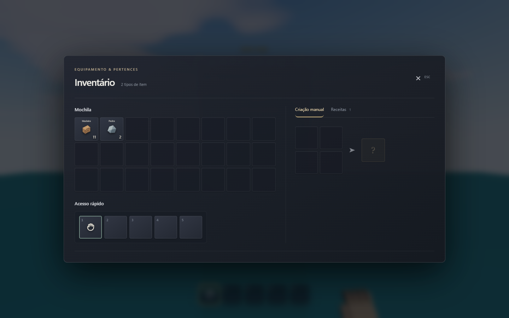
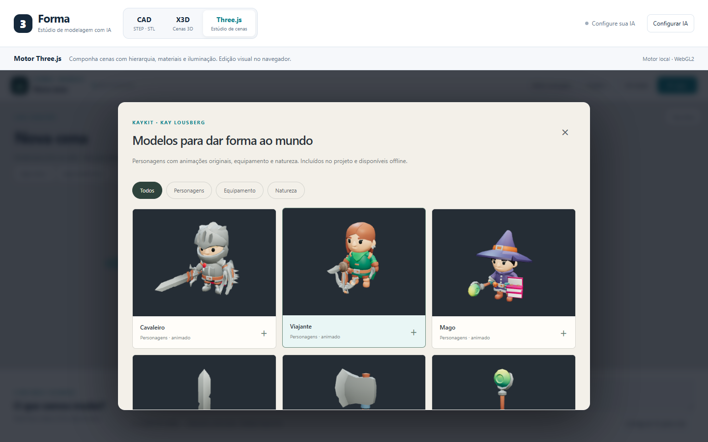

# Revisão Three.js — 6 de novembro de 2026

> Registro da primeira etapa. A [continuação sobre combate, catálogo, coleta e água](threejs-combat-catalog-water-2026-11-06.md) amplia os nove assets iniciais para 23 modelos KayKit e 3.145 modelos estáticos Kenney, além de corrigir o combate nativo e o mundo aberto. As medições abaixo continuam identificadas como resultados da primeira etapa.

## Escolha e diagnóstico

O Three.js oferece o caminho mais curto para melhorar uma experiência utilizável: edição, renderização e jogo funcionam localmente, e é possível reproduzir movimento, interação e inventário no navegador. O CAD também tem infraestrutura relevante, mas depende de acertar simultaneamente contratos de geração, operações OpenCascade, encaixes, movimento e exportação. Reduzir rejeições CAD sem comprovar esses requisitos poderia apenas esconder projetos incorretos.

O problema principal do Three.js não era a falta de mais tipos de objetos. A inspeção encontrou recursos em quantidade, mas contratos frágeis entre autoria, simulação e interface:

- A aceleração e a orientação do jogador eram integradas por quadro; dividir somente a colisão em subpassos não tornava o percurso independente do FPS.
- O chão era inferido pelo deslocamento resultante de todas as colisões, misturando parede, teto e apoio. Segurar Espaço provocava novos saltos após aterrissar.
- A geração preferia menos interseções, mesmo quando uma revisão eliminava personagens e interações. Problemas de alcance existentes na auditoria nem sempre provocavam refinamento.
- O inventário sempre mostrava uma lista de ações e uma bancada, inclusive sem receitas. Instruções sobre madeira, pedra e fibra apareciam em experiências que não ofereciam essas atividades.
- Corpos procedurais eram a única apresentação dos personagens. Gerar a pele, resolver poses de todos os atores e produzir caixas para partes anatômicas acrescentava custo à linha principal.
- O carregamento em blocos estava restrito a mundos grandes; cenas comuns ainda podiam ser construídas de uma vez. A função de skins retornava uma lista completa, impedindo uma pausa entre personagens.
- O menu de inventário pausava o tempo de jogo, mas continuava executando o percurso completo do quadro e renderizando o fundo.

Os testes anteriores demonstravam muitos recursos isolados. Eles não comprovavam qualidade artística, fluidez em qualquer GPU nem fidelidade de toda geração livre por IA. Esta revisão acrescenta regressões para falhas observáveis e uma integração real de modelos externos.

## Movimento e colisão

`scenePlayer.ts` agora integra direção, aceleração e gravidade a 120 Hz, com tempo residual próprio para cada jogador. Velocidades elevadas recebem subdivisões adicionais para limitar a distância percorrida entre consultas de colisão. A queda continua limitada a 30 m/s.

Os contatos conservam suas normais. Chão, teto e paredes são resolvidos individualmente; superfícies caminháveis usam um limite de 50°. Escadas verificam espaço para a cabeça, avanço e apoio na descida. A procura de apoio usa descida incremental para evitar que uma penetração profunda expulse a cápsula lateralmente. A mesma correção mantém contato em encostas descendentes.

O salto responde à transição da tecla. Uma entrada pode ser guardada por 120 ms antes de aterrissar; há 100 ms de tolerância ao sair de uma borda. Reaparecimento, viagem e alternância de voo descartam apoio e entradas antigas. O som de salto responde ao evento efetivamente consumido.

As regressões cobrem 30/60/120/144 Hz, tecla mantida, salto antes da aterrissagem, bordas, teto, parede, escadas com triângulos e caixas, escada real de uma casa, encostas de 35°/65°, queda longa, velocidade ampliada e teleporte.

## Inventário por manipulação direta



- Mochila em grade, com ícones, quantidade, seleção e descrição contextual.
- Arraste para reorganizar a mochila, vincular equipamento à barra, devolver um atalho à mochila e transferir itens entre mochila e baú. Selecionar item e destino oferece uma alternativa por clique/toque; as teclas 2–5 vinculam o item selecionado.
- A bancada 3×3 aparece somente quando existem receitas. Materiais são reservados visualmente, sem sair do inventário antes da fabricação. Retirar o resultado executa uma única transação de criação.
- O livro de receitas prepara os ingredientes na grade; ele não substitui a retirada do resultado por uma lista de grandes botões de fabricação.
- Shift+clique transfere a pilha; clique direito transfere uma unidade em baús. Fora deles, clique duplo/direito usa consumíveis. Transferências respeitam capacidade e conservam quantidades.
- Jogos sem itens, recursos, receitas ou recompensas não apresentam inventário. Coletáveis que apenas somam pontos não exigem uma mochila. Coleta sem fabricação não apresenta bancada nem instruções de sobrevivência.
- Abrir o menu congela o fundo 3D. Ações de item invalidam o quadro uma vez; fechar o menu retoma a simulação.

A fabricação é **sem posição obrigatória dos ingredientes**: corresponde às receitas declaradas pelo projeto. A revisão não transforma esse contrato em receitas posicionais de Minecraft, nem introduz durabilidade, peso, descarte no mundo ou divisão arbitrária de pilhas na mochila.

## Biblioteca real de modelos



Abra **Projeto → Biblioteca de modelos**. A coleção inicial contém nove modelos KayKit, de Kay Lousberg:

| Grupo | Modelos |
|---|---|
| Personagens | Cavaleiro, viajante e mago |
| Equipamento | Espada, machado e cajado |
| Natureza | Colina, rocha e árvore |

Os personagens preservam texturas, esqueleto e 18 clipes nativos por modelo. Cada ator tem seu esqueleto e mixer; geometrias, materiais e texturas são compartilhados. Caminhada, corrida, salto, combate, dano, morte e algumas atividades usam clipes originais. Escalada e natação usam retargeting das juntas do controlador porque esse pacote não oferece esses clipes. Os encaixes de equipamento pertencem às mãos do rig importado.

Humanoides padrão `villager`, `knight` e `wizard`, além dos avatares correspondentes, usam os modelos quando não existe anatomia/paleta personalizada. Personalizações explícitas e alterações manuais nas partes conservam o corpo procedural editável; os testes verificam esse comportamento também com a biblioteca carregada. Robôs, astronautas e criaturas conservam seus modelos anteriores. O prompt do construtor explica essa escolha. A biblioteca não comprova que todos os personagens antigos foram redesenhados.

Personagens exportam seus clipes nativos em GLB. Natureza e equipamento adicionados pela biblioteca são importados como malhas editáveis e ficam autocontidos no JSON da cena. A inserção procura superfície real e espaço livre, em vez de colocar o modelo fora do piso. Importar qualquer GLB animado do usuário continua sendo uma capacidade diferente da integração desses rigs conhecidos.

Os arquivos são servidos pelo próprio aplicativo. Não há CDN, conta externa ou download de terceiros durante o jogo. O script `scripts/vendor-game-assets.py` fixa commits dos repositórios originais, incorpora imagens e compacta os buffers após remover animações não utilizadas. Os três GLBs passaram de aproximadamente 10,9 MB para 3,3 MB; toda a coleção GLB fica abaixo de 3,6 MB. Miniaturas foram renderizadas dos próprios modelos.

Licenças e hashes: [manifesto](../apps/web/public/models/kaykit/manifest.json), [Adventurers](../apps/web/public/models/kaykit/LICENSE-adventurers.txt), [Medieval Hexagon](../apps/web/public/models/kaykit/LICENSE-medieval.txt). Fontes primárias: [KayKit Adventurers](https://github.com/KayKit-Game-Assets/KayKit-Character-Pack-Adventures-1.0), [KayKit Medieval Hexagon](https://github.com/KayKit-Game-Assets/KayKit-Medieval-Hexagon-Pack-1.0). As edições incorporadas declaram CC0; os commits exatos estão no manifesto.

## Desempenho e geração

A construção passa a usar pequenos blocos também nas cenas comuns, com uma pausa possível entre skins. Cancelar uma construção libera as skins já criadas; uma cena concluída mantém seus recursos até o descarte normal.

Atores distantes atualizam pose, IK e movimentos secundários a 30 Hz depois de 22 m e a 12 Hz depois de 60 m. O tempo acumulado acompanha a animação; movimento e combate continuam sob seus controles próprios. Para a colisão de deslocamento, um ator usa um volume corporal próximo ao jogador. Dedos, armas e acessórios permanecem disponíveis para verificações específicas de combate, sem gerar dezenas de obstáculos de movimento por personagem.

Sombras e antisserrilhamento passam a respeitar a qualidade: baixa usa mapa solar de 512 px, sombras locais de 256 px e nenhum MSAA; média usa 1024/512 px e MSAA 2×; alta conserva 2048/1024 px e MSAA 4×. Mudar a resolução de sombra preserva a quantidade de slots de luz, evitando recompilar os materiais durante o jogo.

Na qualidade **Automática**, janelas de dois segundos podem reduzir a resolução interna até 60% proporcionalmente ao custo observado. Isso evita uma longa sequência de realocações de alvos de renderização. O sistema recupera resolução mais devagar, após folga sustentada, e ignora pausas/suspensão de aba. Oclusão e bloom cedem orçamento nas escalas inferiores. Preferências manuais e a resolução fixa de um benchmark continuam fixas; o editor recupera a resolução ao sair do jogo.

A seleção da geração conserva conteúdo funcional e prioriza problemas de alcance, início e apoio, depois problemas de composição/colisão. Uma revisão que retira diálogos, personagens, chaves, recursos, prefabs ou o objetivo é rejeitada e explicada no relatório. Inspeção parcial não recebe a mesma classificação de uma inspeção concluída. Isso impede uma forma concreta de empobrecer a cena; não constitui uma avaliação artística geral.

## Medição na máquina disponível

[Dados da comparação](benchmarks/three-reliability-2026-11-06.json). Produção, Chrome 157, GeForce GT 710 de 2 GiB, i7-8700 e 15,9 GiB de RAM; uma passagem de dez segundos depois de três segundos de aquecimento, na Ilha do Farol. A câmera fica em `[0,3,12]`, com orientação fixa, porque a correção do controlador mudou o percurso do benchmark em movimento.

| Câmera fixa, renderização 480×270 | Antes | Depois |
|---|---:|---:|
| Intervalo mediano entre quadros | 13,4 ms | 13,4 ms |
| Percentil 95 do intervalo | 26,8 ms | 26,7 ms |
| CPU mediana por quadro | 3,8 ms | 4,3 ms |
| Entrada no modo jogo | 6144 ms | 2019 ms |

Esse teste curto **não demonstra ganho de FPS**. A entrada no jogo foi mais rápida nessa passagem, mas compilação e cache de shaders impedem atribuir toda a diferença às mudanças. O custo de CPU inclui os novos passos de física; reduzir a resolução não elimina o trabalho de GPU.

As duas versões deixaram de responder durante a passagem de câmera fixa em resolução cheia; o watchdog encerrou cada navegador após 73 segundos. A causa do bloqueio não foi isolada. Não há amostra completa dessa passagem nem base para prometer fluidez em 1080p nessa GPU. O benchmark agora também limita avaliações JavaScript que ficariam pendentes indefinidamente.

Uma comparação preliminar em movimento apresentou regressões no gate. Ela foi preservada nos dados, mas rejeitada como comparação de desempenho: as versões percorreram distâncias diferentes e renderizaram quantidades diferentes de geometria; além disso, a passagem atual antecede os ajustes finais de sombras e MSAA. Os testes funcionais não substituem essa investigação de travamentos na GPU física.

## Verificação e limites

Resultado funcional: **477/477 testes do frontend e 13/13 cenários de navegador passaram**, incluindo conservação de itens, estabilidade do controlador em diferentes frequências, cancelamento de construção e integridade dos GLBs locais. Lint, typecheck e build de produção passaram. A última rodada completa no navegador levou cinco minutos e incluiu os ajustes finais de sombras/MSAA. Resultados de desempenho são tratados separadamente.

Comandos da revisão:

```powershell
npm.cmd run test --workspace web
npm.cmd run typecheck --workspace web
npm.cmd run lint:web
npm.cmd run build
$env:PLAYWRIGHT_CHROMIUM_EXECUTABLE='C:\Program Files\Google\Chrome\Application\chrome.exe'
$env:RAYON_NUM_THREADS='1'
npx.cmd playwright test --config playwright.three.config.ts tests/browser/three-game.spec.ts tests/browser/three-motion.spec.ts tests/browser/three-library.spec.ts tests/browser/three-inventory.spec.ts tests/browser/three-sandbox.spec.ts tests/browser/three-adventure.spec.ts
```

Os testes de navegador usam WebGL por software para regressão funcional, incluindo consumo de ingredientes, criação, equipamento, baú, missões, água, importação, animação real do rig e exportação. Eles não medem desempenho de GPU física. O benchmark de FPS do repositório é separado e recusa renderizadores por software.

Ainda permanecem limitações materiais: colisão de objetos móveis aproximada, ausência de corpos rígidos gerais, catálogo visual inicial pequeno e custo elevado de algumas skins procedurais personalizadas. Não foi executada uma nova avaliação com provedor real de IA nesta revisão. A geração precisa de uma suíte reservada de pedidos e inspeção visual/jogável para sustentar afirmações mais amplas.
